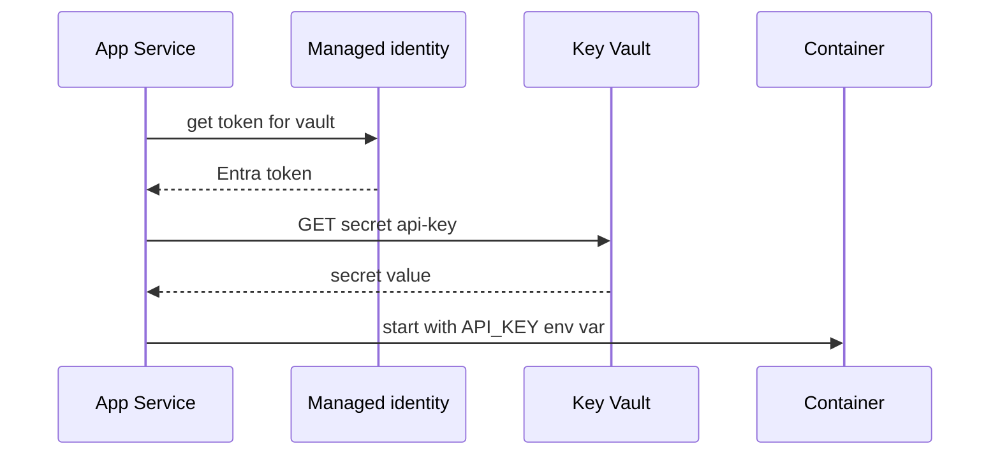

## What this covers

For secrets that need central management, audit trails or rotation, App Service can **reference Azure Key Vault** from an app setting or connection string. App Service resolves the reference with the app's managed identity and injects the secret value as an ordinary environment variable. The container code needs no changes and no Key Vault SDK, which makes this the standard way to give App Service containers secrets.

**Exam weight:** Develop containerized solutions on Azure (20–25%)

**Skills measured**

- "Deploy containers to Azure App Service, including configuring App Service to supply environment variables and secrets"

## Key concepts

### Syntax

| Form | Example |
|------|---------|
| `SecretUri` | `@Microsoft.KeyVault(SecretUri=https://myvault.vault.azure.net/secrets/api-key)` |
| `SecretUri` with version | `@Microsoft.KeyVault(SecretUri=https://myvault.vault.azure.net/secrets/api-key/<version>)` |
| Vault and name | `@Microsoft.KeyVault(VaultName=myvault;SecretName=api-key)` |

The app reads `API_KEY` as a normal env var after the reference is resolved. **No version in the URI means the latest version.**

### Requirements

1. A **managed identity** on the web app. The system-assigned identity is used by default. For a user-assigned identity, set `keyVaultReferenceIdentity` to its **resource ID**.
2. Permission for the identity to **read secrets**: the **Key Vault Secrets User** role (RBAC vault) or the **Get** secret permission (access-policy vault).
3. The Key Vault reference syntax in the app setting value.
4. Network access to the vault. For a firewalled vault, use VNet integration. Linux apps that reach a private endpoint need `vnetRouteAllEnabled=true`.

### Rotation behavior

- An unversioned secret URI always resolves to the latest version.
- App Service caches resolved values and refreshes them in the background **within 24 hours** after rotation.
- Any configuration change restarts the app, which forces an **immediate refetch**. You can also force a refresh with an authenticated POST to `.../config/configreferences/appsettings/refresh`.
- A **versioned** URI never rotates. You have to update the setting.

### Failure mode

If a reference can't be resolved, App Service passes the **literal string** `@Microsoft.KeyVault(...)` to the app. Your code then fails with something like an invalid-key error, not a Key Vault error.

## How it works



## Hands-on

### Azure portal

1. On the web app, open **Settings > Identity** and turn **System assigned** **On**.
2. In the key vault, go to **Access control (IAM)** and assign **Key Vault Secrets User** to the app's identity.
3. Back on the app, open **Settings > Environment variables > App settings** and add `API_KEY` with the value `@Microsoft.KeyVault(SecretUri=...)`.
4. After you save, the **Source** column shows **Key vault** with a green check. A red icon means resolution failed. Select it to see the error.

### Azure CLI

```bash
principal=$(az webapp identity assign -g myResourceGroup -n myDocumentProcessor --query principalId -o tsv)
az role assignment create --assignee "$principal" --role "Key Vault Secrets User" \
  --scope $(az keyvault show -n myvault --query id -o tsv)

az webapp config appsettings set \
  --resource-group myResourceGroup \
  --name myDocumentProcessor \
  --settings \
    API_KEY="@Microsoft.KeyVault(SecretUri=https://myvault.vault.azure.net/secrets/api-key)"
```

Use a user-assigned identity for all references:

```bash
az webapp update -g myResourceGroup -n myDocumentProcessor \
  --set keyVaultReferenceIdentity=<user-assigned-identity-resource-id>
```

Rotate, then pick up the new value straight away:

```bash
az keyvault secret set --vault-name myvault --name api-key --value "<new-value>"
az webapp restart -g myResourceGroup -n myDocumentProcessor
```

### Python

The container just reads the env var. No Key Vault SDK is needed:

```python
import os

api_key = os.environ["API_KEY"]
if api_key.startswith("@Microsoft.KeyVault"):
    raise RuntimeError("Key Vault reference not resolved: check identity and RBAC")
```

## Exam traps

| Need | Choose |
|------|--------|
| Secret in env var, no code change, central rotation | Key Vault reference |
| Non-secret config | Plain app setting |
| Feature flags or shared config across apps | Azure App Configuration |
| Different vault per slot | Key Vault reference marked as a **slot setting** |

> [!WARNING]
> **Exam trap:** Without a managed identity **and** read permission on secrets, the reference won't resolve, and the app receives the raw `@Microsoft.KeyVault(...)` text.

> [!WARNING]
> **Exam trap:** Rotation is picked up **within 24 hours**. If the answer needs the change "immediately", look for a restart or configuration change.

> [!TIP]
> Memorize `@Microsoft.KeyVault(SecretUri=...)`. The `VaultName=...;SecretName=...` form is the alternative.

> [!NOTE]
> Use the **Key Vault Application Settings Diagnostics** detector under **Diagnose and solve problems** to see why a reference failed.

## Quick review

- Syntax: `@Microsoft.KeyVault(SecretUri=https://.../secrets/name)`.
- The app reads `API_KEY` as a normal env var after resolution.
- Requires a managed identity plus Key Vault Secrets User (or a Get access policy).
- No version in the URI means the latest version.
- Refresh happens within 24 hours. A restart forces an immediate refetch.
- An unresolved reference passes the literal string to the app.
- Use cases: third-party API keys, rotating storage keys without redeploying, centralized audit.

## Practice

- [Practice: App Service container questions](/practice/app-service-containers)

## Official references

- [Use Key Vault references in App Service](https://learn.microsoft.com/azure/app-service/app-service-key-vault-references)
- [Azure Key Vault overview](https://learn.microsoft.com/azure/key-vault/general/overview)
- [AI-200 study guide](https://learn.microsoft.com/credentials/certifications/resources/study-guides/ai-200)
