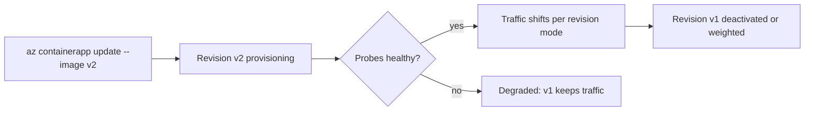

## What this covers

Each change to a container app's **template** (image, env vars, CPU and memory, scale rules, probes) creates a new immutable **revision**. Managing the lifecycle means choosing a revision mode, moving traffic between revisions, restarting or deactivating bad ones, and stopping the whole app when you need to. Most "it worked yesterday" problems are revision problems, so this is also the first thing to check when troubleshooting.

**Exam weight:** Develop containerized solutions on Azure (20–25%)

**Skills measured**

- "Deploy applications to Azure Container Apps, including environment configuration and revision management"
- "Monitor and troubleshoot solutions on AKS and Container Apps by inspecting logs, events, and end-to-end connectivity"

## Key concepts

### Revision-scope vs application-scope changes

| Change | Creates a new revision? |
|--------|------------------------|
| Image, env vars, CPU/memory, probes, scale rules (`properties.template`) | **Yes** |
| Ingress, secrets, registries, Dapr, revision mode (`properties.configuration`) | **No**. Applies to all revisions |

A new revision gets a name suffix: auto-generated, or set with `--revision-suffix v2`.

### Revision modes

- **Single** (default): the newest healthy revision gets 100% of traffic, and the old one is deactivated once the new one is ready. That gives zero-downtime replacement.
- **Multiple**: several revisions stay active. You split traffic by weight (for example 80/20) and can use **labels** for stable test URLs (`<app>---<label>.<env-domain>`).

### Lifecycle states and operations

| Operation | Effect |
|-----------|--------|
| `revision activate` / `deactivate` | Starts or stops replicas of one revision (Multiple mode). A deactivated revision is kept but runs nothing |
| `revision restart` | Restarts the replicas of a revision, for example to pick up a changed secret |
| `containerapp stop` / `start` | Stops or starts the whole app. A stopped app isn't billed for compute |
| Scale to zero | `--min-replicas 0` means no replicas while idle. The log stream then says the revision is scaled to zero |

Revision status combines **Provisioning status** (Provisioning, Provisioned, Failed) with **Running status** (Running, Processing, Degraded, Activating). Up to 100 inactive revisions are kept for rollback.

## How it works



In Single mode a failed revision never takes traffic, so the previous one keeps serving. In Multiple mode **you** decide when traffic moves.

## Hands-on

### Azure portal

1. Open the container app and select **Application > Revisions and replicas**.
2. Select **Choose revision mode** and switch to **Multiple** to keep revisions side by side.
3. Enter traffic percentages per active revision and select **Save**.
4. Select a revision, then **Restart** or **Deactivate**. On **Overview**, use **Stop** or **Start** for the whole app.

### Azure CLI

```bash
az containerapp update -n quote-api -g quote-api-rg \
  --image quoteapiacr.azurecr.io/quote-api:v2 --revision-suffix v2

az containerapp revision set-mode -n quote-api -g quote-api-rg --mode multiple
az containerapp ingress traffic set -n quote-api -g quote-api-rg \
  --revision-weight quote-api--v1=80 quote-api--v2=20

az containerapp revision list -n quote-api -g quote-api-rg -o table
az containerapp revision restart -n quote-api -g quote-api-rg --revision quote-api--v2
az containerapp revision deactivate -n quote-api -g quote-api-rg --revision quote-api--v1
az containerapp revision label add -n quote-api -g quote-api-rg --label blue --revision quote-api--v2

az containerapp stop -n quote-api -g quote-api-rg
az containerapp start -n quote-api -g quote-api-rg
```

### Python

```python
from azure.identity import DefaultAzureCredential
from azure.mgmt.appcontainers import ContainerAppsAPIClient

client = ContainerAppsAPIClient(DefaultAzureCredential(), "<subscription-id>")
rg, app = "<resource-group>", "quote-api"

for rev in client.container_apps_revisions.list_revisions(rg, app):
    print(rev.name, rev.active, rev.traffic_weight, rev.running_state, rev.provisioning_state)

client.container_apps_revisions.restart_revision(rg, app, "quote-api--v2")
```

## Exam traps

| Goal | Use |
|------|-----|
| Replace the app with zero downtime, no canary | Single revision mode |
| Canary or A/B test at 10% | Multiple mode plus `ingress traffic set` |
| Stable URL to test a revision before it gets traffic | Revision **label** |
| Pick up a rotated secret | `revision restart` (secrets don't create revisions) |
| Roll back | Reactivate the old revision and move its weight to 100 |

> [!WARNING]
> **Exam trap:** Changing a secret or ingress setting doesn't create a revision. Changing the image or an env var does.

> [!WARNING]
> **Exam trap:** In Single mode you can't split traffic. Switch to Multiple first.

> [!TIP]
> Template = revision. Configuration = app-wide.

## Quick review

- Revisions are immutable snapshots of the template.
- Single mode is the default: the newest healthy revision gets 100%.
- Multiple mode gives weighted traffic splitting and labels.
- Deactivate stops replicas but keeps the revision for rollback.
- `revision restart` refreshes secrets on running replicas.
- `containerapp stop` stops the whole app and its compute billing.
- A degraded new revision never takes traffic in Single mode.

## Practice

- [Practice: Container Apps deployment questions](/practice/aca-deploy)
- [Practice: Container troubleshooting questions](/practice/containers-troubleshoot)

## Official references

- [Revisions in Azure Container Apps](https://learn.microsoft.com/azure/container-apps/revisions)
- [Manage revisions](https://learn.microsoft.com/azure/container-apps/revisions-manage)
- [Traffic splitting](https://learn.microsoft.com/azure/container-apps/traffic-splitting)
- [AI-200 study guide](https://learn.microsoft.com/credentials/certifications/resources/study-guides/ai-200)
