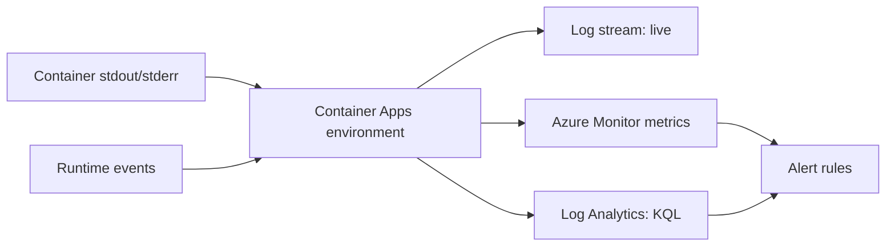

## What this covers

When a container app misbehaves, the answer is usually in one of two log streams. **Console logs** are your app's stdout and stderr. **System logs** come from the platform: image pulls, probe failures, scaling events and container exits. This page covers where those logs go, how to query them with KQL in Log Analytics, and which metrics and alerts catch problems before users do.

**Exam weight:** Develop containerized solutions on Azure (20–25%)

**Skills measured**

- "Monitor and troubleshoot solutions on AKS and Container Apps by inspecting logs, events, and end-to-end connectivity"

## Key concepts

### Log types

| Log | Source | Log Analytics table |
|-----|--------|---------------------|
| Console | Container stdout/stderr | `ContainerAppConsoleLogs_CL` (or `ContainerAppConsoleLogs` with diagnostic settings) |
| System | Container Apps runtime: pulls, probes, scaling, crashes | `ContainerAppSystemLogs_CL` (or `ContainerAppSystemLogs`) |

The `_CL` tables come from the environment's **Log Analytics** destination, which uses columns such as `Log_s`, `RevisionName_s`, `ContainerAppName_s` and `Reason_s`. If you use the **Azure Monitor** destination with diagnostic settings, you get the resource-specific tables with typed columns instead.

### Live vs historical

- **Log stream** (portal or `az containerapp logs show --follow`) is real time and great while reproducing a problem, but it doesn't keep history.
- **Log Analytics** keeps logs, typically with a delay of a few minutes, and lets you join and aggregate across apps.

### Metrics

Container Apps emits metrics such as **Requests** (split by status code), **Replica Count**, **Replica Restart Count**, **CPU Usage** and **Memory Working Set Bytes**. A rising restart count usually means crash loops or failing liveness probes. A steady 5xx rate points to the app or a downstream dependency.

### Diagnose and solve problems

This portal blade runs built-in detectors (container create failures, revision health, ingress, networking) and is the fastest first check.

## How it works



## Hands-on

### Azure portal

1. Open the container app and select **Monitoring > Log stream**. Switch between **Console** and **System**.
2. Select **Monitoring > Logs** and run a KQL query against the workspace.
3. Select **Monitoring > Metrics**, choose **Replica Restart Count**, and split by revision.
4. Select **Monitoring > Alerts > Create alert rule**, for example "Requests where status code 5xx > 10 in 5 minutes".
5. Open **Diagnose and solve problems** for the automated detectors.

### Azure CLI

```bash
az containerapp logs show -n quote-api -g quote-api-rg --type system --tail 50
az containerapp logs show -n quote-api -g quote-api-rg --type console --follow

az monitor log-analytics query -w <workspace-customer-id> --analytics-query \
  "ContainerAppSystemLogs_CL | where ContainerAppName_s == 'quote-api' | top 20 by TimeGenerated"
```

Find crash loops and probe failures:

```kql
ContainerAppSystemLogs_CL
| where ContainerAppName_s == "quote-api"
| where Log_s has_any ("probe", "BackOff", "pull", "terminated", "exit code")
| project TimeGenerated, RevisionName_s, Reason_s, Log_s
| order by TimeGenerated desc
```

Count application errors per revision:

```kql
ContainerAppConsoleLogs_CL
| where ContainerAppName_s == "quote-api" and Log_s has "ERROR"
| summarize errors = count() by RevisionName_s, bin(TimeGenerated, 5m)
```

### Python

```python
from datetime import timedelta
from azure.identity import DefaultAzureCredential
from azure.monitor.query import LogsQueryClient

client = LogsQueryClient(DefaultAzureCredential())
query = """
ContainerAppSystemLogs_CL
| where ContainerAppName_s == 'quote-api'
| project TimeGenerated, Reason_s, Log_s
| take 20
"""
result = client.query_workspace("<workspace-id>", query, timespan=timedelta(hours=1))
for row in result.tables[0].rows:
    print(row)
```

## Exam traps

| Symptom | Look at |
|---------|---------|
| Revision stuck in Provisioning or Degraded | System logs (probe failures, pull errors) |
| App throws exceptions | Console logs |
| Replicas restart repeatedly | Replica Restart Count metric plus system logs |
| Intermittent 5xx | Requests metric by status code, console logs |
| Nothing in log stream | Revision scaled to zero: set min replicas to 1 |

> [!WARNING]
> **Exam trap:** Image pull and probe failures appear in **system** logs, not console logs. The app never started, so it wrote nothing.

> [!WARNING]
> **Exam trap:** In the portal, **Log stream** is live. **Logs** is the Log Analytics query editor. Know which one a question means.

> [!TIP]
> Console = what your code printed. System = what the platform did to your container.

## Quick review

- Console logs come from stdout/stderr. System logs come from runtime events.
- Tables: `ContainerAppConsoleLogs_CL` and `ContainerAppSystemLogs_CL`.
- Log stream is live. Log Analytics is historical and queryable with KQL.
- Replica Restart Count is the metric for crash loops.
- Diagnose and solve problems runs built-in detectors.
- Scaled-to-zero revisions show no live logs.

## Practice

- [Practice: Container troubleshooting questions](/practice/containers-troubleshoot)

## Official references

- [Logging in Azure Container Apps](https://learn.microsoft.com/azure/container-apps/logging)
- [Monitor logs with Log Analytics](https://learn.microsoft.com/azure/container-apps/log-monitoring)
- [Metrics in Azure Container Apps](https://learn.microsoft.com/azure/container-apps/metrics)
- [Troubleshooting in Azure Container Apps](https://learn.microsoft.com/azure/container-apps/troubleshooting)
- [AI-200 study guide](https://learn.microsoft.com/credentials/certifications/resources/study-guides/ai-200)
