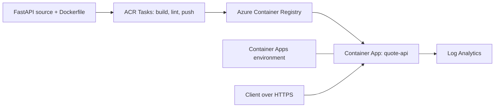

## What this covers

**Quote API** is a FastAPI REST sample built to practise **Azure Container Registry (ACR) Tasks**, **Docker** and **Azure Container Apps**. You take a simple quotes API, package it as a container, build and push it with ACR (including multi-step ACR Tasks), then run it on Container Apps with HTTPS, scaling and environment configuration. This page explains what the project is, why it maps to the exam, and how the pieces fit together.

**Exam weight:** Develop containerized solutions on Azure (20–25%)

**Skills measured**

- "Build, store, version, and manage container images by using Azure Container Registry"
- "Build and run images by using Azure Container Registry Tasks"
- "Deploy applications to Azure Container Apps, including environment configuration and revision management"

## Key concepts

### Why it matters for AI-200

The project lets you practise these exam skills:

- Storing images in ACR
- Building with ACR Tasks / `az acr build`
- Deploying containers to Azure Container Apps
- Wiring up registry auth, target ports, env vars and replicas

The API is a stand-in for any back-end AI service, such as an inference or retrieval API. The hosting steps are the same whatever the container does.

### API endpoints (quick view)

| Method | Endpoint | Description |
|--------|----------|-------------|
| GET | `/` | Welcome message |
| GET | `/quotes` | List all quotes |
| GET | `/quotes/random` | Random quote |
| POST | `/quotes` | Create quote |
| DELETE | `/quotes/{id}` | Delete quote |
| GET | `/health` | Health check |
| GET | `/docs` | Swagger UI |

`/health` is the endpoint to use for Container Apps health probes and for post-deploy smoke tests.

### Repository

Full source, deploy scripts and the CI workflow: **[github.com/Suralmk/azure-contianers](https://github.com/Suralmk/azure-contianers)**. Local path on the author's machine: `acr-tasks/quote-api/`.

## How it works

High-level flow:

1. The code is built into a Docker image.
2. The image is stored in **Azure Container Registry**.
3. **Azure Container Apps** pulls the image and runs the API.
4. **ACR Tasks** can automate build, lint and push (`acr-task.yaml`).



## Hands-on

### Azure portal

1. After running the deploy script, open the resource group `quote-api-rg`.
2. Open the registry, then **Repositories > quote-api** to see the pushed tags.
3. Open the container app `quote-api`, copy the **Application Url** from **Overview**, and add `/docs`.
4. Check **Revisions and replicas** to confirm one active, running revision.

### Azure CLI

```bash
git clone https://github.com/Suralmk/azure-contianers.git
cd azure-contianers/quote-api
./deploy.sh

az acr repository show-tags -n quoteapiacr --repository quote-api -o table
fqdn=$(az containerapp show -n quote-api -g quote-api-rg \
  --query properties.configuration.ingress.fqdn -o tsv)
curl "https://$fqdn/health"
```

### Python

Smoke-test the deployed API:

```python
import requests

base = "https://<container-app-fqdn>"
assert requests.get(f"{base}/health", timeout=10).status_code == 200
print(requests.get(f"{base}/quotes/random", timeout=10).json())
```

## Exam traps

| Step in the project | Exam concept |
|---------------------|--------------|
| `az acr build` | ACR quick task (cloud build, no local Docker) |
| `acr-task.yaml` | Multi-step task (build, cmd, push) |
| `az containerapp create --target-port 8000` | Ingress target port must match the app |
| Registry credentials on the app | Admin user here. Prefer managed identity + AcrPull |

> [!WARNING]
> **Exam trap:** The project uses ACR admin credentials for simplicity. In exam scenarios that ask for "most secure" or "no stored secrets", the answer is a managed identity with **AcrPull**.

> [!TIP]
> Follow the topics in order: Architecture and folder structure, Setup and local run, Deploy script explained, Commands reference, Environment variables.

## Quick review

- Quote API is a FastAPI sample for ACR, ACR Tasks and Container Apps.
- Images are built in ACR with `az acr build` or the multi-step `acr-task.yaml`.
- Container Apps pulls from ACR and serves the API over HTTPS.
- `/health` serves probes and smoke tests. `/docs` is Swagger UI.
- The app listens on port 8000, so the target port is 8000.
- Source, scripts and CI live in the GitHub repo.

## Practice

- [Practice: Azure Container Registry questions](/practice/acr-images)
- [Practice: ACR Tasks questions](/practice/acr-tasks)
- [Practice: Container Apps deployment questions](/practice/aca-deploy)

## Official references

- [Repo: Suralmk/azure-contianers](https://github.com/Suralmk/azure-contianers)
- [Azure Container Apps overview](https://learn.microsoft.com/azure/container-apps/overview)
- [ACR Tasks overview](https://learn.microsoft.com/azure/container-registry/container-registry-tasks-overview)
- [AI-200 study guide](https://learn.microsoft.com/credentials/certifications/resources/study-guides/ai-200)
