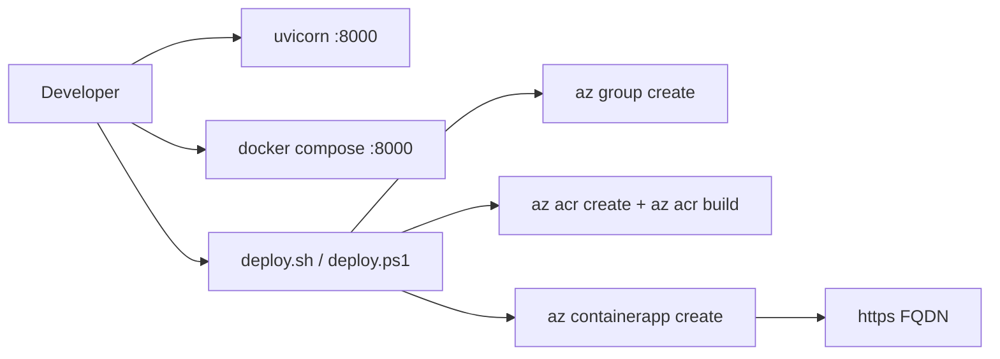

## What this covers

This page gets the Quote API running on your machine, first as plain Python and then as a container, and then deploys it to Azure with a single script. Running locally first separates "my code is broken" from "my Azure configuration is broken". If the container works locally on port 8000 but fails in Azure, the problem is ports, registry auth or environment configuration, not the app.

**Exam weight:** Develop containerized solutions on Azure (20–25%)

**Skills measured**

- "Build and run images by using Azure Container Registry Tasks"
- "Build, store, version, and manage container images by using Azure Container Registry"
- "Deploy applications to Azure Container Apps, including environment configuration and revision management"

## Key concepts

### Prerequisites

- Python 3.12+
- [Azure CLI](https://learn.microsoft.com/cli/azure/install-azure-cli) with the `containerapp` extension
- Docker (optional, because ACR can build in the cloud)

### Three ways to run

| Mode | Command | Use it for |
|------|---------|-----------|
| Local Python | `uvicorn app.main:app --reload --port 8000` | Fast code iteration |
| Local container | `docker compose up --build` | Prove the image and port work |
| Azure | `deploy.sh` / `deploy.ps1` | Resource group, ACR, cloud build, Container Apps |

### Why Docker is optional

The deploy script uses `az acr build`, an **ACR quick task**. The CLI uploads the source folder and ACR builds the image on its own agents and pushes it. Your laptop never runs `docker build`, which suits locked-down or ARM machines.

### Naming rules

ACR names must be **globally unique**, 5–50 alphanumeric characters, with no hyphens. If `quoteapiacr` is taken, the script fails at `az acr create`. Override it with `ACR_NAME`.

## How it works



The script creates the resource group, the ACR, builds the image and deploys to Container Apps.

## Hands-on

### Azure portal

1. After the script finishes, open **Container Apps** and select `quote-api`.
2. Copy the **Application Url** and append `/docs` to open Swagger UI.
3. In the registry, open **Services > Tasks > Runs** to see the quick-task build that `az acr build` created.

### Azure CLI

Run locally with Python:

```bash
cd quote-api
python -m venv .venv
```

Activate on Windows:

```powershell
.venv\Scripts\Activate.ps1
```

Activate on Linux/macOS:

```bash
source .venv/bin/activate
```

```bash
pip install -r requirements.txt
uvicorn app.main:app --reload --port 8000
```

Open http://localhost:8000/docs.

Run with Docker:

```bash
cd quote-api
docker compose up --build
```

Deploy to Azure on Windows:

```powershell
cd quote-api
.\deploy.ps1
```

Deploy on Linux/macOS:

```bash
cd quote-api
chmod +x deploy.sh
./deploy.sh
```

Set a unique ACR name if needed:

```bash
ACR_NAME=myuniqueacr123 ./deploy.sh
```

Check that the name is free before deploying:

```bash
az acr check-name --name myuniqueacr123 --query nameAvailable
```

### Python

Local smoke test while uvicorn is running:

```python
import requests

r = requests.get("http://localhost:8000/health", timeout=5)
print(r.status_code, r.json())
```

## Exam traps

| Problem | Fix |
|---------|-----|
| No Docker on the build machine | `az acr build` (quick task) |
| `az acr create` says the name is taken | Pick a globally unique name (`az acr check-name`) |
| Works locally, unreachable in Azure | Bind `0.0.0.0` and match `--target-port 8000` |
| `az containerapp` missing parameters | `az extension add --name containerapp --upgrade` |

> [!WARNING]
> **Exam trap:** `--reload` is for development only. The container image should start uvicorn without it and bind `0.0.0.0`, not `localhost`.

> [!TIP]
> Local = `uvicorn` on **8000** or Docker Compose. Azure = a one-script deploy (`deploy.ps1` / `deploy.sh`).

## Quick review

- Prerequisites: Python 3.12+, Azure CLI, Docker optional.
- Local run: `uvicorn app.main:app --reload --port 8000`, then `/docs`.
- Container run: `docker compose up --build`.
- Azure deploy: `deploy.sh` or `deploy.ps1` creates the RG, ACR, image and container app.
- ACR names must be globally unique. Override with `ACR_NAME`.
- `az acr build` makes a local Docker install unnecessary.

## Practice

- [Practice: ACR Tasks questions](/practice/acr-tasks)
- [Practice: Azure Container Registry questions](/practice/acr-images)
- [Practice: Container Apps deployment questions](/practice/aca-deploy)

## Official references

- [Repository: Suralmk/azure-contianers](https://github.com/Suralmk/azure-contianers)
- [Quickstart: Build and run an image with ACR Tasks](https://learn.microsoft.com/azure/container-registry/container-registry-quickstart-task-cli)
- [Deploy to Container Apps with az containerapp up](https://learn.microsoft.com/azure/container-apps/containerapp-up)
- [AI-200 study guide](https://learn.microsoft.com/credentials/certifications/resources/study-guides/ai-200)
