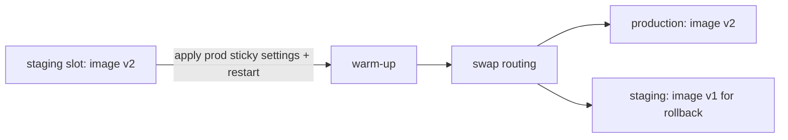

## What this covers

Deployment **slots** let you run different versions of an app side by side in the same App Service plan. Each slot has its own hostname and configuration but shares the plan's compute. A **swap** promotes staging to production with no downtime. Some settings must **stay with the slot** rather than move with the code during a swap, and you mark those as **slot settings** (also called sticky settings).

**Exam weight:** Develop containerized solutions on Azure (20–25%)

**Skills measured**

- "Deploy containers to Azure App Service, including configuring App Service to supply environment variables and secrets"

## Key concepts

### Slots

- Available on **Standard** (5 slots), **Premium** and **Isolated** tiers. Slots cost nothing extra.
- A new slot starts with no content. You can clone settings from another slot.
- For containers, the **image reference** is part of what swaps, so staging's image becomes production's image.

### Why sticky settings matter

| Category | Example |
|----------|---------|
| Environment identifiers | `ENVIRONMENT=production` must not swap to staging |
| Environment-specific endpoints | Different API or DB targets per slot |
| Feature flags | Turn on experimental features only in staging |
| Diagnostics | Verbose logging in staging only |
| Key Vault references | A separate vault per environment |

### What swaps and what stays

| Swaps (follows the content) | Stays with the slot |
|-----------------------------|---------------------|
| App settings and connection strings **not** marked sticky | Settings marked as **slot settings** |
| Framework/runtime, container image, WebSockets, handler mappings | Custom domains, nonpublic TLS certs, scale settings |
| Mounted storage (unless sticky) | Managed identities, VNet integration, IP restrictions, Always On, CORS, diagnostic log settings |

### Swap sequence

1. Production's sticky settings are applied to the staging instances, which **restart**.
2. Staging is warmed up (HTTP request to `/`, or `WEBSITE_SWAP_WARMUP_PING_PATH`).
3. Routing switches. Production never goes offline.
4. To roll back, swap again.

**Swap with preview** pauses after step 1 so you can test staging with production settings. **Auto swap** isn't supported for Linux apps or Web App for Containers.

## How it works



## Hands-on

### Azure portal

1. On the web app, open **Deployment > Deployment slots** and select **Add slot** (for example `staging`).
2. In the staging slot, open **Settings > Environment variables**, add `ENVIRONMENT=staging`, and select **Deployment slot setting**.
3. Back on **Deployment slots**, select **Swap**. Review the **Source slot changes** and **Target slot changes** tabs, then **Start swap**.

### Azure CLI

Mark settings as slot settings:

```bash
az webapp config appsettings set \
  --resource-group myResourceGroup \
  --name myDocumentProcessor \
  --slot staging \
  --slot-settings \
    ENVIRONMENT=staging \
    API_ENDPOINT=https://api-staging.example.com
```

List the sticky settings:

```bash
az webapp config appsettings list \
  --resource-group myResourceGroup \
  --name myDocumentProcessor \
  --query "[?slotSetting==\`true\`].name"
```

Create, deploy to and swap the slot (with preview):

```bash
az webapp deployment slot create -g myResourceGroup -n myDocumentProcessor --slot staging
az webapp config container set -g myResourceGroup -n myDocumentProcessor --slot staging \
  --container-image-name myregistry.azurecr.io/docprocessor:v2
az webapp deployment slot swap -g myResourceGroup -n myDocumentProcessor \
  --slot staging --target-slot production --action preview
az webapp deployment slot swap -g myResourceGroup -n myDocumentProcessor \
  --slot staging --target-slot production --action swap
```

### Python

```python
from azure.identity import DefaultAzureCredential
from azure.mgmt.web import WebSiteManagementClient

client = WebSiteManagementClient(DefaultAzureCredential(), "<subscription-id>")
names = client.web_apps.list_slot_configuration_names("<resource-group>", "myDocumentProcessor")
print("Sticky app settings:", names.app_setting_names)
```

## Exam traps

| Requirement | Answer |
|-------------|--------|
| Value must not move to production on swap | `--slot-settings` (sticky) |
| Value should travel with the new release | `--settings` (swappable) |
| Test staging with production config before switching | Swap with preview (`--action preview`) |
| Undo a bad release | Swap again |

> [!WARNING]
> **Exam trap:** `--slot-settings` vs `--settings` is the key CLI distinction. Only `--slot-settings` makes a value sticky.

> [!WARNING]
> **Exam trap:** Swapping staging into production **restarts the staging instances** with production's sticky settings before traffic moves. A setting that breaks startup aborts the swap.

> [!TIP]
> Sticky = stays with the slot. Non-sticky = travels with the code and image.

## Quick review

- Slot settings stay with the slot during a swap.
- CLI: `--slot staging --slot-settings KEY=value`.
- List sticky settings with `[?slotSetting==\`true\`].name`.
- Good sticky candidates: `ENVIRONMENT`, environment-specific URLs, feature flags, log verbosity, Key Vault references.
- Slots share plan resources but not sticky configuration.
- Use cases: a staging slot pointing at a test model endpoint, verbose `LOG_LEVEL` only in staging, blue/green promotion of an inference image.

## Practice

- [Practice: App Service container questions](/practice/app-service-containers)

## Official references

- [Set up staging environments (slots)](https://learn.microsoft.com/azure/app-service/deploy-staging-slots)
- [Which settings are swapped](https://learn.microsoft.com/azure/app-service/deploy-staging-slots#which-settings-are-swapped)
- [AI-200 study guide](https://learn.microsoft.com/credentials/certifications/resources/study-guides/ai-200)
