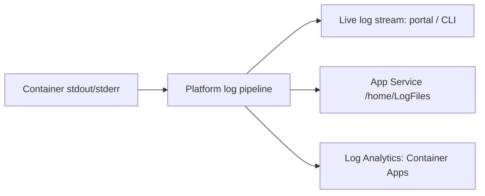

## What this covers

The **log stream** shows container output in real time. Use it to debug startup problems, watch live traffic and observe how the app behaves during testing. Streaming is for **live** visibility. If you also need **persisted** history, turn on container logging (filesystem or Log Analytics). This page covers streaming for both App Service and Azure Container Apps, because the commands and gotchas differ.

**Exam weight:** Develop containerized solutions on Azure (20–25%)

**Skills measured**

- "Monitor and troubleshoot solutions on AKS and Container Apps by inspecting logs, events, and end-to-end connectivity"
- "Deploy containers to Azure App Service, including configuring App Service to supply environment variables and secrets"

## Key concepts

### App Service log stream

- CLI command: `az webapp log tail`.
- Portal path: Web App, then **Monitoring > Log stream**.
- The browser and the terminal show the same real-time output.
- Press **Ctrl+C** to stop streaming in the CLI.
- Scaled-out apps: the stream shows output from **all instances**, and each line includes an **instance identifier**.
- For Linux containers, stdout/stderr only reach the stream after you turn on container logging: `az webapp log config --docker-container-logging filesystem`.

### Container Apps log stream

- CLI command: `az containerapp logs show --follow`. `--type console` (the default) shows your app's output. `--type system` shows platform events.
- `--tail` returns the last *n* lines (0–300, default 20).
- With several revisions, replicas or containers, narrow it with `--revision`, `--replica` and `--container`.
- `az containerapp env logs show --follow` streams environment-wide system logs.
- If a revision is **scaled to zero**, there's nothing to stream. Set min replicas to 1 while debugging.

### Best for

Startup failures, live debugging and short test sessions. Don't rely on it alone for long-term retention.

## How it works



The stream is a live tail of the same pipeline that writes persisted logs. When you disconnect, nothing is kept unless a persistent destination is configured.

## Hands-on

### Azure portal

1. Open the web app (or container app) in the Azure portal.
2. Under **Monitoring**, select **Log stream**.
3. Watch the same real-time container output in the browser viewer. In Container Apps, switch between **Console** and **System**, and pick a revision, replica and container.

### Azure CLI

App Service:

```bash
az webapp log config \
  --resource-group myResourceGroup \
  --name myDocumentProcessor \
  --docker-container-logging filesystem

az webapp log tail \
  --resource-group myResourceGroup \
  --name myDocumentProcessor
```

The log stream shows new entries as they appear. Stop it with `Ctrl+C`. If console lines don't show up straight away, wait about 30 seconds.

Container Apps:

```bash
az containerapp logs show -n quote-api -g quote-api-rg --type console --follow
az containerapp logs show -n quote-api -g quote-api-rg --type system --tail 50

az containerapp replica list -n quote-api -g quote-api-rg --revision <revision-name> \
  --query "[].{name:name, containers:properties.containers[].name}"
az containerapp logs show -n quote-api -g quote-api-rg \
  --revision <revision-name> --replica <replica-name> --container quote-api --follow
```

### Python

Write logs to stdout so the stream (and Log Analytics) can pick them up:

```python
import logging
import sys

logging.basicConfig(stream=sys.stdout, level=logging.INFO,
                    format="%(asctime)s %(levelname)s %(message)s")
logging.info("quote-api started")
```

## Exam traps

| Need | Tool |
|------|------|
| Watch App Service startup live | `az webapp log tail` / Log stream |
| Watch Container Apps output live | `az containerapp logs show --follow` |
| Platform events (pulls, probes) in ACA | `--type system` |
| Logs after the session ends | Filesystem logging (`/home/LogFiles`) or Log Analytics |
| Browse saved log files | Kudu (`https://<app>.scm.azurewebsites.net`) |

> [!WARNING]
> **Exam trap:** Log stream is **real time**, not a historical archive. Turn on persistent logging first if you need the logs after streaming ends.

> [!WARNING]
> **Exam trap:** In Container Apps the default `--type` is `console`. Image-pull and probe failures only show with `--type system`.

> [!TIP]
> Match **Log stream** with `az webapp log tail` for App Service, and with `az containerapp logs show --follow` for Container Apps.

## Quick review

- App Service: `az webapp log tail`. Portal: **Monitoring > Log stream**.
- Turn on `--docker-container-logging filesystem` so stdout reaches the stream.
- Scaled-out apps stream all instances, and each line carries an instance id.
- Container Apps: `az containerapp logs show --follow --type console|system`.
- `--tail` defaults to 20 lines, with a maximum of 300.
- Use cases: a container that won't start, validating a fix live, traffic spikes, port or bind mistakes.

## Practice

- [Practice: Container troubleshooting questions](/practice/containers-troubleshoot)
- [Practice: App Service container questions](/practice/app-service-containers)

## Official references

- [Stream logs in App Service](https://learn.microsoft.com/azure/app-service/troubleshoot-diagnostic-logs#stream-logs)
- [az webapp log](https://learn.microsoft.com/cli/azure/webapp/log)
- [View log streams in Azure Container Apps](https://learn.microsoft.com/azure/container-apps/log-streaming)
- Related topics: [Configure container logs](/study/implement-container-application-hosting-on-azure/configure-container-logs) and [Diagnostic console (Kudu)](/study/implement-container-application-hosting-on-azure/diagnostic-console-kudu)
- [AI-200 study guide](https://learn.microsoft.com/credentials/certifications/resources/study-guides/ai-200)
