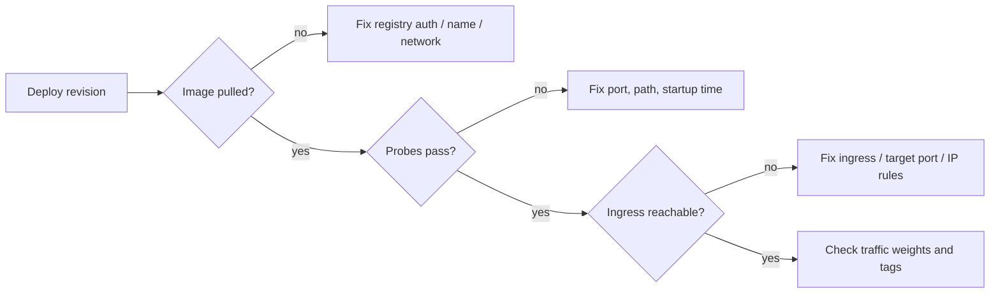

## What this covers

This is a symptom-to-fix guide for Azure Container Apps. Most failures fall into a few groups: the image can't be pulled, the revision never becomes healthy, ingress isn't routing to the right port, the network blocks the request, or traffic goes to an old revision. Know which signal (system logs, revision status, ingress settings) points to which group, and you can answer most troubleshooting questions on the exam.

**Exam weight:** Develop containerized solutions on Azure (20–25%)

**Skills measured**

- "Monitor and troubleshoot solutions on AKS and Container Apps by inspecting logs, events, and end-to-end connectivity"

## Key concepts

### Symptom map

| Symptom | Likely cause | Check |
|---------|--------------|-------|
| Error when deploying a new revision | Image can't be pulled (wrong name or tag, no AcrPull, firewall or DNS) | System logs, registry config |
| Revision stuck **Provisioning / Processing** | Health probes never pass | Probe port and path |
| **Degraded**: "Deployment Progress Deadline Exceeded. 0/1 replicas ready." | Container crashes or probes fail for more than 10 minutes | System logs, console logs |
| Endpoint doesn't respond | Ingress disabled, wrong target port, wrong transport | **Ingress** settings |
| HTTP 403 | IP restrictions or network config | Ingress IP rules, NSG |
| HTTP 404 "Container App is stopped or does not exist" from inside the VNet | Internal env with ingress **Limited to Container Apps Environment** | Set ingress to accept traffic from anywhere |
| Old behavior after a deploy | Traffic still on an old revision, or a reused tag | Revision mode and weights, unique tags |
| `az containerapp` "missing parameters" | Outdated CLI extension | `az extension add --name containerapp --upgrade` |

### Default health probes

If ingress is on and you don't define probes, Container Apps adds **TCP** probes on the ingress target port.

| Probe | Timeout | Period | Initial delay | Failure threshold |
|-------|---------|--------|---------------|-------------------|
| Startup | 3 s | 1 s | 1 s | 240 |
| Readiness | 5 s | 5 s | 3 s | 48 |

Slow-starting containers, such as ones that load a model at boot, need a longer startup window or a larger initial delay. Every probe port must match the port the app really listens on.

### Networking checks

- Custom DNS servers must forward to Azure DNS **168.63.129.16**, and NSGs or firewalls must not block it.
- With user-defined routes or a firewall, allow outbound traffic to the registry (`*.azurecr.io` and its data endpoints).

## How it works



Work from left to right: pull, then start, then probe, then ingress, then traffic. Each stage has its own evidence.

## Hands-on

### Azure portal

1. Open the container app and select **Diagnose and solve problems**, then choose a troubleshooting category.
2. Open **Revisions and replicas** and check **Provision status** and **Running status**.
3. Open **Monitoring > Log stream**, select **System**, and look for pull or probe errors.
4. Open **Settings > Ingress** and check **Enabled**, **Ingress traffic**, **Ingress type**, **Transport** and **Target port**.
5. Open **Application > Containers > Health probes** to check probe ports. Fix them with **Edit and deploy**, which creates a new revision.

### Azure CLI

```bash
az containerapp revision list -n quote-api -g quote-api-rg \
  --query "[].{name:name, active:properties.active, health:properties.healthState, running:properties.runningState, traffic:properties.trafficWeight}" -o table

az containerapp logs show -n quote-api -g quote-api-rg --type system --tail 100

az containerapp show -n quote-api -g quote-api-rg --query properties.configuration.ingress
az containerapp ingress update -n quote-api -g quote-api-rg --target-port 8000
az containerapp ingress update -n quote-api -g quote-api-rg --type external

az containerapp registry set -n quote-api -g quote-api-rg \
  --server quoteapiacr.azurecr.io --identity system
```

Open a shell in a running replica to test connectivity from inside:

```bash
az containerapp exec -n quote-api -g quote-api-rg --command sh
```

### Python

Check revision health from a script:

```python
from azure.identity import DefaultAzureCredential
from azure.mgmt.appcontainers import ContainerAppsAPIClient

client = ContainerAppsAPIClient(DefaultAzureCredential(), "<subscription-id>")
for rev in client.container_apps_revisions.list_revisions("<resource-group>", "quote-api"):
    if rev.active and rev.health_state != "Healthy":
        print("Unhealthy:", rev.name, rev.running_state, rev.provisioning_error)
```

## Exam traps

| Clue in the question | Answer |
|----------------------|--------|
| "0/1 replicas ready", degraded after 10 minutes | Health probe or startup failure |
| `ImagePullBackOff` or unauthorized pull | Registry credentials or managed identity with AcrPull |
| App listens on 8000, ingress set to 80 | Fix `--target-port` |
| Works in the portal test, not from the VNet | Ingress visibility or DNS |
| New code not served | Revision weights or a reused tag |

> [!WARNING]
> **Exam trap:** A degraded revision is almost always a **probe or startup** problem, not an ingress problem. Read the system logs before changing ingress.

> [!WARNING]
> **Exam trap:** Reusing a tag like `latest` can leave you unsure which image a revision runs. Use unique tags (for example the ACR run ID or git SHA).

> [!TIP]
> Pull, start, probe, ingress, traffic: check in that order.

## Quick review

- Deploy errors on a new revision usually mean the image can't be pulled.
- Stuck in Provisioning or Degraded usually means health probes.
- Default probes are TCP on the target port. Startup allows 240 failures.
- An unreachable endpoint means checking ingress enabled, external vs internal, target port and transport.
- Custom DNS must forward to 168.63.129.16.
- Upgrade the `containerapp` extension when parameters are missing.

## Practice

- [Practice: Container troubleshooting questions](/practice/containers-troubleshoot)

## Official references

- [Troubleshooting in Azure Container Apps](https://learn.microsoft.com/azure/container-apps/troubleshooting)
- [Health probes in Azure Container Apps](https://learn.microsoft.com/azure/container-apps/health-probes)
- [Ingress in Azure Container Apps](https://learn.microsoft.com/azure/container-apps/ingress-overview)
- [AI-200 study guide](https://learn.microsoft.com/credentials/certifications/resources/study-guides/ai-200)
