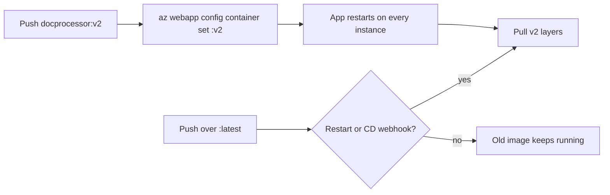

## What this covers

To release a new version with a **different tag**, update the configured image with the CLI. App Service **restarts** the web app automatically and pulls the new image on each instance. Pushing over an **existing tag** (such as `latest`) is different: App Service doesn't notice. This page covers both paths, how tagging strategy affects reliability, and the Container Apps equivalent.

**Exam weight:** Develop containerized solutions on Azure (20–25%)

**Skills measured**

- "Deploy containers to Azure App Service, including configuring App Service to supply environment variables and secrets"
- "Build, store, version, and manage container images by using Azure Container Registry"

## Key concepts

### New tag

- Change the tag with `az webapp config container set --container-image-name ...`. Older CLI versions used `--docker-custom-image-name`, which is now deprecated.
- A new or different tag makes App Service restart and pull automatically.
- The old container keeps serving until the new one has started and answered the warm-up ping.

### Same tag (`latest`) overwritten

- App Service does **not** detect the change by itself.
- On restart, `docker pull` runs and pulls **only the changed layers**. Cached layers are reused when nothing changed.
- To pick up same-tag updates, use a **manual restart** or a **continuous deployment** webhook.

### Tagging strategy

| Tag style | Example | Trade-off |
|-----------|---------|-----------|
| Stable/moving | `latest`, `v2` | Convenient, but you can't tell which build is running and rollback is ambiguous |
| Unique/immutable | `v2.1.7`, `{{.Run.ID}}`, git SHA | Repeatable deploys and easy rollback, but needs a config change per release |
| Digest | `docprocessor@sha256:...` | Exact image, can never drift |

Use unique tags for production. ACR can also **lock** a tag (`az acr repository update --write-enabled false`) so it can't be overwritten.

## How it works



## Hands-on

### Azure portal

1. Open the web app, then **Deployment Center > Settings**.
2. Change **Tag** to `v2` and select **Save**. The app restarts and pulls the new image.
3. For a same-tag update, select **Restart** on **Overview**, or set **Continuous deployment** to **On**.
4. Watch **Log stream** for the pull and start messages.

### Azure CLI

Update with a new tag:

```bash
az webapp config container set \
  --resource-group myResourceGroup \
  --name myDocumentProcessor \
  --container-image-name myregistry.azurecr.io/docprocessor:v2
```

App Service restarts and pulls `docprocessor:v2` on every instance.

Same-tag update, picked up with a restart:

```bash
az acr build -r myregistry -t docprocessor:latest .
az webapp restart --resource-group myResourceGroup --name myDocumentProcessor
```

Check what is configured, and lock a release tag:

```bash
az webapp config container show -g myResourceGroup -n myDocumentProcessor
az acr repository update -n myregistry --image docprocessor:v2 --write-enabled false
```

Container Apps equivalent (creates a new revision):

```bash
az containerapp update -n quote-api -g quote-api-rg \
  --image quoteapiacr.azurecr.io/quote-api:v2
```

### Python

```python
from azure.identity import DefaultAzureCredential
from azure.mgmt.web import WebSiteManagementClient

client = WebSiteManagementClient(DefaultAzureCredential(), "<subscription-id>")
rg, app = "<resource-group>", "myDocumentProcessor"

config = client.web_apps.get_configuration(rg, app)
config.linux_fx_version = "DOCKER|myregistry.azurecr.io/docprocessor:v2"
client.web_apps.update_configuration(rg, app, config)  # triggers restart and pull
```

## Exam traps

| Situation | Action |
|-----------|--------|
| New tag `v2` | `az webapp config container set` is enough (automatic restart) |
| Pushed over `latest` | Restart, or turn on CD with a registry webhook |
| Need guaranteed rollback | Immutable tags or digests |
| Container Apps image change | `az containerapp update --image` creates a new revision |

> [!WARNING]
> **Exam trap:** Pushing a new image to the **same tag** doesn't redeploy anything. App Service only pulls on restart, configuration change or CD webhook.

> [!WARNING]
> **Exam trap:** A restart after a same-tag push doesn't download the whole image. It pulls only the changed layers.

> [!TIP]
> Prefer versioned tags for reliable deployments that are safe to reason about in the exam.

## Quick review

- Change the tag with `az webapp config container set --container-image-name ...`.
- A new or different tag means App Service restarts and pulls automatically.
- An overwritten tag isn't detected. You need a restart or continuous deployment.
- On restart, `docker pull` fetches only the changed layers.
- Lock release tags in ACR with `--write-enabled false`.
- Use cases: promote `docprocessor:v1` to `v2`, a hotfix pushed to `latest`, rollout scripts that only change the image name.

## Practice

- [Practice: App Service container questions](/practice/app-service-containers)
- [Practice: Azure Container Registry questions](/practice/acr-images)

## Official references

- [Configure a custom container](https://learn.microsoft.com/azure/app-service/configure-custom-container)
- [az webapp config container](https://learn.microsoft.com/cli/azure/webapp/config/container)
- [Image tag best practices in ACR](https://learn.microsoft.com/azure/container-registry/container-registry-image-tag-version)
- [AI-200 study guide](https://learn.microsoft.com/credentials/certifications/resources/study-guides/ai-200)
