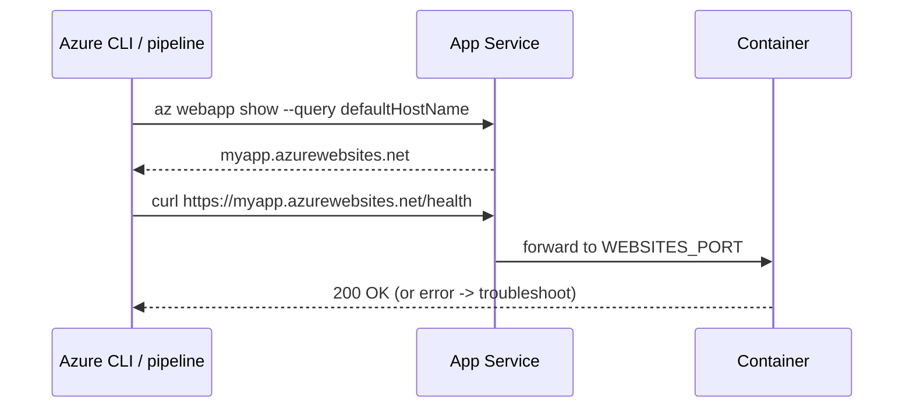

## What this covers

After you deploy a container, check that the application **starts and responds**. A "deployment succeeded" message only means the configuration was accepted. It doesn't mean the container pulled, started and is serving traffic. Get the default hostname with the Azure CLI, then open it in a browser or call it with `curl`. If startup fails, move to the troubleshooting tools (log stream, filesystem logs, Kudu).

**Exam weight:** Develop containerized solutions on Azure (20–25%)

**Skills measured**

- "Deploy containers to Azure App Service, including configuring App Service to supply environment variables and secrets"
- "Monitor and troubleshoot solutions on AKS and Container Apps by inspecting logs, events, and end-to-end connectivity"

## Key concepts

### What to check

| Check | How |
|-------|-----|
| App is running | `az webapp show --query state` returns `Running` |
| Hostname answers | `curl https://<defaultHostName>` |
| Right image | `az webapp config container show` / Deployment Center |
| Health endpoint | `curl https://<host>/health` returns HTTP 200 |
| Settings reached the container | Kudu `https://<app>.scm.azurewebsites.net/Env` |

### Health check feature

App Service **Health check** (`--generic-configurations '{"healthCheckPath": "/health"}'`) pings that path on every instance about once a minute. Unhealthy instances are taken out of the load balancer and replaced after repeated failures. It's continuous verification, not a one-off smoke test.

### Startup signals

- On Linux, App Service waits for the container to answer an HTTP ping on `WEBSITES_PORT`. The default is port 80, and the start time limit defaults to 230 seconds.
- A `404` on `/robots933456.txt` in the logs is App Service's own readiness probe, and it's harmless.

## How it works



## Hands-on

### Azure portal

1. Open the web app's **Overview** and select the **Default domain** link.
2. Check **Status** is **Running** and **Deployment Center > Logs** shows a successful pull and start.
3. Under **Monitoring > Health check**, turn it on with path `/health`.
4. If the page fails, open **Log stream** or **Diagnose and solve problems**.

### Azure CLI

Get the app URL:

```bash
az webapp show \
  --resource-group myResourceGroup \
  --name myDocumentProcessor \
  --query defaultHostName \
  --output tsv
```

Open `https://<defaultHostName>` in a browser, or use:

```bash
curl "https://$(az webapp show \
  --resource-group myResourceGroup \
  --name myDocumentProcessor \
  --query defaultHostName -o tsv)"
```

Pipeline gate that fails unless the app returns 200:

```bash
host=$(az webapp show -g myResourceGroup -n myDocumentProcessor --query defaultHostName -o tsv)
curl --fail --silent --retry 10 --retry-delay 15 --retry-all-errors "https://$host/health"
```

Turn on Health check:

```bash
az webapp config set -g myResourceGroup -n myDocumentProcessor \
  --generic-configurations '{"healthCheckPath": "/health"}'
```

### Python

```python
import requests
from azure.identity import DefaultAzureCredential
from azure.mgmt.web import WebSiteManagementClient

client = WebSiteManagementClient(DefaultAzureCredential(), "<subscription-id>")
site = client.web_apps.get("<resource-group>", "myDocumentProcessor")
print(site.state, site.default_host_name)

resp = requests.get(f"https://{site.default_host_name}/health", timeout=30)
resp.raise_for_status()
```

## Exam traps

If verification fails, these are the usual next steps:

1. Stream logs: `az webapp log tail`.
2. Confirm filesystem logging is enabled.
3. Check Kudu **Environment** and `/home/LogFiles/`.
4. Recheck the port (`WEBSITES_PORT`), the bind address (`0.0.0.0`), and the image and registry auth.

| Symptom | Likely cause |
|---------|--------------|
| 503 / "Application Error" right after deploy | Container still pulling or starting, or crashing |
| Container didn't respond to HTTP pings | Wrong `WEBSITES_PORT` or app bound to localhost |
| Image pull failure in logs | Wrong tag, or missing AcrPull / credentials |
| Works, but old version shown | Same-tag push without restart or CD |

> [!WARNING]
> **Exam trap:** "Deployment succeeded" isn't verification. Always test an HTTP response.

> [!WARNING]
> **Exam trap:** "Didn't respond to HTTP pings on port 80" almost always means the app listens elsewhere. Set `WEBSITES_PORT`.

> [!TIP]
> Know `az webapp show --query defaultHostName`, then tie any failure back to the troubleshooting topics (logs, Kudu, common issues).

## Quick review

- Get the hostname with `az webapp show ... --query defaultHostName -o tsv`.
- Smoke test with a browser or `curl https://<hostname>`.
- Health check (`healthCheckPath`) keeps verifying every instance.
- The failure path goes through container logs, log stream and Kudu.
- The default container port is 80. Override it with `WEBSITES_PORT`.
- Use cases: a post-deploy pipeline gate, checking `/health` after a `v2` tag update, a hand-off checklist.

## Practice

- [Practice: App Service container questions](/practice/app-service-containers)
- [Practice: Container troubleshooting questions](/practice/containers-troubleshoot)

## Official references

- [az webapp show](https://learn.microsoft.com/cli/azure/webapp#az-webapp-show)
- [Monitor App Service instances with Health check](https://learn.microsoft.com/azure/app-service/monitor-instances-health-check)
- [Enable diagnostic logging in App Service](https://learn.microsoft.com/azure/app-service/troubleshoot-diagnostic-logs)
- Related topics: [Stream container logs](/study/implement-container-application-hosting-on-azure/stream-container-logs) and [Common issues and solutions](/study/implement-container-application-hosting-on-azure/common-issues-and-solutions)
- [AI-200 study guide](https://learn.microsoft.com/credentials/certifications/resources/study-guides/ai-200)
