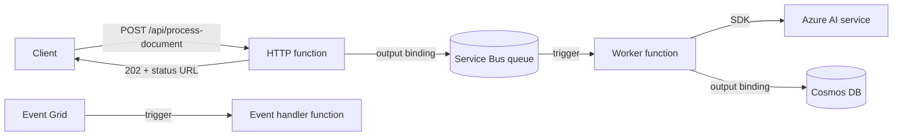

## What this covers

Azure Functions runs small pieces of code in response to events and bills you only while they run. Triggers decide what starts a function (an HTTP call, a queue message, an event); bindings move data in and out without hand-written SDK plumbing. This page builds an AI back end with the Python v2 programming model: an HTTP inference endpoint, a Service Bus worker, an Event Grid handler and output bindings that store results.

**Exam weight:** Connect to and consume Azure services (20–25%)

**Skills measured**

- "Build serverless APIs, including implementing triggers and bindings"

## Key concepts

### Triggers and bindings

- **Exactly one trigger** per function. The trigger payload is also the function's main input.
- **Bindings** are optional: zero or more input and output bindings per function.
- Bindings ship as **extensions**. Python apps get them through the extension bundle declared in `host.json` (`Microsoft.Azure.Functions.ExtensionBundle`, version `[4.*, 5.0.0)`).
- A binding's `connection` property is the **name of an app setting** (or setting prefix), never the secret itself.
- Services with no binding (Azure OpenAI, AI Search, Document Intelligence) are called with their SDK from inside the function.

### Python v2 programming model

All functions are declared with decorators on a `func.FunctionApp()` instance in `function_app.py`; there are no `function.json` files. Large apps split functions into **blueprints** (`func.Blueprint()`) registered with `app.register_functions(bp)`.

| Decorator | Purpose |
| --- | --- |
| `@app.route(route, methods, auth_level)` | HTTP trigger |
| `@app.service_bus_queue_trigger(arg_name, queue_name, connection)` | Service Bus queue trigger |
| `@app.service_bus_topic_trigger(arg_name, topic_name, subscription_name, connection)` | Service Bus subscription trigger |
| `@app.event_grid_trigger(arg_name)` | Event Grid push handler |
| `@app.timer_trigger(schedule, arg_name)` | NCRONTAB schedule (six fields, seconds first) |
| `@app.blob_trigger` / `@app.blob_input` / `@app.blob_output` | Blob Storage |
| `@app.cosmos_db_output(arg_name, database_name, container_name, connection)` | Write documents to Cosmos DB |
| `@app.service_bus_queue_output(arg_name, queue_name, connection)` | Send to a queue |
| `@app.event_grid_output(arg_name, topic_endpoint_uri, topic_key_setting)` | Publish events |

### HTTP authorization levels

| Level | Key required |
| --- | --- |
| `ANONYMOUS` | None (health checks, or behind API Management/Easy Auth) |
| `FUNCTION` | Function key or host key, in `x-functions-key` header or `code` query string. Recommended baseline |
| `ADMIN` | Master key only |

Keys are a shared secret, not identity. For caller identity, add App Service Authentication (Easy Auth) with Microsoft Entra ID or front the API with Azure API Management.

### Limits that shape design

- HTTP-triggered calls time out after **230 seconds** at the load balancer, whatever `functionTimeout` says. Use async request-reply: return `202` with a status URL and hand the work to a queue.
- Service Bus trigger concurrency is set in `host.json`: `maxConcurrentCalls` per instance and `maxAutoLockRenewalDuration` for long processing. The runtime completes the message on success and abandons it on an unhandled exception; the queue's `maxDeliveryCount` (default 10) then dead-letters it.

## How it works



## Hands-on

### Azure portal

1. Open the function app > **Functions** to see each decorated function after deployment; portal editing isn't available for Python.
2. Select an HTTP function > **Get function URL** to copy the URL with its `code` key, or manage keys under **Function Keys**.
3. Use **Code + Test** > **Test/Run** to send a sample body, and **Monitor** to see invocations.
4. Under **Settings** > **Environment variables**, add the app settings each binding's `connection` refers to.

### Azure CLI

```bash
func init ai-backend --python          # Python v2 model is the default
cd ai-backend
func new --name classify --template "HTTP trigger"
func start                              # http://localhost:7071/api/classify

curl -X POST http://localhost:7071/api/classify \
  -H "Content-Type: application/json" -d '{"text": "Invoice total 420 USD"}'

# Push a test message to the queue the worker listens on
az servicebus queue message send -g <resource-group> --namespace-name <namespace> \
  -n document-jobs --body '{"job_id": "1", "document_url": "https://..."}'
```

If `az servicebus queue message send` isn't available in your CLI version, use **Service Bus Explorer** in the portal.

### Python

`function_app.py`:

```python
import azure.functions as func
import json, logging, uuid
from datetime import datetime, timezone

app = func.FunctionApp()

# 1. HTTP API that accepts work and returns 202 (async request-reply)
@app.route(route="process-document", methods=["POST"], auth_level=func.AuthLevel.FUNCTION)
@app.service_bus_queue_output(arg_name="queue_msg", queue_name="document-jobs",
                              connection="ServiceBusConnection")
def accept_document(req: func.HttpRequest, queue_msg: func.Out[str]) -> func.HttpResponse:
    job_id = str(uuid.uuid4())
    queue_msg.set(json.dumps({"job_id": job_id, "document_url": req.get_json()["document_url"]}))
    return func.HttpResponse(json.dumps({"job_id": job_id, "status_url": f"/api/job-status/{job_id}"}),
                             status_code=202, mimetype="application/json")

# 2. Worker: Service Bus trigger + Cosmos DB output binding
@app.service_bus_queue_trigger(arg_name="msg", queue_name="document-jobs",
                               connection="ServiceBusConnection")
@app.cosmos_db_output(arg_name="doc", database_name="ai-results",
                      container_name="classifications", connection="CosmosDBConnection")
def process_document(msg: func.ServiceBusMessage, doc: func.Out[func.Document]) -> None:
    job = json.loads(msg.get_body().decode("utf-8"))
    logging.info("Processing %s (delivery %s)", job["job_id"], msg.delivery_count)
    result = {"category": "invoice", "score": 0.93}   # call your model or AI service here
    doc.set(func.Document.from_dict({
        "id": job["job_id"], **result,
        "processed_at": datetime.now(timezone.utc).isoformat(),
    }))

# 3. Embedding job from the original guide: Service Bus trigger + Blob output
@app.service_bus_queue_trigger(arg_name="msg", queue_name="embed-jobs",
                               connection="ServiceBusConnection")
@app.blob_output(arg_name="out", path="results/{rand-guid}.json", connection="AzureWebJobsStorage")
def process_embedding(msg: func.ServiceBusMessage, out: func.Out[str]):
    payload = json.loads(msg.get_body().decode("utf-8"))
    logging.info("Processing document %s", payload["documentId"])
    out.set(json.dumps({"documentId": payload["documentId"], "status": "embedded"}))

# 4. Event Grid push handler (validation handshake handled by the runtime)
@app.event_grid_trigger(arg_name="event")
def on_blob_created(event: func.EventGridEvent):
    logging.info("%s %s", event.event_type, event.get_json().get("url"))

# 5. Timer: refresh embeddings every night at 02:00 UTC
@app.timer_trigger(schedule="0 0 2 * * *", arg_name="timer", run_on_startup=False)
def nightly_refresh(timer: func.TimerRequest) -> None:
    logging.info("Past due: %s", timer.past_due)
```

`host.json` for slow, memory-heavy messages:

```json
{
  "version": "2.0",
  "extensionBundle": {
    "id": "Microsoft.Azure.Functions.ExtensionBundle",
    "version": "[4.*, 5.0.0)"
  },
  "extensions": {
    "serviceBus": { "maxConcurrentCalls": 1, "maxAutoLockRenewalDuration": "00:05:00" }
  }
}
```

Create SDK clients (with `DefaultAzureCredential`) at module level so they're reused across invocations on a warm instance.

## Exam traps

| Scenario | Trigger / binding |
| --- | --- |
| Blob uploaded, start processing | Event Grid trigger or Blob trigger (`source` = Event Grid on Flex Consumption) |
| Public inference API | HTTP trigger, `auth_level=FUNCTION` + Entra ID/APIM for identity |
| Reliable background work with retries and DLQ | Service Bus queue trigger |
| Every subscriber of a topic | Service Bus topic trigger per subscription |
| Scheduled re-index | Timer trigger |
| Persist inference result | Cosmos DB or Blob output binding |
| Call Azure OpenAI or AI Search | SDK client in code (no binding) |

> [!WARNING]
> **Exam trap:** A function can't have two triggers. "Run on HTTP and on a queue message" means two functions.

> [!WARNING]
> **Exam trap:** `connection="ServiceBusConnection"` names an app setting. Putting the connection string itself there fails at startup.

> [!WARNING]
> **Exam trap:** Raising `functionTimeout` doesn't lift the 230-second HTTP limit. Use 202 + queue, or Durable Functions.

> [!TIP]
> Trigger = "why it runs". Input binding = "what it reads". Output binding = "where it writes".

## Quick review

- One trigger, any number of bindings, per function.
- Python v2 declares everything with decorators in `function_app.py`; blueprints split large apps.
- `FUNCTION` auth level needs a key in `x-functions-key` or `?code=`.
- HTTP calls cap at 230 seconds; use async request-reply for long AI jobs.
- `maxConcurrentCalls` and `maxAutoLockRenewalDuration` live under `extensions.serviceBus` in `host.json`.
- Unhandled exceptions abandon Service Bus messages; `maxDeliveryCount` sends them to the DLQ.
- Services without bindings are reached through SDK clients created at module level.

## Practice

[Practice: Functions triggers and bindings questions](/practice/functions-triggers-bindings)

## Official references

- [Build serverless AI backends with Azure Functions (module)](https://learn.microsoft.com/training/modules/build-backends-azure-functions/)
- [Create triggers and bindings for AI integration patterns (unit)](https://learn.microsoft.com/training/modules/build-backends-azure-functions/4-create-triggers-bindings-ai-patterns)
- [Azure Functions triggers and bindings](https://learn.microsoft.com/azure/azure-functions/functions-triggers-bindings)
- [Azure Functions Python developer guide](https://learn.microsoft.com/azure/azure-functions/functions-reference-python)
- [Service Bus bindings for Azure Functions](https://learn.microsoft.com/azure/azure-functions/functions-bindings-service-bus)
- [Securing Azure Functions: authorization keys](https://learn.microsoft.com/azure/azure-functions/function-keys-how-to)
