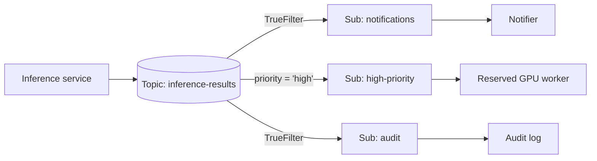

## What this covers

The first design decision in a Service Bus messaging layer is the entity type. A queue hands each message to exactly one worker. A topic copies each message to every subscription whose rules match, so several independent services can act on the same event. This page explains when to use each, how subscription filters route messages at the broker, and how the Python SDK works with both.

**Exam weight:** Connect to and consume Azure services (20–25%)

**Skills measured**

- "Queue and process back-end operations by using Azure Service Bus, including dead-letter queue handling, messages, topics, and subscriptions"

## Key concepts

### Queues: single consumer per message

Many workers can listen on one queue (competing consumers), but the broker gives each message to only one of them. Add workers to scale out with no code change. Queues support two receive modes: **peek-lock** (the default, at-least-once) and **receive-and-delete** (at-most-once, faster). See [Process messages reliably](/study/integrate-backend-services-for-ai-solutions/process-messages-reliably).

### Sessions: ordered processing

Enable sessions on a queue or subscription (`--enable-session true`, set at creation and not changeable later). Messages that share a `session_id` are locked to one receiver at a time and processed in FIFO order. Use them for multi-step pipelines where, for example, text extraction must finish before classification of the same document.

### Topics and subscriptions: fan-out

A topic accepts messages; each subscription receives its own copy and is consumed like a queue. A failure in the audit subscription does not affect the notification subscription. Publishers don't know how many subscriptions exist, so you can add a QA or retraining consumer later without touching the producer. Topics require the Standard or Premium tier.

### Subscription rules and filters

Each subscription has one or more rules. A rule has a filter and an optional action. Filters are evaluated by the broker, so non-matching messages are never delivered to that subscription.

| Filter | What it matches | Notes |
| --- | --- | --- |
| Boolean (`TrueFilter` / `FalseFilter`) | All or none | A new subscription gets a `$Default` rule with `TrueFilter` |
| SQL filter | SQL-92-like expression on system and application properties, for example `priority = 'high' AND model_name LIKE 'gpt%'` | Most flexible, highest broker cost |
| Correlation filter | Exact match on `correlation_id`, `message_id`, `subject`, `content_type`, `to`, `reply_to`, `session_id` and/or application properties | Cheaper and faster than SQL; prefer for equality |

A **SQL rule action** can modify message properties when a rule matches, for example `SET sys.label = 'urgent'`.

Filters read **properties**, never the message body. Put routing data such as `model_name`, `priority` or `document_type` in `application_properties`.

## How it works



When a message arrives, the broker evaluates every rule on every subscription. If any rule on a subscription matches, that subscription gets one copy (even if several of its rules match). If no subscription matches, the message is dropped unless the topic is configured otherwise.

## Hands-on

### Azure portal

1. Open a **Standard** or **Premium** namespace and select **Topics** > **+ Topic**, name `inference-results`.
2. Open the topic, select **+ Subscription**, create `notifications`, `high-priority` and `audit`.
3. Open `high-priority` > **Filters**, delete `$Default`, then add a **SQL Filter** `priority = 'high'`.
4. Use **Service Bus Explorer** on the topic to send a message with a custom property `priority=high` and watch which subscriptions receive it.

### Azure CLI

```bash
az servicebus topic create -g <resource-group> --namespace-name <namespace> -n inference-results

az servicebus topic subscription create -g <resource-group> --namespace-name <namespace> \
  --topic-name inference-results -n high-priority --max-delivery-count 5

# Replace the default catch-all rule with a SQL filter
az servicebus topic subscription rule delete -g <resource-group> --namespace-name <namespace> \
  --topic-name inference-results --subscription-name high-priority -n '$Default'

az servicebus topic subscription rule create -g <resource-group> --namespace-name <namespace> \
  --topic-name inference-results --subscription-name high-priority \
  -n filter-high-priority --filter-sql-expression "priority = 'high'"

# Session-enabled queue for ordered pipelines
az servicebus queue create -g <resource-group> --namespace-name <namespace> \
  -n doc-pipeline --enable-session true
```

### Python

```python
from azure.identity import DefaultAzureCredential
from azure.servicebus import ServiceBusClient, ServiceBusMessage
from azure.servicebus.management import (
    ServiceBusAdministrationClient, SqlRuleFilter, CorrelationRuleFilter,
)

credential = DefaultAzureCredential()
ns = "<namespace>.servicebus.windows.net"

admin = ServiceBusAdministrationClient(fully_qualified_namespace=ns, credential=credential)
admin.delete_rule("inference-results", "high-priority", "$Default")
admin.create_rule(
    topic_name="inference-results",
    subscription_name="high-priority",
    rule_name="filter-high-priority",
    filter=SqlRuleFilter("priority = 'high'"),
)
# Equality-only routing: a correlation filter is cheaper than SQL
admin.create_rule("inference-results", "gpt4o-only", "by-model",
                  filter=CorrelationRuleFilter(properties={"model_name": "gpt-4o"}))

with ServiceBusClient(fully_qualified_namespace=ns, credential=credential) as client:
    # Point-to-point
    with client.get_queue_sender("inference-requests") as queue_sender:
        queue_sender.send_messages(ServiceBusMessage("queue message body"))

    # Publish-subscribe; routing data goes in application_properties
    with client.get_topic_sender("inference-results") as topic_sender:
        topic_sender.send_messages(ServiceBusMessage(
            "topic message body", application_properties={"priority": "high"}))

    # Each subscription has its own copy
    with client.get_subscription_receiver(
        topic_name="inference-results", subscription_name="notifications", max_wait_time=5
    ) as receiver:
        for msg in receiver:
            print(str(msg))
            receiver.complete_message(msg)
```

Receiving from a session-enabled entity uses `client.get_queue_receiver("doc-pipeline", session_id="doc-42")` (or `NEXT_AVAILABLE_SESSION`). The `with` blocks close AMQP links even when exceptions occur.

## Exam traps

| Scenario | Use |
| --- | --- |
| One processing pipeline; scale out workers | Queue |
| Notification, audit and dashboard all react to one result | Topic + 3 subscriptions |
| Route urgent requests to a reserved worker | Topic + SQL or correlation filter |
| Exact match on one property, high volume | Correlation filter |
| Steps for the same document must run in order | Sessions (`session_id` = document id) |
| Add a consumer without redeploying the producer | New subscription |

> [!WARNING]
> **Exam trap:** Adding a filtered rule does not remove `$Default`. With `TrueFilter` still present, the subscription keeps receiving **everything**. Delete `$Default` first.

> [!WARNING]
> **Exam trap:** Filters cannot inspect the JSON body. If routing depends on a value, copy it into an application property when you send.

> [!TIP]
> Need FIFO from Service Bus? The answer is almost always "sessions", not "use a single receiver".

> [!NOTE]
> `requires_session` and partitioning are fixed at creation. Changing them means recreating the entity.

## Quick review

- Queue = one receiver per message; topic = one copy per matching subscription.
- New subscriptions start with a `$Default` rule using `TrueFilter`.
- SQL filters are flexible; correlation filters are faster for equality checks.
- Filters evaluate system and application properties, never the body.
- Sessions give FIFO and exclusive processing per `session_id`.
- Topics need Standard or Premium.
- The SDK uses `get_topic_sender` and `get_subscription_receiver` for pub-sub.

## Practice

[Practice: Service Bus questions](/practice/service-bus)

## Official references

- [Choose between queues and topics with subscriptions (unit)](https://learn.microsoft.com/training/modules/queue-process-operations-service-bus/3-choose-queues-topics-subscriptions)
- [Service Bus queues, topics, and subscriptions](https://learn.microsoft.com/azure/service-bus-messaging/service-bus-queues-topics-subscriptions)
- [Topic filters and actions](https://learn.microsoft.com/azure/service-bus-messaging/topic-filters)
- [Message sessions](https://learn.microsoft.com/azure/service-bus-messaging/message-sessions)
- [az servicebus topic subscription rule](https://learn.microsoft.com/cli/azure/servicebus/topic/subscription/rule)
