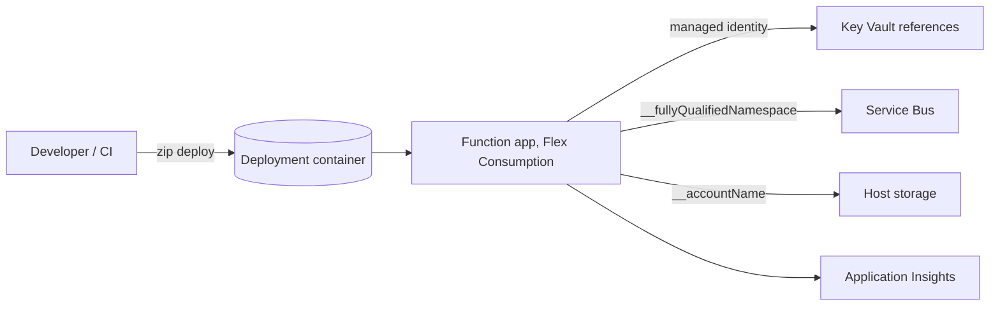

## What this covers

Writing the function is half the job. You also choose a hosting plan that fits cold-start and memory needs, wire configuration and secrets without hard-coding them, give the app a managed identity instead of connection strings, and ship the code. This page covers the hosting plans, local project files, app settings, Key Vault references, identity-based connections and the deployment commands.

**Exam weight:** Connect to and consume Azure services (20–25%)

**Skills measured**

- "Configure and deploy function apps"

## Key concepts

### Hosting plans

| Plan | Cold start | Scale | Notes |
| --- | --- | --- | --- |
| **Flex Consumption** (recommended serverless) | Mitigated with **always-ready** instances | Scale to zero, up to 1,000 instances, per-function scaling | Linux only; instance memory 512 MB, 2,048 MB (default, 1 vCPU) or 4,096 MB (2 vCPU); VNet integration; one app per plan |
| **Premium** (Elastic Premium EP1–EP3) | None: at least one pre-warmed instance | Event-driven, no scale to zero | Custom Linux containers, VNet, deployment slots; pay for the minimum always |
| **Dedicated** (App Service plan) | Always On | Manual/autoscale | Reuse spare App Service capacity |
| **Container Apps** | Depends on min replicas | KEDA | GPU, custom OS packages, alongside other microservices |
| Consumption (legacy) | Yes | Up to 200 instances | Linux Consumption retires September 2028; use Flex for new apps |

Flex Consumption specifics: HTTP triggers scale together as one group; Blob (Event Grid-based) and Durable triggers form groups; every other function scales on its own. Deployment slots aren't supported (rolling updates are the zero-downtime option). The Blob trigger only supports the Event Grid source. You can't migrate an app in place to or from Flex; you create a new app and redeploy.

### Project files

| File | Role |
| --- | --- |
| `function_app.py` | Python v2 entry point with decorators |
| `host.json` | Runtime-wide settings: `functionTimeout`, logging, extension bundle, trigger concurrency |
| `local.settings.json` | Local-only app settings under `Values`; **never committed or deployed** |
| `requirements.txt` | Packages installed by remote build |
| `.funcignore` | Files left out of the package |

### App settings

App settings are exposed to code as environment variables (`os.environ["MODEL_ID"]`) and are encrypted at rest. Required runtime settings include `AzureWebJobsStorage` (the host's storage) and, outside Flex, `FUNCTIONS_WORKER_RUNTIME` and `FUNCTIONS_EXTENSION_VERSION`. Flex Consumption moves the runtime, version and deployment settings into the site configuration, so don't set those as app settings there. Locally, `AzureWebJobsStorage=UseDevelopmentStorage=true` points at the Azurite emulator.

### Key Vault references

Put a reference instead of the secret in an app setting:

- `@Microsoft.KeyVault(SecretUri=https://<vault>.vault.azure.net/secrets/AiServiceKey/)`
- `@Microsoft.KeyVault(VaultName=<vault>;SecretName=AiServiceKey)`

The app's managed identity needs **Key Vault Secrets User**. Versionless references pick up a rotated secret within 24 hours, or immediately on any config change. If resolution fails, the setting holds the literal reference string. For shared non-secret config, load Azure App Configuration with `azure-appconfiguration-provider`.

### Identity-based connections

Replace connection strings with a setting prefix plus a suffix, then grant RBAC to the managed identity:

| Binding | Setting | Role |
| --- | --- | --- |
| Host storage | `AzureWebJobsStorage__accountName` | Storage Blob Data Owner (plus Queue Data Contributor and Account Contributor for blob triggers) |
| Service Bus | `ServiceBusConnection__fullyQualifiedNamespace` | Azure Service Bus Data Receiver / Sender |
| Cosmos DB | `CosmosDBConnection__accountEndpoint` | Cosmos DB Built-in Data Contributor |
| User-assigned identity | add `__credential=managedidentity` and `__clientId=<client-id>` | — |

### Deployment options

- `func azure functionapp publish <app>`: Core Tools builds remotely and deploys.
- `az functionapp deployment source config-zip --src app.zip` (add `--build-remote true` for Python on Flex).
- GitHub Actions (`Azure/functions-action`) or Azure Pipelines for CI/CD.
- Flex Consumption stores the package in a Blob container (by default in the `AzureWebJobsStorage` account, configurable with `--deployment-storage-*`).
- Premium and Dedicated: deploy to a **staging slot** and swap; mark environment-specific settings as **slot settings**.

## How it works



## Hands-on

### Azure portal

1. **Create a resource** > **Function App** > **Flex Consumption**; pick Python 3.11 or later, a region, instance size 2,048 MB.
2. Under **Settings** > **Identity**, turn on the system-assigned identity.
3. Under **Settings** > **Environment variables**, add `ServiceBusConnection__fullyQualifiedNamespace` and a Key Vault reference setting; check the green **Key vault reference** status.
4. Under **Scale and concurrency**, set **Always ready instances** for `http` and the **Maximum instance count**.
5. For Premium apps, use **Deployment slots** and **Swap**.

### Azure CLI

```bash
# Create storage account (required for Functions)
az storage account create --name <storage-account> --resource-group <resource-group> \
  --location eastus --sku Standard_LRS

# Flex Consumption function app (Python)
az functionapp create --name <app-name> --resource-group <resource-group> \
  --storage-account <storage-account> --flexconsumption-location eastus \
  --runtime python --runtime-version 3.11 --instance-memory 2048 \
  --always-ready-instances http=1

# Legacy Linux Consumption equivalent (retiring; shown for recognition)
# az functionapp create ... --consumption-plan-location eastus --runtime python \
#   --functions-version 4 --os-type Linux

# Scale settings
az functionapp scale config set -g <resource-group> -n <app-name> --maximum-instance-count 100
az functionapp scale config set -g <resource-group> -n <app-name> \
  --trigger-type http --trigger-settings perInstanceConcurrency=10

# Identity, settings and Key Vault reference
PRINCIPAL=$(az functionapp identity assign -g <resource-group> -n <app-name> --query principalId -o tsv)
az role assignment create --assignee $PRINCIPAL --role "Key Vault Secrets User" \
  --scope $(az keyvault show -n <vault> --query id -o tsv)
az functionapp config appsettings set -g <resource-group> -n <app-name> --settings \
  "ServiceBusConnection__fullyQualifiedNamespace=<namespace>.servicebus.windows.net" \
  "AI_KEY=@Microsoft.KeyVault(SecretUri=https://<vault>.vault.azure.net/secrets/AiServiceKey/)"

# Deploy
func azure functionapp publish <app-name>
# or
az functionapp deployment source config-zip -g <resource-group> -n <app-name> \
  --src app.zip --build-remote true
```

### Python

```python
import os
from azure.identity import DefaultAzureCredential
from azure.appconfiguration.provider import load

# App settings arrive as environment variables (Key Vault references already resolved)
model_id = os.environ["MODEL_ID"]
threshold = float(os.getenv("CONFIDENCE_THRESHOLD", "0.85"))
ai_key = os.environ["AI_KEY"]

# Shared, non-secret settings from Azure App Configuration
config = load(endpoint=os.environ["APP_CONFIG_ENDPOINT"],
              credential=DefaultAzureCredential(),
              selects=[{"key_filter": "AIBackend/*"}])
model_endpoint = config["AIBackend/ModelEndpoint"]
```

Pull cloud settings into `local.settings.json` with `func azure functionapp fetch-app-settings <app-name>` and protect them with `func settings encrypt`.

## Exam traps

| Requirement | Choose |
| --- | --- |
| Serverless, VNet access, scale to zero, minimal cold start | Flex Consumption + always-ready |
| No cold start ever, deployment slots, custom container | Premium |
| GPU inference in a function | Container Apps hosting |
| Secret in config without storing it in app settings | Key Vault reference + managed identity |
| No connection strings for Service Bus trigger | `ServiceBusConnection__fullyQualifiedNamespace` + Data Receiver role |
| Swap staging into production | Deployment slots (Premium/Dedicated), not Flex |

> [!WARNING]
> **Exam trap:** `local.settings.json` isn't deployed. Settings must be created in Azure with `az functionapp config appsettings set` (or IaC).

> [!WARNING]
> **Exam trap:** A Key Vault reference fails silently to the literal `@Microsoft.KeyVault(...)` string if the identity lacks **Key Vault Secrets User** or the vault's network blocks the app.

> [!WARNING]
> **Exam trap:** Flex Consumption doesn't support deployment slots and is Linux only. A Windows-only or slot-swap requirement rules it out.

> [!TIP]
> The double underscore `__` in a setting name means "property of this connection": `<prefix>__fullyQualifiedNamespace`, `<prefix>__accountName`, `<prefix>__accountEndpoint`.

> [!NOTE]
> The minimum billed execution on Flex Consumption is 1,000 ms; always-ready instances are billed even when idle.

## Quick review

- Flex Consumption is the recommended serverless plan: Linux, 512/2,048/4,096 MB, up to 1,000 instances.
- Premium keeps pre-warmed instances and supports slots and custom containers.
- `local.settings.json` is local only; app settings become environment variables in Azure.
- Key Vault references need a managed identity with Key Vault Secrets User.
- Identity-based connections use `<prefix>__<property>` settings plus RBAC.
- Deploy with `func azure functionapp publish` or `az functionapp deployment source config-zip`.
- `AzureWebJobsStorage` is always required by the host.

## Practice

[Practice: Function app configuration and deployment questions](/practice/functions-deploy)

## Official references

- [Understand Azure Functions hosting and scaling for AI workloads (unit)](https://learn.microsoft.com/training/modules/build-backends-azure-functions/2-understand-hosting-scaling)
- [Manage secrets and configuration in Functions (unit)](https://learn.microsoft.com/training/modules/build-backends-azure-functions/5-manage-secrets-configuration)
- [Configure identity and access for Functions (unit)](https://learn.microsoft.com/training/modules/build-backends-azure-functions/6-configure-identity-access)
- [Flex Consumption plan hosting](https://learn.microsoft.com/azure/azure-functions/flex-consumption-plan)
- [Create and manage function apps in the Flex Consumption plan](https://learn.microsoft.com/azure/azure-functions/flex-consumption-how-to)
- [Use Key Vault references](https://learn.microsoft.com/azure/app-service/app-service-key-vault-references)
- [Identity-based connections](https://learn.microsoft.com/azure/azure-functions/functions-reference#configure-an-identity-based-connection)
- [Deployment technologies in Azure Functions](https://learn.microsoft.com/azure/azure-functions/functions-deployment-technologies)
