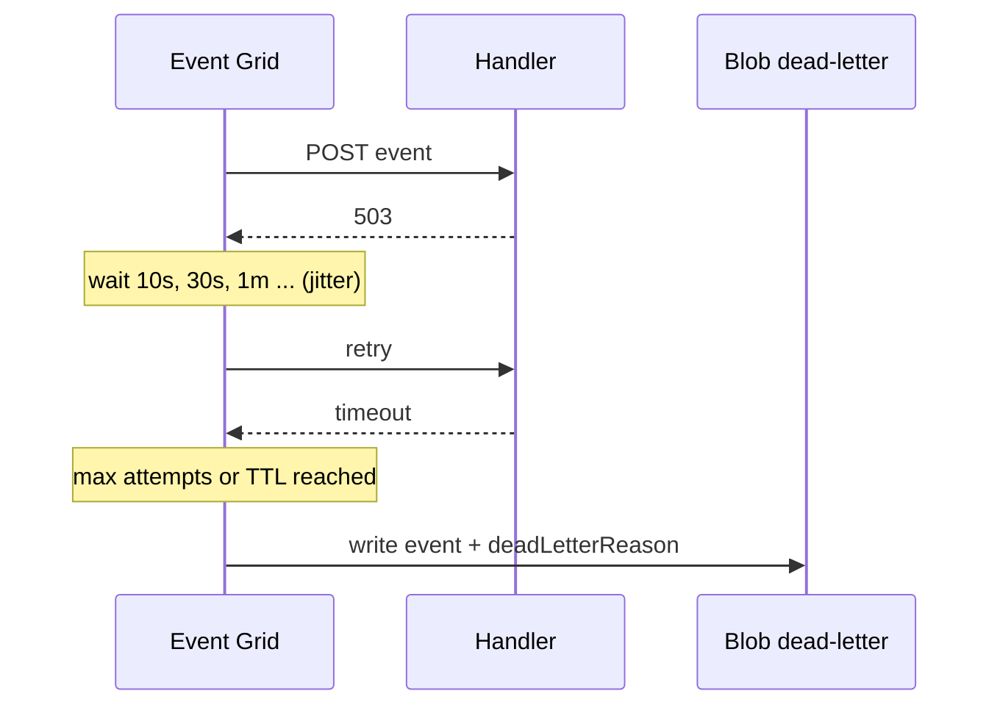

## What this covers

Handlers fail: a function is cold, a model service restarts, a vector store is briefly down. Event Grid retries automatically, but you choose how long it keeps trying, where undeliverable events go, and how your handler signals "try again" versus "give up". This page covers the retry schedule, the two retry limits, dead-letter destinations, output batching and the delivery metrics to alert on.

**Exam weight:** Connect to and consume Azure services (20–25%)

**Skills measured**

- "Implement event-driven workflows by using Azure Event Grid, including filters, custom events, and retries"

## Key concepts

### What counts as success

Event Grid POSTs the event and waits **30 seconds**. Only **200, 201, 202, 203 or 204** count as delivered. Anything else, or no response, starts the retry logic. Delivery is at-least-once, so the handler must dedupe on the event `id`.

### Errors that are not retried

| Response | Behavior |
| --- | --- |
| 400 Bad Request, 413 Request Entity Too Large, 403 Forbidden | Not retried; dead-lettered (if configured) or dropped |
| 401 Unauthorized from a **webhook** | Not retried |
| 401 / 404 from an **Azure resource** handler | Retried after at least 5 minutes (the resource may still be provisioning) |
| 503, 500, timeouts, others | Retried with backoff |

### Retry schedule

Exponential backoff with jitter: 10 s, 30 s, 1 min, 5 min, 10 min, 30 min, 1 h, 3 h, 6 h, then every 12 h until 24 h. Event Grid may skip attempts if an endpoint looks persistently unhealthy. If a slow endpoint answers within 3 minutes, Event Grid tries (best effort) to remove the queued retry, so duplicates are still possible.

### Retry policy

Two settings on the event subscription; whichever is reached first ends retrying:

| Setting | Range | Default | CLI flag |
| --- | --- | --- | --- |
| Max delivery attempts | 1–30 | 30 | `--max-delivery-attempts` |
| Event time-to-live | 1–1,440 minutes | 1,440 (24 h) | `--event-ttl` |

With the default schedule, only about six attempts fit into 30 minutes. A 30-minute TTL with 10 attempts behaves like a 30-minute TTL.

### Dead-letter destination

Disabled by default. Point the subscription at a **Blob Storage container** (create it first) with `--deadletter-endpoint`. Each dead-lettered event is written with `deadLetterReason` (`MaxDeliveryAttemptsExceeded`, `MaxRetryDurationExceeded` and others), `deliveryAttempts`, `lastDeliveryOutcome` (`NotFound`, `TimedOut`, `Busy`, `Forbidden`...), `publishTime` and `lastDeliveryAttemptTime`. There's a delay of about 5 minutes between the last attempt and the blob write. Without a dead-letter destination, events that exhaust retries are **dropped**.

You can subscribe to `BlobCreated` on the dead-letter container to alert or reprocess automatically.

### Managed identity for delivery

When the handler is Service Bus, Event Hubs or Storage, enable a managed identity on the topic and use `--delivery-identity` (and `--deadletter-identity`) so no keys are stored in the subscription.

### Output batching

`--max-events-per-batch` (1–5,000) and `--preferred-batch-size-in-kilobytes` (1–1,024). Batches are all-or-none: one failure retries the whole batch. Keep batches small enough to finish within 30 seconds.

### Handler design

- Return 200–204 on success, **503** when overloaded, never 400 for a transient problem.
- For work longer than 30 s, return **202** immediately and queue the work (for example to Service Bus).
- Store processed event IDs to stay idempotent.

## How it works



## Hands-on

### Azure portal

1. Open the event subscription > **Additional features**.
2. Set **Max event delivery attempts** and **Event time to live**.
3. Check **Enable dead-lettering**, choose the storage account and container.
4. On the topic **Metrics** blade, chart **Delivery Failed Events** and **Dead Lettered Events** and add an alert rule.

### Azure CLI

```bash
TOPIC_ID=$(az eventgrid topic show -n ai-events -g <resource-group> --query id -o tsv)
STORAGE_ID=$(az storage account show -n <storage-account> -g <resource-group> --query id -o tsv)
az storage container create --name dead-letters --account-name <storage-account> --auth-mode login

az eventgrid event-subscription create \
  --name moderation-sub \
  --source-resource-id $TOPIC_ID \
  --endpoint https://<app>.azurewebsites.net/api/events \
  --max-delivery-attempts 5 \
  --event-ttl 30 \
  --deadletter-endpoint $STORAGE_ID/blobServices/default/containers/dead-letters

# High-throughput handler with output batching
az eventgrid event-subscription create \
  --name batch-processor-sub \
  --source-resource-id $TOPIC_ID \
  --endpoint https://<app>.azurewebsites.net/api/events \
  --max-events-per-batch 100 \
  --preferred-batch-size-in-kilobytes 512
```

### Python

A webhook handler (Flask) that follows the status-code rules:

```python
from flask import Flask, request, jsonify

app = Flask(__name__)
processed_ids: set[str] = set()   # use Redis or a table in production

@app.post("/api/events")
def events():
    for event in request.get_json():          # Event Grid always posts a JSON array
        if event["id"] in processed_ids:
            continue                          # duplicate delivery
        if not model_service_healthy():       # your health check
            return "", 503                    # transient: Event Grid retries
        enqueue_for_inference(event)          # your code; long work goes to a queue
        processed_ids.add(event["id"])
    return "", 202                            # accepted = delivered
```

A CloudEvents webhook must also answer the HTTP `OPTIONS` validation request by returning the `WebHook-Allowed-Origin` header; Azure Functions triggers handle validation automatically.

## Exam traps

| Requirement | Setting |
| --- | --- |
| Stale events useless after 10 minutes | `--event-ttl 10` |
| Give up after 3 tries | `--max-delivery-attempts 3` |
| Keep undeliverable events for investigation | `--deadletter-endpoint` (Blob container) |
| Handler is temporarily overloaded | Return 503 |
| Processing takes 2 minutes | Return 202 and process asynchronously |
| Fewer HTTP calls at high volume | Output batching |

> [!WARNING]
> **Exam trap:** Dead-lettering is off by default. Without it, events that run out of retries are dropped, and the **Dropped Events** metric is the only trace.

> [!WARNING]
> **Exam trap:** Returning 400 for a temporary failure means Event Grid never retries. Use 503 (or 500/429) instead.

> [!WARNING]
> **Exam trap:** Event Grid's dead-letter target is a Blob container, not a queue. Service Bus has its own built-in DLQ; don't confuse the two.

> [!TIP]
> "30-30-24": 30-second response timeout, 30 max attempts, 24-hour default TTL.

## Quick review

- Success is HTTP 200–204 within 30 seconds.
- 400, 403, 413 (and webhook 401) aren't retried.
- Max attempts 1–30 (default 30); TTL 1–1,440 minutes (default 1,440). First limit wins.
- Dead-lettering targets a Blob container and is off by default.
- Batching is all-or-none.
- Watch Delivery Failed, Dropped and Dead Lettered event metrics.

## Practice

[Practice: Event Grid questions](/practice/event-grid)

## Official references

- [Configure delivery and retry policies (unit)](https://learn.microsoft.com/training/modules/event-driven-workflows-event-grid/4-delivery-retry-policies)
- [Event Grid message delivery and retry](https://learn.microsoft.com/azure/event-grid/delivery-and-retry)
- [Dead letter and retry policies](https://learn.microsoft.com/azure/event-grid/manage-event-delivery)
- [Event delivery with managed identity](https://learn.microsoft.com/azure/event-grid/managed-service-identity)
- [Monitor Event Grid message delivery](https://learn.microsoft.com/azure/event-grid/monitor-event-delivery)
