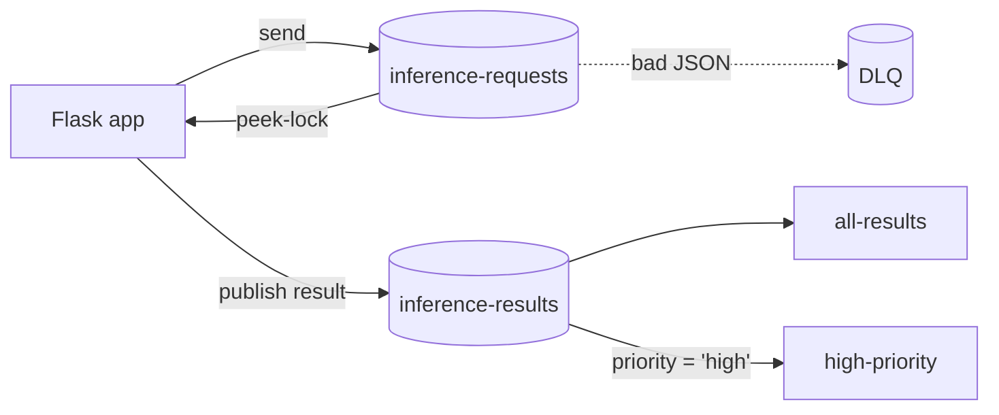

## What this covers

The Microsoft Learn exercise builds a small Python Flask app around an AI inference scenario: it queues inference requests, receives them with peek-lock, pushes malformed payloads to the dead-letter queue, and fans results out through a topic with subscriptions filtered by priority. This page reproduces the moving parts with the Azure CLI and the `azure-servicebus` SDK so you can rehearse them without the starter files. It takes about 30 minutes.

**Exam weight:** Connect to and consume Azure services (20–25%)

**Skills measured**

- "Queue and process back-end operations by using Azure Service Bus, including dead-letter queue handling, messages, topics, and subscriptions"

## Key concepts

### What you build

| Resource | Purpose |
| --- | --- |
| Standard namespace | Required for topics |
| Queue `inference-requests` | Point-to-point requests, max delivery count 3 |
| Topic `inference-results` | Fan-out of finished results |
| Subscriptions `all-results`, `high-priority` | `TrueFilter` vs SQL filter `priority = 'high'` |
| Role assignment | Your user gets **Azure Service Bus Data Owner** so `DefaultAzureCredential` works locally |

### Prerequisites

An Azure subscription, Visual Studio Code, Python 3.12 or later, and a current Azure CLI signed in with `az login`.

### Concepts exercised

- Peek-lock receive and `complete_message` ([Process messages reliably](/study/integrate-backend-services-for-ai-solutions/process-messages-reliably)).
- Dead-lettering bad payloads and reading the DLQ.
- Topic filters ([Choose between queues and topics](/study/integrate-backend-services-for-ai-solutions/choose-between-queues-and-topics-with-subscriptions)).
- JSON message bodies with application properties ([Structure messages](/study/integrate-backend-services-for-ai-solutions/structure-messages-for-ai-workloads)).

## How it works



## Hands-on

### Azure portal

1. After the CLI steps, open the namespace and confirm the queue, topic and both subscriptions exist.
2. Open `high-priority` > **Filters** and confirm only your SQL rule remains.
3. After running the scripts, use **Service Bus Explorer** > **Dead-letter** on the queue to see the malformed message and its reason.
4. Delete the resource group when finished.

### Azure CLI

```bash
# Replace with resource group and names for your environment
RG=<resource-group>; NS=<namespace>; LOC=eastus
az group create --name $RG --location $LOC

az servicebus namespace create -g $RG -n $NS -l $LOC --sku Standard
az servicebus queue create -g $RG --namespace-name $NS -n inference-requests --max-delivery-count 3
az servicebus topic create -g $RG --namespace-name $NS -n inference-results
az servicebus topic subscription create -g $RG --namespace-name $NS --topic-name inference-results -n all-results
az servicebus topic subscription create -g $RG --namespace-name $NS --topic-name inference-results -n high-priority
az servicebus topic subscription rule delete -g $RG --namespace-name $NS --topic-name inference-results \
  --subscription-name high-priority -n '$Default'
az servicebus topic subscription rule create -g $RG --namespace-name $NS --topic-name inference-results \
  --subscription-name high-priority -n high-only --filter-sql-expression "priority = 'high'"

# Data-plane access for your signed-in user
az role assignment create --assignee $(az ad signed-in-user show --query id -o tsv) \
  --role "Azure Service Bus Data Owner" \
  --scope $(az servicebus namespace show -g $RG -n $NS --query id -o tsv)

# Clean up
az group delete --name $RG --yes --no-wait
```

Role assignments can take a few minutes to propagate; retry if the first send returns an authorization error.

### Python

```python
# pip install azure-servicebus azure-identity
import json
from azure.identity import DefaultAzureCredential
from azure.servicebus import ServiceBusClient, ServiceBusMessage, ServiceBusSubQueue

NS = "<namespace>.servicebus.windows.net"

def main():
    with ServiceBusClient(fully_qualified_namespace=NS, credential=DefaultAzureCredential()) as client:
        # 1. Send two good requests and one malformed payload
        with client.get_queue_sender("inference-requests") as sender:
            sender.send_messages([
                ServiceBusMessage(json.dumps({"prompt": "Summarize doc-1", "priority": "high"}),
                                  content_type="application/json"),
                ServiceBusMessage(json.dumps({"prompt": "Summarize doc-2", "priority": "low"}),
                                  content_type="application/json"),
                ServiceBusMessage("not-json"),
            ])

        # 2. Receive with peek-lock; dead-letter bad input; publish results to the topic
        with client.get_queue_receiver("inference-requests", max_wait_time=5) as receiver, \
             client.get_topic_sender("inference-results") as publisher:
            for msg in receiver:
                try:
                    req = json.loads(str(msg))
                except json.JSONDecodeError:
                    receiver.dead_letter_message(msg, reason="MalformedPayload",
                                                 error_description="Body is not JSON")
                    continue
                publisher.send_messages(ServiceBusMessage(
                    json.dumps({"summary": "...", "prompt": req["prompt"]}),
                    application_properties={"priority": req["priority"]}))
                receiver.complete_message(msg)

        # 3. Each subscription sees its own filtered copy
        for sub in ("all-results", "high-priority"):
            with client.get_subscription_receiver("inference-results", sub, max_wait_time=5) as r:
                print(sub, [str(m) for m in r.receive_messages(max_message_count=10)])

        # 4. Inspect the DLQ
        with client.get_queue_receiver("inference-requests", sub_queue=ServiceBusSubQueue.DEAD_LETTER,
                                       max_wait_time=5) as dlq:
            for m in dlq:
                print("DLQ:", m.dead_letter_reason, str(m))
                dlq.complete_message(m)

if __name__ == "__main__":
    main()
```

Expected result: `all-results` receives two messages, `high-priority` receives one, and the DLQ holds the `not-json` message with reason `MalformedPayload`. Step 3 uses `receive_messages` in the default peek-lock mode without completing, so the messages reappear after the lock expires.

## Exam traps

| Observation in the lab | Explanation |
| --- | --- |
| `high-priority` receives every message | `$Default` rule not deleted |
| `Unauthorized` with `DefaultAzureCredential` | Missing data-plane role (Owner/Contributor on the resource is not enough) |
| Topic create fails | Namespace is Basic tier |
| Message reappears after a crash | Peek-lock released at lock expiry, by design |

> [!WARNING]
> **Exam trap:** Azure **Owner** or **Contributor** is a control-plane role. Sending and receiving with Entra ID needs a **Service Bus Data** role.

> [!TIP]
> Practise reading the DLQ in the portal: questions often show `DeadLetterReason` values and ask what caused them.

## Quick review

- Topics need a Standard or Premium namespace.
- Remove `$Default` before relying on a SQL filter.
- Your signed-in user needs a Service Bus Data role for passwordless local runs.
- Malformed input goes to the DLQ explicitly via `dead_letter_message`.
- Each subscription receives an independent copy of matching messages.
- Clean up with `az group delete`.

## Practice

[Practice: Service Bus questions](/practice/service-bus)

## Official references

- [Exercise - Process messages with Azure Service Bus (unit)](https://learn.microsoft.com/training/modules/queue-process-operations-service-bus/6-exercise-process-messages)
- [Quickstart: send and receive messages with Python](https://learn.microsoft.com/azure/service-bus-messaging/service-bus-python-how-to-use-queues)
- [Quickstart: topics and subscriptions with Python](https://learn.microsoft.com/azure/service-bus-messaging/service-bus-python-how-to-use-topics-subscriptions)
- [az servicebus CLI reference](https://learn.microsoft.com/cli/azure/servicebus)
