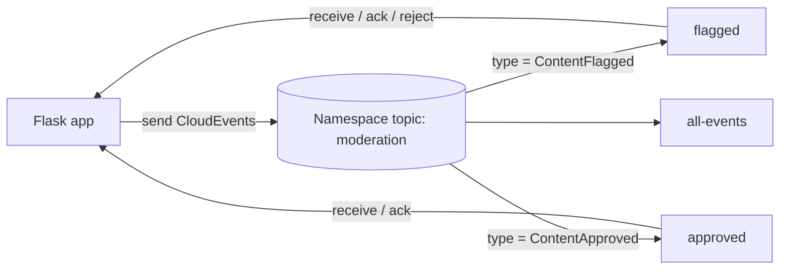

## What this covers

The Microsoft Learn exercise deploys an **Event Grid namespace** with a namespace topic, adds event subscriptions filtered by event type, and runs a Python Flask app that publishes content moderation events and reads them back with **pull delivery**. You see how filtering splits flagged, approved and all events into separate subscriptions, and how acknowledge, release and reject settle each event. Allow about 30 minutes.

**Exam weight:** Connect to and consume Azure services (20–25%)

**Skills measured**

- "Implement event-driven workflows by using Azure Event Grid, including filters, custom events, and retries"

## Key concepts

### What you build

| Resource | Purpose |
| --- | --- |
| Event Grid namespace | Container for namespace topics; endpoint `https://<namespace>.<region>-1.eventgrid.azure.net` |
| Namespace topic `moderation` | Receives CloudEvents from the app |
| Subscription `flagged` | Queue (pull) delivery, filter type `com.contoso.ai.ContentFlagged` |
| Subscription `approved` | Filter type `com.contoso.ai.ContentApproved` |
| Subscription `all-events` | No filter |
| Role assignments | **EventGrid Data Sender** and **EventGrid Data Receiver** for your user |

Prerequisites: an Azure subscription, Visual Studio Code, Python 3.12 or later, and a current Azure CLI.

### Pull delivery settlement

`receive()` returns events with a **lock token**. Within the lock duration you must settle each one:

| Operation | Effect | Like Service Bus... |
| --- | --- | --- |
| `acknowledge` | Done, removed | `complete` |
| `release` | Back to the subscription for redelivery (optionally after a delay) | `abandon` |
| `reject` | Not processable; dead-lettered if a dead-letter destination is set, else dropped | `dead_letter` |

If the lock expires, the event is redelivered. After the subscription's max delivery count it's dead-lettered or dropped. Pull subscriptions also have an event retention period.

## How it works



Unlike push, nothing calls your app. The app connects outbound, so it works behind a firewall with no public endpoint and no validation handshake.

## Hands-on

### Azure portal

1. Search **Event Grid Namespaces** > **+ Create**, pick resource group, name and region.
2. In the namespace, under **Event broker**, select **Topics** > **+ Topic**, name it `moderation`.
3. Open the topic > **Subscriptions** > **+ Subscription**. Keep **Cloud Events v1.0** and **Delivery mode: Queue**.
4. On **Filters**, add event type `com.contoso.ai.ContentFlagged`. On **Additional features**, review retention, max delivery count, lock duration and dead-lettering.
5. Repeat for `approved` and `all-events`.

### Azure CLI

```bash
RG=<resource-group>; NS=<namespace>; LOC=eastus
az group create -n $RG -l $LOC
az eventgrid namespace create -g $RG -n $NS -l $LOC
az eventgrid namespace topic create -g $RG --namespace-name $NS -n moderation

az eventgrid namespace topic event-subscription create -g $RG --namespace-name $NS \
  --topic-name moderation -n flagged \
  --delivery-configuration "{deliveryMode:Queue,queue:{receiveLockDurationInSeconds:60,maxDeliveryCount:5,eventTimeToLive:P1D}}" \
  --filters-configuration "{includedEventTypes:['com.contoso.ai.ContentFlagged']}"

az eventgrid namespace topic event-subscription create -g $RG --namespace-name $NS \
  --topic-name moderation -n all-events \
  --delivery-configuration "{deliveryMode:Queue,queue:{receiveLockDurationInSeconds:60}}"

SCOPE=$(az eventgrid namespace show -g $RG -n $NS --query id -o tsv)
ME=$(az ad signed-in-user show --query id -o tsv)
az role assignment create --assignee $ME --role "EventGrid Data Sender" --scope $SCOPE
az role assignment create --assignee $ME --role "EventGrid Data Receiver" --scope $SCOPE

az eventgrid namespace show -g $RG -n $NS --query "topicsConfiguration.hostname" -o tsv
# Clean up when done
az group delete -n $RG --yes --no-wait
```

Older CLI versions may need `az extension add --name eventgrid` for the namespace commands. Create the `approved` subscription the same way as `flagged`, with its own event type.

### Python

```python
# pip install azure-eventgrid azure-identity
from azure.identity import DefaultAzureCredential
from azure.core.messaging import CloudEvent
from azure.eventgrid import EventGridSenderClient, EventGridReceiverClient

ENDPOINT = "https://<namespace>.<region>-1.eventgrid.azure.net"
cred = DefaultAzureCredential()

def main():
    sender = EventGridSenderClient(ENDPOINT, cred, namespace_topic="moderation")
    sender.send([
        CloudEvent(type="com.contoso.ai.ContentFlagged", source="/moderation",
                   subject="/items/img-7", data={"itemId": "img-7", "confidence": 0.91}),
        CloudEvent(type="com.contoso.ai.ContentApproved", source="/moderation",
                   subject="/items/img-8", data={"itemId": "img-8", "confidence": 0.99}),
    ])

    receiver = EventGridReceiverClient(ENDPOINT, cred, namespace_topic="moderation",
                                       subscription="flagged")
    details = receiver.receive(max_events=10, max_wait_time=10)
    ack, bad = [], []
    for d in details:
        print(d.event.type, d.event.data)
        (ack if d.event.data.get("itemId") else bad).append(d.broker_properties.lock_token)
    if ack:
        receiver.acknowledge(lock_tokens=ack)
    if bad:
        receiver.reject(lock_tokens=bad)

if __name__ == "__main__":
    main()
```

Expected result: `flagged` returns only `img-7`, `approved` only `img-8`, and `all-events` both. Role assignments can take a few minutes to apply.

## Exam traps

| Observation | Cause |
| --- | --- |
| `flagged` returns every event | No event-type filter on the subscription |
| Events come back after a few minutes | Not acknowledged before the lock expired |
| 401/403 when receiving | Missing **EventGrid Data Receiver** role |
| Can't publish Event Grid-schema events | Namespace topics accept CloudEvents only |

> [!WARNING]
> **Exam trap:** Pull delivery is a feature of **namespace topics**. Classic custom topics and system topics only push.

> [!TIP]
> Map pull operations to Service Bus: acknowledge = complete, release = abandon, reject = dead-letter.

## Quick review

- Event Grid namespaces host namespace topics with queue (pull) or push subscriptions.
- Filters on namespace subscriptions are set with `--filters-configuration`.
- Received events carry a lock token used to acknowledge, release or reject.
- Senders need **EventGrid Data Sender**; pull receivers need **EventGrid Data Receiver**.
- Pull delivery needs no public endpoint and no validation handshake.
- Clean up with `az group delete`.

## Practice

[Practice: Event Grid questions](/practice/event-grid)

## Official references

- [Exercise - Publish and receive events with Azure Event Grid (unit)](https://learn.microsoft.com/training/modules/event-driven-workflows-event-grid/6-exercise-publish-receive-events)
- [Pull delivery overview](https://learn.microsoft.com/azure/event-grid/pull-delivery-overview)
- [Quickstart: pull delivery (portal and SDK)](https://learn.microsoft.com/azure/event-grid/event-grid-dotnet-get-started-pull-delivery)
- [Azure Event Grid client library for Python](https://learn.microsoft.com/python/api/overview/azure/eventgrid-readme)
- [az eventgrid namespace](https://learn.microsoft.com/cli/azure/eventgrid/namespace)
