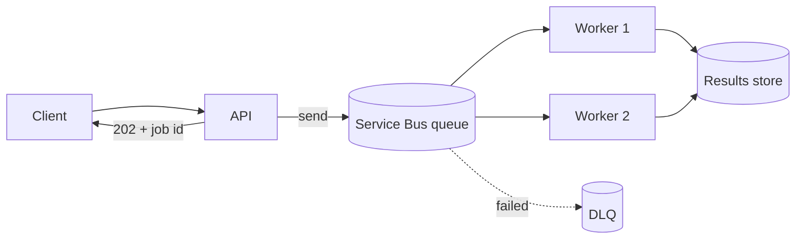

## What this covers

AI inference is slow and unpredictable: one request finishes in two seconds, the next takes thirty. If your API calls the model synchronously, a traffic spike fills every thread and requests start timing out. Azure Service Bus sits between the component that accepts work and the component that does it, so each side runs at its own pace. This page covers the building blocks (namespaces, queues, topics), the messaging patterns that justify them, and how to pick a tier.

**Exam weight:** Connect to and consume Azure services (20–25%)

**Skills measured**

- "Queue and process back-end operations by using Azure Service Bus, including dead-letter queue handling, messages, topics, and subscriptions"

## Key concepts

### Namespace

A namespace is the container and security boundary for all messaging entities. It has one endpoint, `<namespace>.servicebus.windows.net`, and the tier (Basic, Standard, Premium) is set at the namespace level. Clients talk to it over AMQP 1.0 (port 5671, or AMQP over WebSockets on 443).

### Entities

- **Queue**: point-to-point. Each message is delivered to exactly one receiver, even when many receivers compete on the same queue.
- **Topic + subscriptions**: publish-subscribe. A topic copies each message into every subscription whose filter matches; each subscription behaves like its own queue.
- **Dead-letter queue (DLQ)**: a system subqueue that exists automatically under every queue and every subscription.

### Authentication

Two options: shared access signature (SAS) keys and connection strings, or Microsoft Entra ID with Azure RBAC. Prefer Entra ID with a managed identity. The data-plane roles are **Azure Service Bus Data Sender**, **Azure Service Bus Data Receiver** and **Azure Service Bus Data Owner**.

### Messaging patterns for AI back ends

| Pattern | Problem it solves | AI example |
| --- | --- | --- |
| Load leveling | Bursts overwhelm expensive compute | Queue absorbs a spike of 10,000 summarization requests; GPU workers drain it at a steady rate |
| Competing consumers | One worker can't keep up | Five Container Apps replicas read the same queue; each message goes to one replica |
| Temporal decoupling | Consumer is offline during deploys or scale events | API keeps accepting requests while the model service restarts; messages wait durably |
| Publish-subscribe | Several services react to one outcome | "Inference completed" fans out to notification, audit and metrics subscriptions |

### Tiers

| | Basic | Standard | Premium |
| --- | --- | --- | --- |
| Queues | Yes | Yes | Yes |
| Topics/subscriptions | No | Yes | Yes |
| Max message size | 256 KB | 256 KB | 100 MB (AMQP), 1 MB (HTTP) |
| Capacity | Shared | Shared, variable latency | Dedicated messaging units, predictable latency |
| VNet / private endpoints | No | No | Yes |
| Availability zones | No | No | Yes |

Sessions, duplicate detection and transactions need Standard or Premium.

## How it works

The producer enqueues and immediately returns `202 Accepted` to the client. Workers pull at their own rate, write results to a store, and the client polls or gets a callback. Queue depth (the **active message count** metric) is the back-pressure signal: KEDA scalers in Azure Container Apps and the Service Bus trigger in Azure Functions add workers as it grows.



A steadily growing queue means you lack processing capacity; a queue that is always empty may mean you are over-provisioned.

## Hands-on

### Azure portal

1. Search **Service Bus**, select **+ Create**, choose a resource group, a globally unique namespace name, region and **Standard** pricing tier.
2. Open the namespace, select **Queues** > **+ Queue**, name it `embed-jobs`, set **Max delivery count** to `5`, and enable **dead-lettering on message expiration**.
3. Under **Access control (IAM)**, assign **Azure Service Bus Data Sender** to the API's managed identity and **Azure Service Bus Data Receiver** to the worker's identity.
4. Use **Service Bus Explorer** on the queue to send and peek test messages.

### Azure CLI

```bash
# Service Bus namespace and queue
az servicebus namespace create \
  --name <namespace> \
  --resource-group <resource-group> \
  --location eastus \
  --sku Standard

az servicebus queue create \
  --name embed-jobs \
  --namespace-name <namespace> \
  --resource-group <resource-group> \
  --max-delivery-count 5 \
  --enable-dead-lettering-on-message-expiration true

# Grant a managed identity send rights on the namespace
az role assignment create \
  --assignee <principal-id> \
  --role "Azure Service Bus Data Sender" \
  --scope $(az servicebus namespace show -n <namespace> -g <resource-group> --query id -o tsv)
```

### Python

```python
# pip install azure-servicebus azure-identity
import json
from azure.identity import DefaultAzureCredential
from azure.servicebus import ServiceBusClient, ServiceBusMessage

client = ServiceBusClient(
    fully_qualified_namespace="<namespace>.servicebus.windows.net",
    credential=DefaultAzureCredential(),
)

with client, client.get_queue_sender("embed-jobs") as sender:
    sender.send_messages(
        ServiceBusMessage(json.dumps({"documentId": "doc-42", "blobUrl": "https://..."}))
    )
```

Use `ServiceBusClient.from_connection_string(conn_str)` only when you must use SAS (for example, a client outside Azure with no Entra ID identity).

## Exam traps

| Need | Choose |
| --- | --- |
| One worker processes each request | Service Bus queue |
| Several services react to the same message | Service Bus topic + subscriptions |
| Messages over 256 KB without claim-check | Premium tier |
| Private endpoint / VNet isolation | Premium tier |
| Topics at the lowest cost | Standard (Basic has no topics) |
| Cheap, simple queue with no ordering, sessions or DLQ | Azure Queue Storage (not Service Bus) |

> [!WARNING]
> **Exam trap:** The Basic tier has queues only. If a scenario needs topics, subscriptions or sessions, Basic is wrong.

> [!WARNING]
> **Exam trap:** Competing consumers do **not** each get a copy. Only a topic gives every subscription its own copy.

> [!TIP]
> Queue = "one of you does it". Topic = "all of you hear about it".

> [!NOTE]
> Service Bus is a message broker for commands and business transactions. Event Grid is a router for lightweight "something happened" notifications. See [Event Grid concepts](/study/integrate-backend-services-for-ai-solutions/understand-azure-event-grid-concepts-and-event-driven-patterns-for-ai-solutions).

## Quick review

- A namespace is the container; its endpoint is `<namespace>.servicebus.windows.net`.
- Queues give one-to-one delivery; topics give one copy per matching subscription.
- Standard and Basic cap messages at 256 KB; Premium allows up to 100 MB over AMQP.
- Premium adds dedicated capacity, VNet integration, private endpoints and availability zones.
- Prefer Entra ID with managed identity and the Data Sender/Receiver roles over SAS keys.
- Active message count is the scaling and health signal for workers.

## Practice

[Practice: Service Bus questions](/practice/service-bus)

## Official references

- [Queue and process AI operations with Azure Service Bus (module)](https://learn.microsoft.com/training/modules/queue-process-operations-service-bus/)
- [What is Azure Service Bus?](https://learn.microsoft.com/azure/service-bus-messaging/service-bus-messaging-overview)
- [Service Bus Premium and Standard tiers](https://learn.microsoft.com/azure/service-bus-messaging/service-bus-premium-messaging)
- [Authenticate with Microsoft Entra ID](https://learn.microsoft.com/azure/service-bus-messaging/authenticate-application)
- [Azure Service Bus documentation](https://learn.microsoft.com/azure/service-bus-messaging/)
