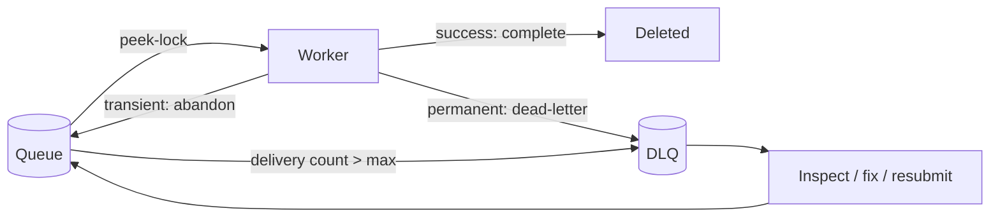

## What this covers

Workers crash, models time out and payloads arrive malformed. Service Bus gives you receive modes, explicit settlement, a dead-letter queue and lock management so that no inference request is silently lost and no poison message blocks the queue forever. This page is the core of the "dead-letter queue handling" wording in the skill.

**Exam weight:** Connect to and consume Azure services (20–25%)

**Skills measured**

- "Queue and process back-end operations by using Azure Service Bus, including dead-letter queue handling, messages, topics, and subscriptions"

## Key concepts

### Receive modes

| Mode | Behavior | Guarantee | Use |
| --- | --- | --- | --- |
| `PEEK_LOCK` (default) | Message locked, stays in queue until settled | At-least-once | Inference requests you can't lose |
| `RECEIVE_AND_DELETE` | Removed on delivery | At-most-once | Telemetry where a lost item is acceptable |

### Settlement in peek-lock

| Call | Effect |
| --- | --- |
| `complete_message()` | Success, message deleted |
| `abandon_message()` | Lock released, immediately redeliverable, `delivery_count` + 1 |
| `dead_letter_message(reason, error_description)` | Moved to DLQ now; use for errors that will never succeed |
| `defer_message()` | Stays in the queue but hidden; fetch later only by `sequence_number` with `receive_deferred_messages()` |

If the lock expires before settlement, the message becomes visible again and its delivery count goes up, so handlers must be idempotent.

### Max delivery count

Each entity has `max_delivery_count` (default **10**). Once a message's delivery count exceeds it, the broker dead-letters it with reason `MaxDeliveryCountExceeded`. Use 3–5 when failures are mostly permanent; higher when the model service flaps.

### The dead-letter queue

- Exists automatically under every queue and subscription; you never create it.
- Paths: `<queue>/$deadletterqueue` and `<topic>/subscriptions/<subscription>/$deadletterqueue`. In Python use `sub_queue=ServiceBusSubQueue.DEAD_LETTER` instead of building the path.
- System reasons include `MaxDeliveryCountExceeded`, `TTLExpiredException` (when dead-lettering on expiration is on) and, for subscriptions, filter evaluation exceptions when enabled.
- Messages carry `dead_letter_reason` and `dead_letter_error_description`.
- DLQ messages never expire and are never auto-cleaned; you must receive and complete them.
- Alert on the **dead-lettered message count** metric in Azure Monitor.

### Lock duration

Default **1 minute**, maximum **5 minutes** per entity. For longer work call `renew_message_lock()` or let `AutoLockRenewer` renew in the background. For work that exceeds even that, use two-phase processing: record the job, complete the message quickly, then run the long task from the tracking store.

## How it works



## Hands-on

### Azure portal

1. On the queue, set **Lock duration** (up to 5 minutes) and **Max delivery count**.
2. Open **Service Bus Explorer**, switch to **Dead-letter**, and peek messages to read `DeadLetterReason` and `DeadLetterErrorDescription`.
3. In **Metrics**, chart **Count of dead-lettered messages in a Queue/Topic** and create an alert rule.

### Azure CLI

```bash
az servicebus queue update -g <resource-group> --namespace-name <namespace> -n inference-requests \
  --lock-duration PT2M --max-delivery-count 5

# Active vs dead-letter counts
az servicebus queue show -g <resource-group> --namespace-name <namespace> -n inference-requests \
  --query "countDetails"
```

### Python

```python
import json
from azure.identity import DefaultAzureCredential
from azure.servicebus import (
    ServiceBusClient, ServiceBusMessage, ServiceBusReceiveMode,
    ServiceBusSubQueue, AutoLockRenewer,
)

NS = "<namespace>.servicebus.windows.net"
client = ServiceBusClient(fully_qualified_namespace=NS, credential=DefaultAzureCredential())

# Worker: peek-lock with explicit settlement and lock renewal
with client:
    renewer = AutoLockRenewer()
    with client.get_queue_receiver("inference-requests",
                                   receive_mode=ServiceBusReceiveMode.PEEK_LOCK,
                                   max_wait_time=30) as receiver:
        for msg in receiver:
            renewer.register(receiver, msg, max_lock_renewal_duration=600)
            try:
                payload = json.loads(str(msg))
                result = run_inference(payload)              # your code
                save_result(result, payload["document_id"])  # your code
                receiver.complete_message(msg)
            except json.JSONDecodeError:
                receiver.dead_letter_message(msg, reason="MalformedPayload",
                                             error_description="Body is not valid JSON")
            except ModelNotFoundError:
                receiver.dead_letter_message(msg, reason="UnsupportedModel",
                                             error_description="Requested model unavailable")
            except TransientServiceError:
                receiver.abandon_message(msg)
    renewer.close()
```

Inspect and resubmit after the root cause is fixed:

```python
with ServiceBusClient(fully_qualified_namespace=NS, credential=DefaultAzureCredential()) as client:
    with client.get_queue_receiver("inference-requests",
                                   sub_queue=ServiceBusSubQueue.DEAD_LETTER,
                                   max_wait_time=10) as dlq, \
         client.get_queue_sender("inference-requests") as sender:
        for msg in dlq:
            print(msg.dead_letter_reason, msg.dead_letter_error_description,
                  msg.correlation_id, msg.delivery_count)
            sender.send_messages(ServiceBusMessage(
                body=b"".join(msg.body),
                content_type=msg.content_type,
                correlation_id=msg.correlation_id,
                application_properties=msg.application_properties,
            ))
            dlq.complete_message(msg)
```

`msg.body` is a generator of byte sections, hence the `b"".join`.

## Exam traps

| Situation | Action |
| --- | --- |
| Malformed JSON or unsupported model | `dead_letter_message` (retries won't help) |
| Model endpoint returns 503 | `abandon_message` (retry) |
| Can't process yet, need it later by ID | `defer_message`, keep the sequence number |
| Inference takes 12 minutes | `AutoLockRenewer` or two-phase processing |
| Messages processed twice | Lock expired before complete: renew lock, make handler idempotent |
| Need to reprocess failures after a fix | Read DLQ, send copies to the main queue, complete DLQ messages |

> [!WARNING]
> **Exam trap:** You can't set lock duration above 5 minutes. "Increase lock duration to 10 minutes" is never the answer; renew the lock.

> [!WARNING]
> **Exam trap:** The DLQ has no TTL. Dead-lettered messages stay (and count toward entity size) until you complete them.

> [!WARNING]
> **Exam trap:** Deferred messages are not returned by normal receives. Lose the sequence number and you lose easy access to the message.

> [!TIP]
> Abandon = "try again". Dead-letter = "never again". Defer = "later, by number".

## Quick review

- Peek-lock is the default and gives at-least-once delivery.
- Default max delivery count is 10, then reason `MaxDeliveryCountExceeded`.
- Lock duration defaults to 1 minute, max 5 minutes.
- Every queue and subscription has a built-in DLQ; reach it with `ServiceBusSubQueue.DEAD_LETTER`.
- DLQ messages persist until explicitly completed.
- Resubmitting means sending a new message to the original entity.

## Practice

[Practice: Service Bus questions](/practice/service-bus)

## Official references

- [Process messages reliably (unit)](https://learn.microsoft.com/training/modules/queue-process-operations-service-bus/5-process-messages-reliably)
- [Message transfers, locks, and settlement](https://learn.microsoft.com/azure/service-bus-messaging/message-transfers-locks-settlement)
- [Dead-letter queues](https://learn.microsoft.com/azure/service-bus-messaging/service-bus-dead-letter-queues)
- [Message deferral](https://learn.microsoft.com/azure/service-bus-messaging/message-deferral)
- [azure-servicebus client library for Python](https://learn.microsoft.com/python/api/overview/azure/servicebus-readme)
