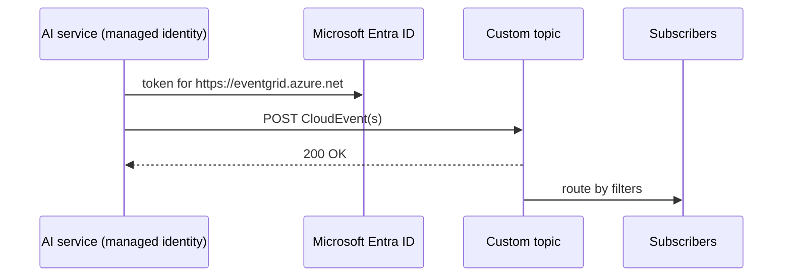

## What this covers

Azure services publish their own events. Your AI application publishes custom ones: "inference completed", "embeddings refreshed", "model retrained". This page shows how to create a custom topic, design the event, authenticate, and publish with the `azure-eventgrid` Python SDK or a plain HTTP POST.

**Exam weight:** Connect to and consume Azure services (20–25%)

**Skills measured**

- "Implement event-driven workflows by using Azure Event Grid, including filters, custom events, and retries"

## Key concepts

### Custom topic

A custom topic is an endpoint such as `https://<topic>.<region>-1.eventgrid.azure.net/api/events`. Create it with `--input-schema cloudeventschemav1_0` so it accepts CloudEvents. For pull delivery or MQTT, publish to a **namespace topic** instead (shown below).

### Authentication options

| Method | How | When |
| --- | --- | --- |
| Access key | `aeg-sas-key: <key>` header, or `AzureKeyCredential` | Quick tests, clients outside Azure |
| SAS token | `aeg-sas-token` header, time-limited token built from the key | Hand a scoped, expiring credential to a client |
| Microsoft Entra ID | Bearer token; `DefaultAzureCredential` | **Recommended**; managed identity with the **EventGrid Data Sender** role on the topic |

You can disable key and SAS auth on the topic (`disableLocalAuth`) to force Entra ID.

### Event design for AI operations

- Include correlation IDs (`requestId`, pipeline run ID).
- Reference results (Blob URL) instead of embedding them; the event is capped at 1 MB.
- Add operational metadata such as `modelVersion` and `processingDurationMs`.
- Add a short summary (`classification`, `confidence`) so subscribers can filter with advanced filters without downloading the result.

### Event patterns

- **Inference completion**: request ID, model, duration, result URL, status. Drives notifications and dashboards.
- **Model update**: version, key metrics, deployment target. Drives cache refreshes and integration tests.
- **Pipeline stage transition**: run ID, stage name, status, input/output references. Drives the next stage and progress monitoring.

Publish at meaningful checkpoints only; internal state changes that no subscriber cares about just add cost.

## How it works



A `200 OK` means Event Grid accepted the event for routing, not that any subscriber processed it. A list of events sent in one call goes in one HTTP request.

## Hands-on

### Azure portal

1. Create the topic under **Event Grid Topics** > **+ Create**; on **Advanced**, choose **Cloud Event Schema v1.0**.
2. Copy the **Topic Endpoint** from **Overview** (and a key from **Access keys** only if you need key auth).
3. In **Access control (IAM)**, assign **EventGrid Data Sender** to the app's managed identity.

### Azure CLI

```bash
az eventgrid topic create --name ai-pipeline-events --resource-group <resource-group> \
  --location eastus --input-schema cloudeventschemav1_0

ENDPOINT=$(az eventgrid topic show --name ai-pipeline-events --resource-group <resource-group> \
  --query "endpoint" --output tsv)
KEY=$(az eventgrid topic key list --name ai-pipeline-events --resource-group <resource-group> \
  --query "key1" --output tsv)

# Passwordless publishing for a managed identity
az role assignment create --assignee <principal-id> --role "EventGrid Data Sender" \
  --scope $(az eventgrid topic show -n ai-pipeline-events -g <resource-group> --query id -o tsv)

# REST publish of one CloudEvent with the access key
curl -X POST "$ENDPOINT" \
  -H "Content-Type: application/cloudevents+json; charset=utf-8" \
  -H "aeg-sas-key: $KEY" \
  -d '{"specversion":"1.0","type":"com.contoso.ai.ModelRetrained","source":"/services/training",
       "id":"evt-20250915-160000-001","subject":"/models/sentiment-v2",
       "datacontenttype":"application/json",
       "data":{"modelVersion":"2.1.0","accuracy":0.94}}'
```

For a batch over REST, send a JSON array with `Content-Type: application/cloudevents-batch+json; charset=utf-8`.

### Python

```python
# pip install azure-eventgrid azure-identity
import os
from azure.identity import DefaultAzureCredential
from azure.core.credentials import AzureKeyCredential
from azure.core.messaging import CloudEvent
from azure.eventgrid import EventGridPublisherClient

endpoint = os.environ["EVENTGRID_TOPIC_ENDPOINT"]

# Production: managed identity with EventGrid Data Sender
client = EventGridPublisherClient(endpoint, DefaultAzureCredential())
# Key-based alternative: EventGridPublisherClient(endpoint, AzureKeyCredential(os.environ["EVENTGRID_TOPIC_KEY"]))

client.send(CloudEvent(
    type="com.contoso.ai.InferenceCompleted",
    source="/services/content-moderation",
    subject="/pipelines/moderation/image-classifier",
    data={
        "requestId": "req-78901",
        "modelName": "content-classifier-v3",
        "modelVersion": "3.2.1",
        "processingDurationMs": 1250,
        "resultLocation": "https://<storage-account>.blob.core.windows.net/output/req-78901.json",
        "status": "completed",
        "summary": {"classification": "safe", "confidence": 0.97},
    },
))

# Batch: one HTTP request for several stage events
client.send([
    CloudEvent(type="com.contoso.ai.StageCompleted", source="/services/embeddings",
               subject="/pipelines/rag/run-42",
               data={"pipelineRunId": "run-42", "stage": "embeddings", "status": "completed"}),
    CloudEvent(type="com.contoso.ai.StageCompleted", source="/services/indexing",
               subject="/pipelines/rag/run-42",
               data={"pipelineRunId": "run-42", "stage": "indexing", "status": "completed"}),
])
```

Publishing to an **Event Grid namespace topic** uses a different client:

```python
from azure.eventgrid import EventGridSenderClient

sender = EventGridSenderClient("https://<namespace>.<region>-1.eventgrid.azure.net",
                               DefaultAzureCredential(), namespace_topic="moderation")
sender.send(CloudEvent(type="com.contoso.ai.ContentFlagged", source="/moderation",
                       data={"itemId": "img-7"}))
```

## Exam traps

| Need | Use |
| --- | --- |
| Passwordless publish from Functions or Container Apps | Managed identity + **EventGrid Data Sender** |
| Publish from a shell script or CI pipeline | REST POST with `aeg-sas-key` or a bearer token |
| Give an external partner a credential that expires | SAS token |
| Publish CloudEvents from Python to a custom topic | `EventGridPublisherClient` + `CloudEvent` |
| Publish to a namespace topic | `EventGridSenderClient` |

> [!WARNING]
> **Exam trap:** Azure **Contributor** on the topic doesn't grant publishing via Entra ID. You need the **EventGrid Data Sender** data-plane role.

> [!WARNING]
> **Exam trap:** `200 OK` from the publish call says nothing about delivery. Delivery failures appear in metrics and in the dead-letter container.

> [!TIP]
> Header names: `aeg-sas-key` for a raw key, `aeg-sas-token` for a SAS token, `Authorization: Bearer` for Entra ID.

## Quick review

- Create custom topics with `--input-schema cloudeventschemav1_0`.
- Endpoint via `az eventgrid topic show --query endpoint`; keys via `az eventgrid topic key list`.
- Prefer `DefaultAzureCredential` + EventGrid Data Sender over keys.
- `client.send([...])` sends a list in one request.
- REST content type for one CloudEvent is `application/cloudevents+json; charset=utf-8`.
- Reference large results by URL; events max out at 1 MB.

## Practice

[Practice: Event Grid questions](/practice/event-grid)

## Official references

- [Publish custom events from AI applications (unit)](https://learn.microsoft.com/training/modules/event-driven-workflows-event-grid/5-publish-custom-events)
- [Azure Event Grid client library for Python](https://learn.microsoft.com/python/api/overview/azure/eventgrid-readme)
- [Authenticate publishing clients with Microsoft Entra ID](https://learn.microsoft.com/azure/event-grid/authenticate-with-microsoft-entra-id)
- [Post to a custom topic](https://learn.microsoft.com/azure/event-grid/post-to-custom-topic)
- [Built-in roles for Event Grid](https://learn.microsoft.com/azure/event-grid/security-authorization)
