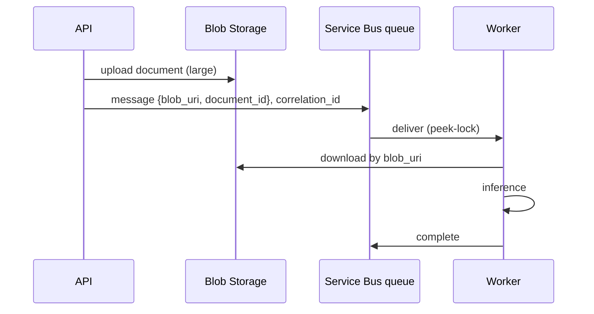

## What this covers

How you shape a Service Bus message decides whether it fits the tier's size limit, whether subscriptions can route it, and whether you can trace a failed inference back to the request that caused it. This page covers message anatomy, JSON payloads, IDs for deduplication and tracing, the claim-check pattern for large payloads, time-to-live and batch sending.

**Exam weight:** Connect to and consume Azure services (20–25%)

**Skills measured**

- "Queue and process back-end operations by using Azure Service Bus, including dead-letter queue handling, messages, topics, and subscriptions"

## Key concepts

### Message anatomy

| Part | Who sets it | Use |
| --- | --- | --- |
| Body | You | The payload: prompt, model parameters, document reference. Opaque bytes to the broker |
| Application properties | You | Custom key-value metadata for routing and filtering (`model_name`, `priority`, `document_type`) |
| System properties | You or the broker | `message_id`, `correlation_id`, `content_type`, `subject`, `time_to_live`, `session_id`, `scheduled_enqueue_time_utc`; broker-set `sequence_number`, `enqueued_time_utc`, `delivery_count` |

### Serialization

JSON is the normal choice for AI payloads. Set `content_type="application/json"` so consumers know how to decode the body.

### message_id and duplicate detection

When **duplicate detection** is enabled on a queue or topic (creation-time setting, Standard/Premium), the broker discards any message whose `message_id` was already seen within the history window (default 10 minutes, configurable up to 7 days). Generate a unique ID per logical request; reuse the same ID only when you deliberately retry the same request.

### correlation_id and tracing

Set `correlation_id` to the request ID the API issued, and carry it into logs, results and the DLQ. For OpenTelemetry, put the W3C `traceparent` in application properties so the consumer span links to the producer span. The Azure SDK's tracing plugin can also add this automatically.

### Claim-check pattern

Standard caps messages at 256 KB; Premium allows up to 100 MB over AMQP. For documents, images or embedding batches, upload the payload to Blob Storage and send only the blob URI plus metadata. Benefits: works on any tier, lowers broker throughput cost, and lets you secure the payload with separate Storage RBAC.

### Time-to-live (TTL)

`time_to_live` sets how long a message can wait. If the message also has an entity default TTL, the shorter one wins. Expired messages are moved to the DLQ only if **dead-lettering on message expiration** is enabled; otherwise they are silently removed.

### Batching

`ServiceBusMessageBatch` sends many messages in one round trip. `add_message()` raises `MessageSizeExceededError` once the batch would exceed the tier's limit.

## How it works



## Hands-on

### Azure portal

1. Create a queue with **Enable duplicate detection** checked and a history window of 10 minutes.
2. Set **Message time to live** to 1 day and enable **dead-lettering on message expiration**.
3. In **Service Bus Explorer**, send a message with **Content Type** `application/json` and a custom property `model_name`.

### Azure CLI

```bash
az servicebus queue create -g <resource-group> --namespace-name <namespace> -n inference-requests \
  --enable-duplicate-detection true \
  --duplicate-detection-history-time-window PT10M \
  --default-message-time-to-live P1D \
  --enable-dead-lettering-on-message-expiration true
```

### Python

```python
import json, uuid
from datetime import timedelta
from azure.identity import DefaultAzureCredential
from azure.servicebus import ServiceBusClient, ServiceBusMessage
from azure.servicebus.exceptions import MessageSizeExceededError
from azure.storage.blob import BlobServiceClient

credential = DefaultAzureCredential()

# 1. JSON payload with routing properties and tracking IDs
request_payload = {
    "prompt": "Extract the contract parties and effective date.",
    "model": "gpt-4o", "temperature": 0.1, "max_tokens": 2000,
    "document_id": "doc-2025-0142",
}
message = ServiceBusMessage(
    body=json.dumps(request_payload),
    content_type="application/json",
    message_id=str(uuid.uuid4()),
    correlation_id="req-abc-12345",
    time_to_live=timedelta(minutes=5),  # real-time request: stale after 5 minutes
    application_properties={"model_name": "gpt-4o", "priority": "standard",
                            "document_type": "contract"},
)

# 2. Claim-check: store the large payload, send a reference
blob = BlobServiceClient("https://<storage-account>.blob.core.windows.net", credential=credential)
blob.get_blob_client("documents", "doc-2025-0142.pdf").upload_blob(b"<large bytes>", overwrite=True)
claim_check = ServiceBusMessage(
    json.dumps({"blob_uri": "https://<storage-account>.blob.core.windows.net/documents/doc-2025-0142.pdf",
                "document_id": "doc-2025-0142", "operation": "extract"}),
    content_type="application/json",
    correlation_id="req-abc-12345",
    application_properties={"pattern": "claim-check"},
)

# 3. Batch send with overflow handling
with ServiceBusClient("<namespace>.servicebus.windows.net", credential) as client:
    with client.get_queue_sender("inference-requests") as sender:
        sender.send_messages([message, claim_check])
        batch = sender.create_message_batch()
        for page in range(500):
            msg = ServiceBusMessage(json.dumps({"page": page}), content_type="application/json")
            try:
                batch.add_message(msg)
            except MessageSizeExceededError:
                sender.send_messages(batch)
                batch = sender.create_message_batch()
                batch.add_message(msg)
        if len(batch) > 0:
            sender.send_messages(batch)
```

Batch processing jobs can use a long TTL such as `timedelta(hours=24)` or rely on the queue default.

## Exam traps

| Need | Use |
| --- | --- |
| Payload above 256 KB on Standard | Claim-check (Blob URI in the message) |
| Drop accidental resubmits | Duplicate detection + stable `message_id` |
| Trace one request across stages | `correlation_id` (+ `traceparent`) |
| Route by model in a subscription | Application property, not a body field |
| Delay processing until a time | `scheduled_enqueue_time_utc` / `schedule_messages()` |
| Stale real-time request should not be processed | Short per-message `time_to_live` |

> [!WARNING]
> **Exam trap:** Expired messages reach the DLQ only when dead-lettering on expiration is enabled. By default they just disappear.

> [!WARNING]
> **Exam trap:** Using the same hard-coded `message_id` on every send with duplicate detection on silently drops every message after the first in the window.

> [!TIP]
> "Body is for the worker, properties are for the broker."

## Quick review

- Message = body + application properties + system properties.
- Duplicate detection keys on `message_id` within a history window (default 10 minutes).
- `correlation_id` links a request across API, worker, DLQ and results.
- Claim-check keeps messages small and works on every tier.
- The shorter of message TTL and entity default TTL applies.
- `MessageSizeExceededError` signals a full batch: send it and start a new one.

## Practice

[Practice: Service Bus questions](/practice/service-bus)

## Official references

- [Structure messages for AI workloads (unit)](https://learn.microsoft.com/training/modules/queue-process-operations-service-bus/4-structure-messages-ai-workloads)
- [Messages, payloads, and serialization](https://learn.microsoft.com/azure/service-bus-messaging/service-bus-messages-payloads)
- [Duplicate detection](https://learn.microsoft.com/azure/service-bus-messaging/duplicate-detection)
- [Message expiration (time to live)](https://learn.microsoft.com/azure/service-bus-messaging/message-expiration)
- [Claim-Check pattern](https://learn.microsoft.com/azure/architecture/patterns/claim-check)
