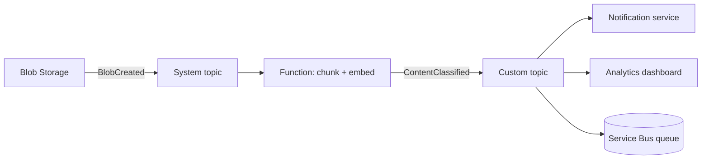

## What this covers

Polling wastes compute and adds latency. Azure Event Grid flips that around: when something changes (a blob lands, an inference completes), Event Grid pushes a small notification to whoever subscribed. This page introduces the Event Grid building blocks, the topic types, push vs pull delivery, and the event-driven patterns that show up in AI pipelines. It also draws the line between Event Grid and Service Bus, a favourite exam comparison.

**Exam weight:** Connect to and consume Azure services (20–25%)

**Skills measured**

- "Implement event-driven workflows by using Azure Event Grid, including filters, custom events, and retries"

## Key concepts

### The five components

| Component | What it is |
| --- | --- |
| **Event** | A small record that says something happened (who, what, when) plus a compact `data` payload. Max 1 MB per event; it references the resource rather than carrying it |
| **Event source** | The emitter: an Azure service (Blob Storage, Key Vault, Container Registry) or your code |
| **Topic** | The endpoint sources publish to |
| **Event subscription** | Which events from a topic to take (filters) and where to send them, plus retry and dead-letter settings |
| **Event handler** | The destination: Azure Functions, webhook, Service Bus queue or topic, Storage queue, Event Hubs |

### Topic types

| Type | Who publishes | Created by | Notes |
| --- | --- | --- | --- |
| **System topic** | An Azure service only | Automatically when you subscribe to that resource's events (or explicitly) | You can't post to it; schema defined by the service, e.g. `Microsoft.Storage.BlobCreated` |
| **Custom topic** | Your application | You, before publishing | You choose the input schema (CloudEvents recommended) |
| **Namespace topic** | Your application or MQTT clients | Inside an **Event Grid namespace** | Supports **pull** delivery (and push to Event Hubs/webhooks); CloudEvents only |

Domains (a management container for thousands of related custom topics, one per tenant) also exist for multitenant publishers.

### Push vs pull delivery

- **Push**: Event Grid POSTs to the handler and retries on failure. Used by system, custom and namespace topics.
- **Pull**: the consumer connects to a namespace topic subscription and receives events when ready, then acknowledges, releases or rejects them by lock token. Good when the consumer can't expose a public endpoint or needs to control its own rate.

### Delivery guarantees

At-least-once delivery, no ordering guarantee, retries with exponential backoff for up to 24 hours by default. Handlers must be idempotent (dedupe on event `id`). Details are on [Configure delivery and retry policies](/study/integrate-backend-services-for-ai-solutions/configure-delivery-and-retry-policies-for-reliable-event-processing).

### Event-driven patterns for AI

- **Reactive data processing**: subscribe to `Microsoft.Storage.BlobCreated` to start chunking and embedding as soon as a document is uploaded. No polling loop.
- **Pipeline stage coordination**: each stage publishes a custom event (`com.contoso.ai.EmbeddingsRefreshed`) that triggers the next. Stages scale and deploy independently.
- **Model lifecycle**: `ModelRetrained` or `ModelPromoted` events tell serving endpoints to refresh caches and run smoke tests.

## How it works



A content moderation platform shows both topic types: the upload raises a system event, the classifier publishes a custom event, and each downstream service has its own subscription with its own filter. A failing subscriber doesn't block the others.

## Hands-on

### Azure portal

1. Open a storage account, select **Events** > **+ Event Subscription**. The portal creates the system topic for you.
2. Choose **Event Schema: Cloud Event Schema v1.0**, filter to **Blob Created**, and pick **Azure Function** as the endpoint type.
3. Search **Event Grid Topics** > **+ Create** to create a custom topic; on **Advanced**, set the input schema to **Cloud Event Schema v1.0**.

### Azure CLI

```bash
# Event Grid topic (custom)
az eventgrid topic create \
  --name <topic-name> \
  --resource-group <resource-group> \
  --location eastus \
  --input-schema cloudeventschemav1_0

# System-topic subscription: new blobs -> Azure Function
STORAGE_ID=$(az storage account show -n <storage-account> -g <resource-group> --query id -o tsv)
az eventgrid event-subscription create \
  --name blob-to-embed \
  --source-resource-id $STORAGE_ID \
  --endpoint-type azurefunction \
  --endpoint <function-resource-id> \
  --included-event-types Microsoft.Storage.BlobCreated \
  --subject-begins-with /blobServices/default/containers/documents/
```

### Python

An Azure Function that handles the push delivery (Python v2 model). The Event Grid trigger handles the endpoint validation handshake for you.

```python
import azure.functions as func
import logging

app = func.FunctionApp()

@app.event_grid_trigger(arg_name="event")
def on_blob_created(event: func.EventGridEvent):
    data = event.get_json()
    logging.info("Event %s type=%s subject=%s url=%s",
                 event.id, event.event_type, event.subject, data.get("url"))
    # Download the blob by URL, chunk, embed, upsert into the vector store
```

## Exam traps

| Requirement | Choose |
| --- | --- |
| React to a state change in near real time, fan out to many handlers | Event Grid |
| Ordered, transactional processing of commands; consumer pulls at its own pace | Service Bus |
| High-volume telemetry stream with replay | Event Hubs |
| React to Azure resource events (blob created, secret near expiry) | Event Grid system topic |
| Publish your own app events | Custom topic (or namespace topic) |
| Consumer behind a firewall, no public endpoint | Namespace topic with pull delivery |

> [!WARNING]
> **Exam trap:** You can't publish to a system topic. If the scenario says "your app emits InferenceCompleted", the answer is a custom or namespace topic.

> [!WARNING]
> **Exam trap:** Event Grid doesn't guarantee order. If order matters, route events into a Service Bus queue with sessions.

> [!TIP]
> Event Grid = "something happened" (discrete, lightweight). Service Bus = "please do this" (a command or business message that must not be lost).

> [!NOTE]
> Event Grid charges per operation (published events, delivery attempts), so you pay for what flows rather than for idle capacity.

## Quick review

- Event, source, topic, event subscription, handler: know each role.
- System topics are Azure-emitted and read-only for publishers; custom topics are yours.
- Namespace topics add pull delivery and MQTT.
- Delivery is at-least-once and unordered; dedupe on `id`.
- Max event size is 1 MB; send references, not payloads.
- `Microsoft.Storage.BlobCreated` + Functions is the classic ingest trigger.

## Practice

[Practice: Event Grid questions](/practice/event-grid)

## Official references

- [Understand Azure Event Grid concepts and event-driven patterns (unit)](https://learn.microsoft.com/training/modules/event-driven-workflows-event-grid/2-understand-event-grid-concepts)
- [What is Azure Event Grid?](https://learn.microsoft.com/azure/event-grid/overview)
- [System topics](https://learn.microsoft.com/azure/event-grid/system-topics)
- [Custom topics](https://learn.microsoft.com/azure/event-grid/custom-topics)
- [Pull delivery overview](https://learn.microsoft.com/azure/event-grid/pull-delivery-overview)
- [Compare Azure messaging services](https://learn.microsoft.com/azure/service-bus-messaging/compare-messaging-services)
