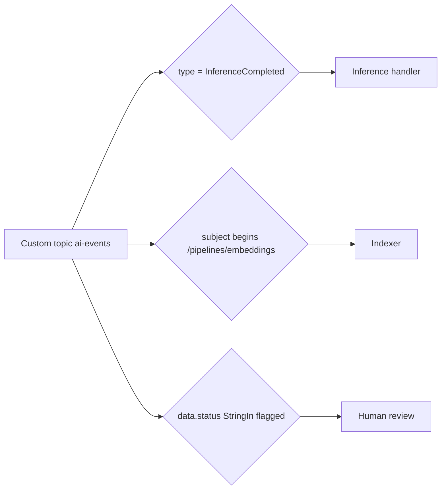

## What this covers

Event shape drives routing. The attributes you set (`type`, `subject`, `data` fields) are exactly what event subscriptions filter on. This page compares the two schemas Event Grid supports, shows how to design custom event types for AI pipelines, and walks through the three filter layers: event type, subject, and advanced filters on data.

**Exam weight:** Connect to and consume Azure services (20–25%)

**Skills measured**

- "Implement event-driven workflows by using Azure Event Grid, including filters, custom events, and retries"

## Key concepts

### Event Grid schema vs CloudEvents v1.0

| | Event Grid schema | CloudEvents v1.0 |
| --- | --- | --- |
| Owner | Microsoft, proprietary | CNCF open standard |
| Recommended for new work | No (kept for compatibility) | **Yes** |
| Key fields | `id`, `topic`, `subject`, `eventType`, `eventTime`, `data`, `dataVersion`, `metadataVersion` | `specversion`, `type`, `source`, `id`, `time`, `subject`, `datacontenttype`, `data` |
| Extension attributes | No | Yes |
| Namespace topics | Not supported | Required |

Conversion: a topic using the Event Grid schema can deliver CloudEvents to a subscriber (`--event-delivery-schema cloudeventschemav1_0`). The reverse, CloudEvents in and Event Grid schema out, is **not supported**, because extension attributes can't be represented.

### CloudEvents attributes

- Required: `specversion` (always `"1.0"`), `type`, `source`, `id`.
- Optional: `subject`, `time` (UTC), `datacontenttype`, `data`.
- `source` + `id` must be unique per event; subscribers dedupe on them.

```json
{
  "specversion": "1.0",
  "type": "com.contoso.ai.InferenceCompleted",
  "source": "/services/content-moderation",
  "id": "a1b2c3d4-e5f6-7890-abcd-ef1234567890",
  "time": "2025-09-15T14:30:00Z",
  "subject": "/pipelines/moderation/batch-42",
  "datacontenttype": "application/json",
  "data": {
    "modelName": "content-classifier-v3",
    "requestId": "req-78901",
    "resultLocation": "https://<storage-account>.blob.core.windows.net/results/batch-42.json",
    "status": "success",
    "confidence": 0.97
  }
}
```

### Designing custom event types

Use reverse-DNS names that describe a completed state change: `com.contoso.ai.InferenceCompleted`, `EmbeddingsRefreshed`, `BatchProcessingStarted`, `AnomalyDetected`, `ModelRetrained`, `ContentClassified`. Keep `data` small: identifiers, a status, a short summary and a URL to the full result.

Make `subject` a path (`/pipelines/embeddings/batch-42`, `/models/classification/v3`) so subscribers can filter by prefix or suffix.

### Filter layers on an event subscription

All configured filters must match (AND).

1. **Event type**: `--included-event-types` with one or more types. Default is all types.
2. **Subject**: `--subject-begins-with` and `--subject-ends-with` (case-insensitive by default; `--subject-case-sensitive` to change). Typical use: container path prefix and `.pdf` suffix for blob events.
3. **Advanced filters**: operators on `data.*` fields or envelope attributes. Operators include `NumberGreaterThan`, `NumberLessThan`, `NumberIn`, `NumberInRange`, `StringContains`, `StringBeginsWith`, `StringEndsWith`, `StringIn`, `StringNotIn`, `BoolEquals`, `IsNullOrUndefined`, `IsNotNull`. Up to **25 advanced filters** per subscription (25 filter values across them). Different filters combine with AND; multiple values in one filter combine with OR.

## How it works



Event Grid evaluates each subscription's filters independently; one event can match several subscriptions and is delivered to each.

## Hands-on

### Azure portal

1. Open the custom topic > **+ Event Subscription**, choose the **Cloud Event Schema v1.0** delivery schema.
2. On **Filters**, clear **Subscribe to all event types** and type `com.contoso.ai.InferenceCompleted`.
3. Check **Enable subject filtering** and set **Subject begins with** `/pipelines/embeddings`.
4. Under **Advanced filters**, add key `data.confidence`, operator **Number is greater than**, value `0.9`.

### Azure CLI

```bash
az eventgrid topic create -n ai-events -g <resource-group> -l eastus \
  --input-schema cloudeventschemav1_0
TOPIC_ID=$(az eventgrid topic show -n ai-events -g <resource-group> --query id -o tsv)

# Type filter
az eventgrid event-subscription create --name inference-handler-sub \
  --source-resource-id $TOPIC_ID \
  --endpoint https://<app>.azurewebsites.net/api/events \
  --included-event-types com.contoso.ai.InferenceCompleted com.contoso.ai.AnomalyDetected

# Subject filter
az eventgrid event-subscription create --name embeddings-sub \
  --source-resource-id $TOPIC_ID \
  --endpoint https://<app>.azurewebsites.net/api/events \
  --subject-begins-with /pipelines/embeddings

# Advanced filters (repeat --advanced-filter for AND)
az eventgrid event-subscription create --name flagged-content-sub \
  --source-resource-id $TOPIC_ID \
  --endpoint https://<review-app>.azurewebsites.net/api/events \
  --advanced-filter data.status StringIn flagged \
  --advanced-filter data.confidence NumberGreaterThan 0.9
```

The webhook endpoint must complete the validation handshake before the subscription is created (Functions triggers do it for you).

### Python

```python
from azure.core.messaging import CloudEvent

# Build an event whose type, subject and data fields line up with the filters above
event = CloudEvent(
    type="com.contoso.ai.ContentClassified",
    source="/services/content-moderation",
    subject="/pipelines/moderation/image-classifier",
    data={"requestId": "req-78901", "status": "flagged", "confidence": 0.95},
)
print(event.id, event.specversion)  # id is a generated UUID, specversion "1.0"
```

Publishing it is covered in [Publish custom events](/study/integrate-backend-services-for-ai-solutions/publish-custom-events-from-ai-applications).

## Exam traps

| Goal | Filter |
| --- | --- |
| Only one or two event types | `--included-event-types` |
| Only PDFs in container `documents` | `--subject-begins-with /blobServices/default/containers/documents/` + `--subject-ends-with .pdf` |
| Route by confidence score | Advanced filter `data.confidence NumberGreaterThan 0.9` |
| Route by one of several model names | Advanced filter `data.modelName StringIn a b c` (OR within values) |
| Deliver CloudEvents from an Event Grid-schema topic | `--event-delivery-schema cloudeventschemav1_0` |

> [!WARNING]
> **Exam trap:** CloudEvents-in, Event Grid schema-out is not supported. Only the other direction converts.

> [!WARNING]
> **Exam trap:** The input schema is fixed when the custom topic is created. Publishing Event Grid-schema events to a CloudEvents topic fails with 400.

> [!TIP]
> Filter order of cost: type, then subject, then advanced. Use the simplest filter that does the job.

## Quick review

- CloudEvents v1.0 is the recommended schema; required attributes are `specversion`, `type`, `source`, `id`.
- Name custom types in reverse-DNS form.
- Make `subject` a hierarchical path to enable prefix and suffix filters.
- Advanced filters: up to 25 per subscription; AND across filters, OR within values.
- Event Grid-schema to CloudEvents conversion works; the reverse doesn't.
- Keep `data` small with a reference URL.

## Practice

[Practice: Event Grid questions](/practice/event-grid)

## Official references

- [Work with event schemas and properties (unit)](https://learn.microsoft.com/training/modules/event-driven-workflows-event-grid/3-event-schemas-properties)
- [CloudEvents v1.0 schema with Event Grid](https://learn.microsoft.com/azure/event-grid/cloud-event-schema)
- [Event Grid event schema](https://learn.microsoft.com/azure/event-grid/event-schema)
- [Understand event filtering](https://learn.microsoft.com/azure/event-grid/event-filtering)
- [az eventgrid event-subscription](https://learn.microsoft.com/cli/azure/eventgrid/event-subscription)
