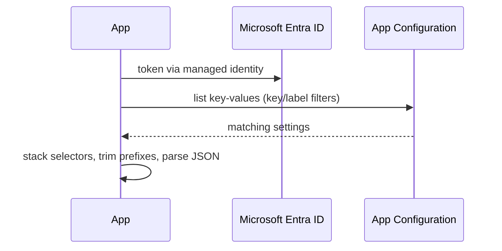

## What this covers

Azure App Configuration is a managed key-value store for settings such as model endpoints, batch sizes and retry policies. Keeping them out of the code means you can change them without a rebuild or redeploy. This page covers the data model, the tiers, connecting from Python with `azure-appconfiguration-provider` and managed identity, and filtering which keys load.

**Exam weight:** Secure, monitor, and troubleshoot Azure solutions (20–25%)

**Skills measured**

- "Store and retrieve app configuration information by using Azure App Configuration"

## Key concepts

### The data model

| Property | Notes |
| --- | --- |
| **Key** | Case-sensitive Unicode string. Use `:` or `/` for hierarchy, such as `OpenAI:Endpoint`. No enforced schema. |
| **Value** | Unicode string. Key + value together must be ≤ **10 KB**. |
| **Label** | Optional variant of the same key (environment, region, version). No label = the **null label**, the default. |
| **Content type** | Tells the provider how to read the value: `application/json` is parsed into a Python object; the Key Vault reference type is resolved from Key Vault. |
| **Tags** | Optional metadata for filtering. |

Every change is kept in **revision history** (7 days on Free, 30 days on Standard), so you can restore a key to an earlier point in time.

### Tiers

App Configuration has **Free**, **Developer**, **Standard** and **Premium** tiers. Free is for trials: small storage (10 MB), a daily request cap and no SLA. Standard and Premium add an SLA, geo-replication, private endpoints, larger storage and longer history. Use Standard or higher in production.

### Two ways to read settings

- **`azure-appconfiguration-provider`**: the high-level library. `load()` pulls a filtered set of settings once and returns a dictionary-like `AzureAppConfigurationProvider`. It handles label stacking, JSON parsing, Key Vault references, feature flags, refresh, startup retries and replica failover. Use this in apps.
- **`azure-appconfiguration`**: the low-level `AzureAppConfigurationClient` for CRUD on single settings (`get_configuration_setting`, `set_configuration_setting`, `list_configuration_settings`). Use it for tooling and admin scripts.

### Authentication and roles

- Endpoint format: `https://<store-name>.azconfig.io`.
- Prefer `DefaultAzureCredential` with managed identity over connection strings. A connection string holds an access key that grants access to the whole store and must be rotated.
- **App Configuration Data Reader**: read key-values, feature flags and Key Vault references. Give this to apps.
- **App Configuration Data Owner**: read and write. Give this to operators and CI/CD.
- You can disable access keys on the store (`--disable-local-auth`) to force Microsoft Entra ID.

### Loading and filtering

- By default `load()` loads **all keys with the null label**.
- `selects=[SettingSelector(key_filter="Pipeline:*", label_filter="Production")]` narrows the load. `*` is the wildcard; `"\0"` means the null label. `tag_filters` is also supported.
- With several selectors, they load in order and the **last one wins** for duplicate keys.
- `trim_prefixes=["DocPipeline:"]` lets the app read `DocPipeline:OpenAI:Endpoint` as `OpenAI:Endpoint`.
- `startup_timeout` (default 100 s) controls how long `load()` retries before failing.
- A sync `load` lives in `azure.appconfiguration.provider`; an async one lives in `azure.appconfiguration.provider.aio` and needs the async credential.

Refreshing settings without a restart is covered in [Refresh configuration dynamically and use snapshots](/study/manage-application-secrets-and-configuration-for-ai-solutions/refresh-configuration-dynamically-and-use-snapshots).

## How it works



`load()` makes one batch of list calls instead of one call per key, so start-up is fast and the store sees little traffic.

## Hands-on

### Azure portal

1. Create an **App Configuration** store on the **Standard** tier.
2. Under **Access settings**, note the **Endpoint**. Optionally turn off access keys.
3. **Access control (IAM)** → assign **App Configuration Data Reader** to the app's managed identity and **Data Owner** to yourself.
4. **Configuration explorer** → **Create** → **Key-value**: add `OpenAI:Endpoint`, `Pipeline:BatchSize` with label `Production`.

### Azure CLI

```bash
az appconfig create --name <store-name> --resource-group <resource-group> \
  --location eastus --sku Standard

az role assignment create --assignee <principal-id> \
  --role "App Configuration Data Reader" \
  --scope $(az appconfig show --name <store-name> --query id -o tsv)

az appconfig kv set --name <store-name> --key "OpenAI:Endpoint" \
  --value "https://<resource>.openai.azure.com/" --auth-mode login --yes
az appconfig kv set --name <store-name> --key "Pipeline:BatchSize" \
  --value 200 --label Production --auth-mode login --yes

az appconfig kv list --name <store-name> --key "Pipeline:*" \
  --label Production --auth-mode login
az appconfig show --name <store-name> --query endpoint -o tsv
```

### Python

```python
import os
from azure.appconfiguration.provider import load, SettingSelector
from azure.identity import DefaultAzureCredential

# pip install azure-appconfiguration-provider azure-identity
endpoint = os.environ["AZURE_APPCONFIG_ENDPOINT"]  # https://<store>.azconfig.io
credential = DefaultAzureCredential()

# Default: every key with the null label
config = load(endpoint=endpoint, credential=credential)
model_endpoint = config["OpenAI:Endpoint"]

# Only pipeline keys for Production
config = load(
    endpoint=endpoint,
    credential=credential,
    selects=[SettingSelector(key_filter="Pipeline:*", label_filter="Production")],
)
batch_size = int(config["Pipeline:BatchSize"])

# Shared store: strip this app's prefix
config = load(endpoint=endpoint, credential=credential,
              trim_prefixes=["DocPipeline:"])
print(config.get("OpenAI:Endpoint", "not set"), "OpenAI:Endpoint" in config)
```

## Exam traps

| Requirement | Choose |
| --- | --- |
| App reads settings, no secrets in config | Managed identity + App Configuration Data Reader |
| Pipeline writes settings | App Configuration Data Owner |
| Load only one component's keys | `SettingSelector(key_filter="Prefix:*")` |
| Shorter key names in a shared store | `trim_prefixes` |
| Structured value as an object | Content type `application/json` |
| Admin script editing one key | `AzureAppConfigurationClient` (`azure-appconfiguration`) |

> [!WARNING]
> **Exam trap:** With no selectors, `load()` returns only **null-label** keys. If every key has a `Production` label, the app gets an empty config and a `KeyError`.

> [!WARNING]
> **Exam trap:** Contributor or Owner on the store manages the resource but doesn't grant data access under Entra ID auth. Apps need App Configuration Data Reader.

> [!TIP]
> Endpoints: Key Vault is `vault.azure.net`, App Configuration is `azconfig.io`.

> [!NOTE]
> Keys are case-sensitive: `Pipeline:BatchSize` and `pipeline:batchsize` are two different settings.

## Quick review

- A setting is key + value + optional label, content type and tags; key + value ≤ 10 KB.
- The null label is the default; `load()` loads only null-label keys unless told otherwise.
- `azure-appconfiguration-provider` `load()` returns a dictionary-like object.
- Apps get App Configuration Data Reader; writers get Data Owner.
- `SettingSelector` filters by key, label or tags; the last selector wins.
- `trim_prefixes` removes a shared prefix from key names.
- Prefer Entra ID over connection strings; access keys can be disabled.

## Practice

[Practice: Azure App Configuration questions](/practice/app-configuration)

## Official references

- [Manage application settings with Azure App Configuration (module)](https://learn.microsoft.com/training/modules/manage-app-settings-app-config/)
- [Connect to App Configuration from application code (unit)](https://learn.microsoft.com/training/modules/manage-app-settings-app-config/2-connect-app-configuration)
- [Python configuration provider reference](https://learn.microsoft.com/azure/azure-app-configuration/reference-python-provider)
- [Keys and values](https://learn.microsoft.com/azure/azure-app-configuration/concept-key-value)
- [Authorize access with Microsoft Entra ID](https://learn.microsoft.com/azure/azure-app-configuration/concept-enable-rbac)
