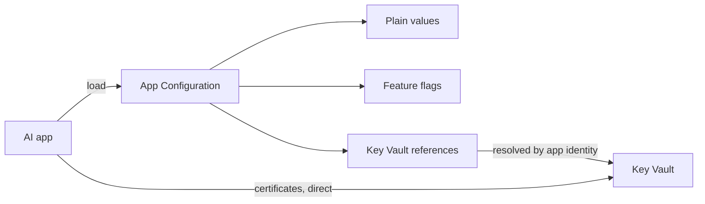

## What this covers

Both services hold values that steer an application, but they're built for different data. Exam scenarios often describe a setting and ask where it should live. This page gives the decision test, compares the two services side by side and shows the recommended combined architecture.

**Exam weight:** Secure, monitor, and troubleshoot Azure solutions (20–25%)

**Skills measured**

- "Store and retrieve app configuration information by using Azure App Configuration"
- "Secure secrets by using Azure Key Vault, including rotation and retrieval"

## Key concepts

### The one-question test

**Could this value, on its own, let someone reach a resource or do something they shouldn't?**

- **Yes** → Key Vault (as a secret, key or certificate).
- **No** → App Configuration (as a key-value or feature flag).

| App Configuration (non-sensitive) | Key Vault (sensitive) |
| --- | --- |
| Model endpoint URLs (`https://my-openai.openai.azure.com/`) | Azure OpenAI API keys |
| Deployment names (`gpt-4o`, `text-embedding-3-large`) | Connection strings with embedded keys or passwords |
| Embedding dimensions (`1536`, `3072`) | Storage account access keys |
| Batch sizes, retry counts, timeouts | Third-party tokens and API keys |
| Feature flags | TLS certificates and private keys |
| Log levels, diagnostic settings | Encryption keys for data at rest |
| Queue, container and database names | Passwords and service principal secrets |

### What each service is designed for

| Capability | App Configuration | Key Vault |
| --- | --- | --- |
| Labels for environments | Yes | No (use separate vaults) |
| Feature flags | Yes | No |
| Snapshots and point-in-time restore | Yes | Versions per secret |
| Dynamic refresh in the provider | Yes | Via your own cache or `secret_refresh_interval` |
| HSM-backed protection | No | Premium tier and Managed HSM |
| Expiry dates and near-expiry events | No | Yes |
| Key rotation policies | No | Yes (keys) |
| Soft delete and purge protection | Yes (Standard and above) | Yes, always on |
| Access granularity | Store-level roles | Vault or individual object; per-access audit logs |
| Throughput | Higher; built for frequent reads | Stricter throttling (per vault per 10 s) |
| Value size | Key + value ≤ 10 KB | Secret ≤ 25 KB |

### Rotation and audit

If a value has to rotate on a schedule, expire, and leave a record of who read it, it belongs in Key Vault. Key Vault diagnostic logs (`AuditEvent`) record every secret read with the caller identity. Changing a batch size or switching a deployment name is an operational change, not a security event, so App Configuration's labels, revision history and refresh fit better.

### The complementary pattern

Use **App Configuration as the single entry point** and **Key Vault as the secure back end**:

- Plain settings and feature flags live in App Configuration.
- Secrets live in Key Vault and appear in App Configuration as **Key Vault references**.
- The app calls `load()` once and gets one dictionary.
- Certificates used for TLS are usually read straight from Key Vault (or bound by the hosting platform), not through App Configuration.

| Setting type | Where | Example |
| --- | --- | --- |
| Non-sensitive configuration | App Configuration value | `OpenAI:Endpoint`, `Pipeline:BatchSize` |
| Feature toggles | App Configuration feature flag | `UseNewEmbeddingsModel`, `EnableBatchProcessing` |
| API keys and tokens | Key Vault via App Configuration reference | `OpenAI:ApiKey`, `ThirdParty:ServiceToken` |
| Connection strings with credentials | Key Vault via App Configuration reference | `CosmosDB:ConnectionString`, `Storage:AccountKey` |
| Certificates | Key Vault, direct | TLS certificates for HTTPS endpoints |

### Better still: no secret at all

Where the target service supports Microsoft Entra ID (Azure OpenAI, Cosmos DB, Storage, Service Bus, App Configuration itself), give the app's managed identity a data role and drop the key entirely. Key Vault is for the credentials you can't eliminate.

## How it works



## Hands-on

### Azure portal

1. In App Configuration, create `OpenAI:Endpoint` and `Pipeline:BatchSize` as plain key-values.
2. Create a feature flag `EnableBatchProcessing`.
3. In Key Vault, store `openai-api-key`; back in App Configuration create a **Key Vault reference** `OpenAI:ApiKey` pointing to it.
4. In the vault's **Diagnostic settings**, send **AuditEvent** logs to a Log Analytics workspace so secret reads are audited.

### Azure CLI

```bash
az appconfig kv set --name <store-name> --key "OpenAI:Endpoint" \
  --value "https://<resource>.openai.azure.com/" --yes
az appconfig feature set --name <store-name> --feature EnableBatchProcessing --yes

az keyvault secret set --vault-name <vault-name> --name openai-api-key --value "<api-key>"
az appconfig kv set-keyvault --name <store-name> --key "OpenAI:ApiKey" \
  --secret-identifier "https://<vault-name>.vault.azure.net/secrets/openai-api-key" --yes

az monitor diagnostic-settings create --name kv-audit \
  --resource $(az keyvault show --name <vault-name> --query id -o tsv) \
  --workspace <log-analytics-workspace-id> \
  --logs '[{"category":"AuditEvent","enabled":true}]'
```

### Python

```python
import os
from azure.appconfiguration.provider import load
from azure.identity import DefaultAzureCredential
from featuremanagement import FeatureManager

credential = DefaultAzureCredential()
config = load(
    endpoint=os.environ["AZURE_APPCONFIG_ENDPOINT"],
    credential=credential,
    keyvault_credential=credential,
    feature_flag_enabled=True,
)

settings = {
    "endpoint": config["OpenAI:Endpoint"],         # App Configuration value
    "api_key": config["OpenAI:ApiKey"],            # Key Vault via reference
    "batch_size": int(config["Pipeline:BatchSize"]),
}
batching_on = FeatureManager(config).is_enabled("EnableBatchProcessing")
```

## Exam traps

| Scenario | Correct placement |
| --- | --- |
| Model deployment name changes after validation | App Configuration |
| Cosmos DB connection string with account key | Key Vault, referenced from App Configuration |
| Per-environment retry counts | App Configuration with labels |
| Credential needing 90-day rotation and audit | Key Vault |
| TLS certificate for an HTTPS endpoint | Key Vault |
| Emergency off switch for a pipeline stage | App Configuration feature flag |

> [!WARNING]
> **Exam trap:** Storing a secret as a plain App Configuration value "because it's simpler" loses per-access audit, expiry, rotation and HSM protection. Use a Key Vault reference.

> [!WARNING]
> **Exam trap:** Putting batch sizes and flags in Key Vault wastes it: no labels, no flags, no snapshots and tighter throttling under high read volume.

> [!TIP]
> "Does it unlock something?" If yes, Key Vault. If it only tunes behavior, App Configuration.

> [!NOTE]
> Don't keep two independent copies of a value in both services. They drift. A reference keeps one source of truth.

## Quick review

- Values that grant access go to Key Vault; values that tune behavior go to App Configuration.
- Key Vault adds expiry, rotation, per-access audit and HSM protection.
- App Configuration adds labels, feature flags, snapshots and dynamic refresh.
- Recommended pattern: App Configuration as the entry point, Key Vault references for secrets.
- Certificates are read directly from Key Vault.
- Avoid duplicating values across services; avoid hard-coding.
- Prefer managed identity to eliminate secrets where the target supports Entra ID.

## Practice

[Practice: Azure App Configuration questions](/practice/app-configuration)

[Practice: Azure Key Vault questions](/practice/key-vault)

## Official references

- [Decide what to store in App Configuration vs Key Vault (unit)](https://learn.microsoft.com/training/modules/manage-app-settings-app-config/5-decide-app-config-vs-key-vault)
- [Azure App Configuration best practices](https://learn.microsoft.com/azure/azure-app-configuration/howto-best-practices)
- [Azure Key Vault overview](https://learn.microsoft.com/azure/key-vault/general/overview)
- [Key Vault logging](https://learn.microsoft.com/azure/key-vault/general/logging)
