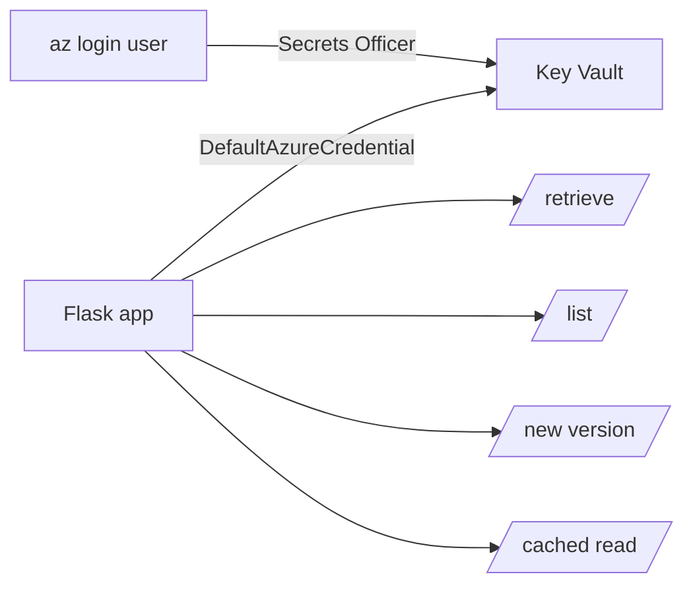

## What this covers

This is the hands-on lab for the Key Vault module. You deploy a vault preloaded with sample secrets, then finish a Python Flask app that retrieves secrets and metadata, lists properties without exposing values, creates a new version to simulate rotation, and adds a time-based cache. Microsoft estimates about 20 minutes. Use this page to rehearse the steps and the commands the exam expects you to recognize.

**Exam weight:** Secure, monitor, and troubleshoot Azure solutions (20–25%)

**Skills measured**

- "Secure secrets by using Azure Key Vault, including rotation and retrieval"

## Key concepts

### Lab prerequisites

- An Azure subscription.
- Visual Studio Code, Python 3.12 or later, and the latest Azure CLI.
- The starter project from the **Launch Exercise** link on the unit page.

### Tasks in the lab

1. Download the project starter files.
2. Create a Key Vault and store sample secrets.
3. Add code to the starter files to complete the app.
4. Run the app to perform secret operations.

### Ideas the lab reinforces

- **RBAC on the vault.** Your signed-in user needs a data plane role. **Key Vault Secrets Officer** lets you create and read secrets; Key Vault Contributor alone would not.
- **`DefaultAzureCredential` locally.** On your machine the chain falls through to `AzureCliCredential`, so `az login` is the only setup. In Azure the same code would use managed identity.
- **Metadata vs values.** `get_secret()` returns the value plus properties. `list_properties_of_secrets()` returns properties only.
- **Rotation is a new version.** Calling `set_secret()` with an existing name adds a version; the app sees it on the next uncached read.
- **Caching hides rotation.** With a TTL cache in place, a new version appears only after the TTL expires, which is exactly the trade-off examined in [Implement caching strategies to reduce Key Vault calls](/study/manage-application-secrets-and-configuration-for-ai-solutions/implement-caching-strategies-to-reduce-key-vault-calls).

## How it works



Each Flask route exercises one SDK call. The cache route shows the cache hit and how long ago the value was fetched, so you can see the vault being skipped.

## Hands-on

### Azure portal

1. Create a resource group and a **Key Vault** with **Azure role-based access control** as the permission model.
2. In the vault's **Access control (IAM)**, assign **Key Vault Secrets Officer** to your own user.
3. Under **Secrets**, add `openai-api-key`, `cosmosdb-connection-string` and `blob-storage-key` with sample values, a content type and tags.
4. Select a secret → **New Version** to see the version list grow.

### Azure CLI

```bash
RG=rg-ai200-kv
KV=kv-ai200-$RANDOM
az group create --name $RG --location eastus
az keyvault create --name $KV --resource-group $RG --location eastus \
  --enable-rbac-authorization true

USER_ID=$(az ad signed-in-user show --query id -o tsv)
az role assignment create --assignee $USER_ID \
  --role "Key Vault Secrets Officer" \
  --scope $(az keyvault show --name $KV --query id -o tsv)

az keyvault secret set --vault-name $KV --name openai-api-key \
  --value "sample-key-1" --content-type text/plain --tags environment=dev
az keyvault secret set --vault-name $KV --name cosmosdb-connection-string \
  --value "AccountEndpoint=https://sample.documents.azure.com:443/;AccountKey=sample"

echo "KEY_VAULT_URL=$(az keyvault show --name $KV --query properties.vaultUri -o tsv)" > .env

# Clean up afterwards (vault goes to soft-deleted state)
az group delete --name $RG --yes --no-wait
```

### Python

```python
import os
import time
from flask import Flask, jsonify
from azure.identity import DefaultAzureCredential
from azure.keyvault.secrets import SecretClient

app = Flask(__name__)
client = SecretClient(os.environ["KEY_VAULT_URL"], DefaultAzureCredential())
_cache, TTL = {}, 300

@app.get("/secret/<name>")
def retrieve(name):
    s = client.get_secret(name)
    return jsonify(name=s.name, version=s.properties.version,
                   content_type=s.properties.content_type,
                   preview=s.value[:4] + "***")  # never return the full value

@app.get("/secrets")
def list_props():
    return jsonify([{"name": p.name, "enabled": p.enabled, "tags": p.tags}
                    for p in client.list_properties_of_secrets()])

@app.post("/rotate/<name>")
def rotate(name):
    new = client.set_secret(name, f"rotated-{int(time.time())}")
    return jsonify(new_version=new.properties.version)

@app.get("/cached/<name>")
def cached(name):
    hit = _cache.get(name)
    now = time.monotonic()
    if hit and now - hit[1] < TTL:
        return jsonify(source="cache", age=round(now - hit[1]))
    _cache[name] = (client.get_secret(name).value, now)
    return jsonify(source="key-vault")
```

## Exam traps

| Lab situation | Explanation |
| --- | --- |
| `Forbidden` when the app reads a secret | Your user has no data plane role; assign Secrets User or Officer |
| Works locally, fails in Azure | The app's managed identity was never given a role |
| New version not visible on `/cached` | TTL hasn't expired yet |
| Vault name already taken after cleanup | Soft-deleted vault still holds the name; purge or pick a new name |

> [!WARNING]
> **Exam trap:** Owner or Contributor on the resource group doesn't let you read secrets in an RBAC vault. Data plane roles are separate.

> [!TIP]
> Locally `DefaultAzureCredential` uses your `az login` account, so role assignments must target **your user**, not only the app identity.

> [!NOTE]
> Deleting the resource group soft-deletes the vault. Run `az keyvault purge --name <vault-name>` if you need the name back and purge protection is off.

## Quick review

- The lab uses an RBAC vault, Python 3.12, Flask and the Azure CLI.
- You need Key Vault Secrets Officer to create secrets as your user.
- `get_secret()` returns value + properties; `list_properties_of_secrets()` returns only properties.
- `set_secret()` on an existing name simulates rotation by adding a version.
- A TTL cache delays when a new version is seen.
- Deleted vaults stay soft-deleted and keep their names.

## Practice

[Practice: Azure Key Vault questions](/practice/key-vault)

## Official references

- [Exercise - Manage secrets with Azure Key Vault (unit)](https://learn.microsoft.com/training/modules/manage-app-secrets-key-vault/6-exercise-manage-secrets)
- [Launch the exercise](https://go.microsoft.com/fwlink/?linkid=2352903)
- [Quickstart: Azure Key Vault secret client library for Python](https://learn.microsoft.com/azure/key-vault/secrets/quick-create-python)
- [Azure RBAC for Key Vault](https://learn.microsoft.com/azure/key-vault/general/rbac-guide)
