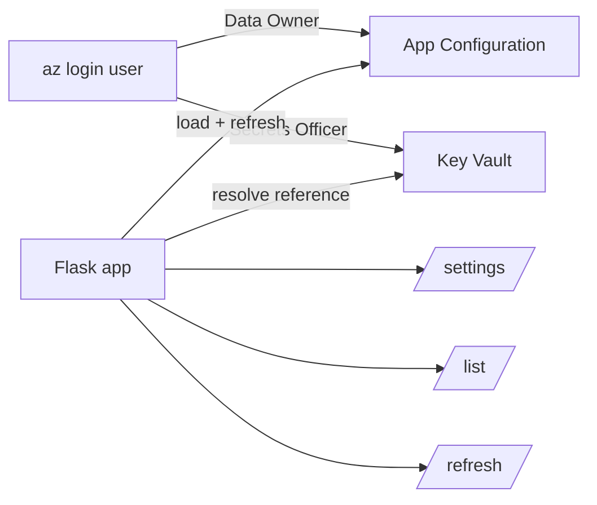

## What this covers

This is the hands-on lab for the App Configuration module, about 30 minutes. You deploy an App Configuration store and a Key Vault with sample data, then finish a Python Flask app that loads settings with label stacking, resolves Key Vault references automatically, lists setting metadata and refreshes when a sentinel key changes. Use this page to rehearse the flow and the commands.

**Exam weight:** Secure, monitor, and troubleshoot Azure solutions (20–25%)

**Skills measured**

- "Store and retrieve app configuration information by using Azure App Configuration"
- "Secure secrets by using Azure Key Vault, including rotation and retrieval"

## Key concepts

### Lab prerequisites

- An Azure subscription.
- Visual Studio Code, Python 3.12 or later, and the latest Azure CLI.
- The starter project from the **Launch Exercise** link on the unit page.

### Tasks in the lab

1. Download the project starter files.
2. Create an App Configuration store and a Key Vault with sample settings.
3. Add code to the starter files to complete the app.
4. Run the app to perform configuration operations.

### Ideas the lab reinforces

- **Two stores, two roles.** Your user needs **App Configuration Data Owner** (to create settings) and a Key Vault role that can write and read secrets. The app at run time only needs Data Reader and Key Vault Secrets User.
- **Label stacking.** Null-label defaults load first, the environment label second; see [Organize settings with labels and feature flags](/study/manage-application-secrets-and-configuration-for-ai-solutions/organize-settings-with-labels-and-feature-flags).
- **Transparent references.** `keyvault_credential` makes the API key appear in the same dictionary as the endpoint.
- **Metadata vs resolved values.** The low-level `AzureAppConfigurationClient` lists raw settings (key, label, content type, ETag), showing the reference JSON instead of the secret.
- **Sentinel refresh.** Changing `Sentinel` causes the next `refresh()` after the interval to reload everything; see [Refresh configuration dynamically and use snapshots](/study/manage-application-secrets-and-configuration-for-ai-solutions/refresh-configuration-dynamically-and-use-snapshots).

## How it works



## Hands-on

### Azure portal

1. Create an **App Configuration** store and a **Key Vault** (RBAC permission model) in one resource group.
2. Assign yourself **App Configuration Data Owner** on the store and **Key Vault Secrets Officer** on the vault.
3. Add `Pipeline:BatchSize` (no label, `10`) and `Pipeline:BatchSize` (label `Production`, `200`), `OpenAI:Endpoint`, and a `Sentinel` key.
4. Add secret `openai-api-key` to the vault and a **Key Vault reference** `OpenAI:ApiKey` in the store.

### Azure CLI

```bash
RG=rg-ai200-appcfg
AC=appcs-ai200-$RANDOM
KV=kv-ai200-$RANDOM
az group create --name $RG --location eastus
az appconfig create --name $AC --resource-group $RG --location eastus --sku Standard
az keyvault create --name $KV --resource-group $RG --location eastus \
  --enable-rbac-authorization true

ME=$(az ad signed-in-user show --query id -o tsv)
az role assignment create --assignee $ME --role "App Configuration Data Owner" \
  --scope $(az appconfig show --name $AC --query id -o tsv)
az role assignment create --assignee $ME --role "Key Vault Secrets Officer" \
  --scope $(az keyvault show --name $KV --query id -o tsv)

az appconfig kv set -n $AC --key Pipeline:BatchSize --value 10 --auth-mode login --yes
az appconfig kv set -n $AC --key Pipeline:BatchSize --value 200 --label Production --auth-mode login --yes
az appconfig kv set -n $AC --key OpenAI:Endpoint --value "https://sample.openai.azure.com/" --auth-mode login --yes
az appconfig kv set -n $AC --key Sentinel --value 1 --auth-mode login --yes

az keyvault secret set --vault-name $KV --name openai-api-key --value "sample-key"
az appconfig kv set-keyvault -n $AC --key OpenAI:ApiKey --auth-mode login --yes \
  --secret-identifier "https://$KV.vault.azure.net/secrets/openai-api-key"

echo "AZURE_APPCONFIG_ENDPOINT=$(az appconfig show -n $AC --query endpoint -o tsv)" > .env

# Trigger a refresh later
az appconfig kv set -n $AC --key Pipeline:BatchSize --value 300 --label Production --auth-mode login --yes
az appconfig kv set -n $AC --key Sentinel --value 2 --auth-mode login --yes

# Clean up
az group delete --name $RG --yes --no-wait
```

### Python

```python
import os
from flask import Flask, jsonify
from azure.appconfiguration import AzureAppConfigurationClient
from azure.appconfiguration.provider import load, SettingSelector, WatchKey
from azure.identity import DefaultAzureCredential

endpoint = os.environ["AZURE_APPCONFIG_ENDPOINT"]
credential = DefaultAzureCredential()
app = Flask(__name__)

config = load(
    endpoint=endpoint,
    credential=credential,
    selects=[
        SettingSelector(key_filter="*", label_filter="\0"),
        SettingSelector(key_filter="*", label_filter="Production"),
    ],
    keyvault_credential=credential,
    refresh_on=[WatchKey("Sentinel")],
    refresh_interval=10,
)

@app.get("/settings")
def settings():
    config.refresh()
    return jsonify(
        batch_size=config["Pipeline:BatchSize"],
        endpoint=config["OpenAI:Endpoint"],
        api_key_preview=config["OpenAI:ApiKey"][:4] + "***",
    )

@app.get("/list")
def list_settings():
    client = AzureAppConfigurationClient(endpoint, credential)
    return jsonify([
        {"key": s.key, "label": s.label, "content_type": s.content_type}
        for s in client.list_configuration_settings()
    ])
```

`azure-appconfiguration` (low-level client) and `azure-appconfiguration-provider` are separate packages; install both for this sample.

## Exam traps

| Lab situation | Explanation |
| --- | --- |
| `load()` fails on `OpenAI:ApiKey` | No `keyvault_credential`, or no Key Vault role for the identity |
| Batch size stays `10` | Production selector missing or placed before the null-label selector |
| Changed value not visible | Sentinel not updated, or refresh interval not yet elapsed |
| `/list` shows a JSON URI for the API key | Expected: the low-level client doesn't resolve references |
| 403 from `az appconfig kv set --auth-mode login` | Your user lacks App Configuration Data Owner |

> [!WARNING]
> **Exam trap:** `--auth-mode login` uses your Entra ID identity and needs a data role. Without it, the CLI falls back to access keys, which may be disabled on the store.

> [!TIP]
> Change the value, **then** the sentinel. The app reloads both together.

> [!NOTE]
> Deleting the resource group soft-deletes the vault (and a Standard App Configuration store with soft delete enabled), so names stay reserved until purged.

## Quick review

- The lab uses App Configuration + Key Vault + Flask + Python 3.12.
- Your user needs Data Owner on the store and a write role on the vault.
- Label stacking: null label first, environment label second.
- `keyvault_credential` resolves references into the same dictionary.
- The low-level client shows reference JSON, not secret values.
- Update the sentinel to trigger a full reload on the next refresh.

## Practice

[Practice: Azure App Configuration questions](/practice/app-configuration)

[Practice: Azure Key Vault questions](/practice/key-vault)

## Official references

- [Exercise - Retrieve settings and secrets from Azure App Configuration (unit)](https://learn.microsoft.com/training/modules/manage-app-settings-app-config/6-exercise-retrieve-settings)
- [Launch the exercise](https://go.microsoft.com/fwlink/?linkid=2352904)
- [Python configuration provider reference](https://learn.microsoft.com/azure/azure-app-configuration/reference-python-provider)
- [Azure App Configuration client library for Python](https://learn.microsoft.com/python/api/overview/azure/appconfiguration-readme)
