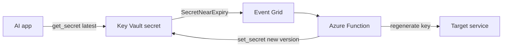

## What this covers

"Rotation" is named in the skill itself, so expect questions on it. Key Vault never overwrites a secret: each write adds a version. This page covers how versions behave, how to rotate by hand or automatically with Event Grid, how keys differ (they have native rotation policies) and how application code survives a rotation without downtime.

**Exam weight:** Secure, monitor, and troubleshoot Azure solutions (20–25%)

**Skills measured**

- "Secure secrets by using Azure Key Vault, including rotation and retrieval"

## Key concepts

### Versions

- Every `set_secret()` on an existing name creates a **new version** with a 32-character hex identifier. Older versions stay readable.
- `get_secret(name)` returns the **latest** version. `get_secret(name, version=...)` pins one version.
- `list_properties_of_secret_versions(name)` lists every version with `created_on`, `expires_on` and `enabled`. Use it to audit rotation history.
- Disable an old version with `update_secret_properties(name, version=..., enabled=False)`. Reading a disabled version returns 403 (`Forbidden`, secret disabled).
- Secret identifiers: `https://<vault>.vault.azure.net/secrets/<name>` (versionless, always latest) vs `.../secrets/<name>/<version>` (pinned).

### Expiry and activation dates

- `expires_on` (`exp`) and `not_before` (`nbf`) are attributes on each version.
- Expiry on a secret is a **signal**, not a lock: the module notes expired secrets can still be read. Its job is to drive monitoring and rotation.
- A common pattern: 90-day expiry on API keys plus a `SecretNearExpiry` subscription, which gives a 30-day window to rotate.

### Event Grid events from Key Vault

| Event | Fires when |
| --- | --- |
| `Microsoft.KeyVault.SecretNewVersionCreated` | A new secret or version is created |
| `Microsoft.KeyVault.SecretNearExpiry` | Current version is **30 days** from expiry |
| `Microsoft.KeyVault.SecretExpired` | Current version has expired |
| `Microsoft.KeyVault.KeyNearExpiry` | Timing set by the key's rotation policy |
| `Microsoft.KeyVault.CertificateNearExpiry` | 30 days before certificate expiry |

The event payload carries `Id`, `VaultName`, `ObjectType`, `ObjectName`, `Version`, `NBF` and `EXP`.

### Rotation strategies

- **Manual**: an operator or CI/CD pipeline writes a new version, then restarts or signals the app. Simple; fine for long-lived third-party keys. The app keeps the old value until it reloads.
- **Automated with Event Grid**: `SecretNearExpiry` → Event Grid → Azure Function → the function creates a new credential at the target service and stores it as a new version.
- **Dual-credential**: for services with two active keys (Azure Storage, Azure Cosmos DB): regenerate the **secondary** key, store it as the new version, wait until every instance uses it, then regenerate the old **primary**. One valid key always exists.

### Rotation policies (keys) vs secrets

Key Vault **keys** support a native **rotation policy**: `lifetimeActions` with a `Rotate` trigger (`timeAfterCreate` or `timeBeforeExpiry`) and a `Notify` trigger, plus `expiryTime` for new versions (ISO 8601 durations such as `P90D`, `P18M`, `P2Y`; minimum rotation interval 7 days). Managing it needs Key Vault Crypto Officer, and each scheduled rotation costs extra. **Certificates** auto-renew through lifetime actions. **Secrets** have no built-in generator because Key Vault can't mint a password for another service, so secret rotation uses the Event Grid + Function pattern.

## How it works



On the app side, use a versionless reference and a retry-on-auth-failure loop: if the downstream service rejects the cached credential, fetch the latest version once and try again. In normal operation this costs no extra vault calls.

## Hands-on

### Azure portal

1. Open the vault → **Secrets** → select the secret → **New Version**, enter a value and set **Set expiration date**.
2. Select an old version and clear **Enabled** to retire it.
3. In the vault, open **Events** → **+ Event Subscription**, filter to **Secret Near Expiry**, and choose an Azure Function endpoint.
4. For a key, open **Keys** → the key → **Rotation policy** to set **Rotate after** and **Notify before expiry**.

### Azure CLI

```bash
az keyvault secret set --vault-name <vault-name> --name openai-api-key \
  --value "<new-key>" --expires 2027-01-23T00:00:00Z

az keyvault secret list-versions --vault-name <vault-name> --name openai-api-key \
  --query "[].{id:id, enabled:attributes.enabled, expires:attributes.expires}"

az keyvault secret set-attributes --vault-name <vault-name> --name openai-api-key \
  --version <old-version> --enabled false

az eventgrid event-subscription create \
  --name kv-near-expiry \
  --source-resource-id $(az keyvault show --name <vault-name> --query id -o tsv) \
  --endpoint-type azurefunction \
  --endpoint <function-resource-id> \
  --included-event-types Microsoft.KeyVault.SecretNearExpiry

# Keys only: native rotation policy and on-demand rotation
az keyvault key rotation-policy update --vault-name <vault-name> --name <key-name> --value policy.json
az keyvault key rotate --vault-name <vault-name> --name <key-name>
```

```json
{
  "lifetimeActions": [
    { "trigger": { "timeAfterCreate": "P18M" }, "action": { "type": "Rotate" } },
    { "trigger": { "timeBeforeExpiry": "P30D" }, "action": { "type": "Notify" } }
  ],
  "attributes": { "expiryTime": "P2Y" }
}
```

### Python

```python
from datetime import datetime, timedelta, timezone
from azure.identity import DefaultAzureCredential
from azure.keyvault.secrets import SecretClient

client = SecretClient("https://kv-ragpipeline-prod.vault.azure.net/", DefaultAzureCredential())

initial = client.set_secret("cosmosdb-connection-string", "AccountEndpoint=https://...")
updated = client.set_secret("cosmosdb-connection-string", "AccountEndpoint=https://new...")

latest = client.get_secret("cosmosdb-connection-string")  # version 2
pinned = client.get_secret("cosmosdb-connection-string", version=initial.properties.version)

for v in client.list_properties_of_secret_versions("cosmosdb-connection-string"):
    print(v.version, v.created_on, v.enabled, v.expires_on)

# Retire the old version after every instance has moved
client.update_secret_properties(
    "cosmosdb-connection-string", version=initial.properties.version, enabled=False
)

# New key with a 90-day expiry so SecretNearExpiry fires at day 60
client.set_secret(
    "openai-api-key", "<new-key>",
    expires_on=datetime.now(timezone.utc) + timedelta(days=90),
    content_type="text/plain",
    tags={"rotation-policy": "90-days", "service": "azure-openai"},
)

def call_with_rotation(secret_name, call, max_retries=1):
    value = client.get_secret(secret_name).value
    for attempt in range(max_retries + 1):
        try:
            return call(value)
        except PermissionError:  # replace with the downstream SDK's auth error
            if attempt == max_retries:
                raise
            value = client.get_secret(secret_name).value  # rotated? fetch latest
```

## Exam traps

| Requirement | Choose |
| --- | --- |
| Rotate an encryption key on a schedule with no code | Key rotation policy |
| Rotate a third-party API key automatically | Expiry + `SecretNearExpiry` → Event Grid → Function |
| Rotate Storage or Cosmos DB keys without downtime | Dual-credential (secondary first) |
| Invalidate app caches when a secret changes | `SecretNewVersionCreated` |
| Roll back to the previous value | Read or re-set the older version |
| Stop anyone using an old value | Disable that version |

> [!WARNING]
> **Exam trap:** `SecretNearExpiry` fires only if the secret **has an expiration date**, and always 30 days before it. No expiry, no event.

> [!WARNING]
> **Exam trap:** Pinning a version in a reference or config (`.../secrets/name/<version>`) means rotation is never picked up. Use versionless identifiers unless you deliberately want to pin.

> [!TIP]
> Dual-credential order: **S**econdary first, **P**rimary last. "Swap, wait, then sweep."

> [!NOTE]
> Deleting a secret deletes all its versions together (and soft delete keeps them all recoverable). To retire one version, disable it.

## Quick review

- Each `set_secret` on an existing name creates a new version; nothing is overwritten.
- `get_secret` without a version returns the latest.
- Disabled versions return 403; expired secrets still exist and act as a rotation signal.
- `SecretNearExpiry` fires 30 days before expiry and needs an expiry date.
- Keys have native rotation policies; secrets rotate via Event Grid + Function.
- Dual-key services rotate secondary first, then primary.
- Refetch the latest version on a downstream auth failure for zero-downtime rotation.

## Practice

[Practice: Azure Key Vault questions](/practice/key-vault)

## Official references

- [Handle secret versioning and rotation (unit)](https://learn.microsoft.com/training/modules/manage-app-secrets-key-vault/4-handle-versioning-rotation)
- [Azure Key Vault as an Event Grid source](https://learn.microsoft.com/azure/event-grid/event-schema-key-vault)
- [Configure cryptographic key auto-rotation](https://learn.microsoft.com/azure/key-vault/keys/how-to-configure-key-rotation)
- [Automate rotation of a secret with two sets of credentials](https://learn.microsoft.com/azure/key-vault/secrets/tutorial-rotation-dual)
- [Understanding autorotation in Azure Key Vault](https://learn.microsoft.com/azure/key-vault/general/autorotation)
