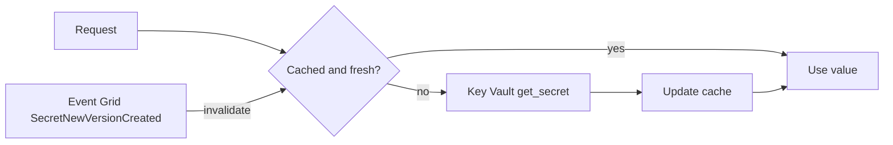

## What this covers

An inference API that calls `get_secret()` on every request adds tens of milliseconds of latency and will hit Key Vault's throttling limits during a traffic spike. Caching secrets in memory fixes both problems. This page covers the limits, the cache patterns, how to keep the cache fresh after rotation and how to react to HTTP 429.

**Exam weight:** Secure, monitor, and troubleshoot Azure solutions (20–25%)

**Skills measured**

- "Secure secrets by using Azure Key Vault, including rotation and retrieval"

## Key concepts

### Throttling limits

- Over the limit, Key Vault returns **HTTP 429 Too Many Requests** with a `Retry-After` header.
- Secret operations: about **4,000 transactions per vault per 10 seconds** in a region.
- A subscription has an aggregate limit of **5×** the per-vault limit across all vaults in a region.
- Limits change; check the service limits page. The exam cares that the limit is per vault per 10-second window and that caching is the fix.

Without a cache, 400 requests per second already reaches 4,000 reads in 10 seconds. With a cache, the vault sees a few refreshes per hour.

### Cache patterns

| Pattern | How | Best for |
| --- | --- | --- |
| **Time-based (TTL) in-memory cache** | Store value + timestamp, refetch after the TTL | Most apps; the default starting point |
| **Startup preloading** | Read every needed secret once at startup | Containers that restart often; static secrets |
| **Event-driven invalidation** | `SecretNewVersionCreated` → Event Grid → drop the cache entry | Near-real-time freshness after rotation |
| **Shared distributed cache** | One process fills Azure Managed Redis; others read it | Large fleets; adds a second place secrets live |

- TTL math: a 900-second (15-minute) TTL means at most 4 reads per hour per instance. Ten replicas give 40 vault calls per hour per secret.
- Use `time.monotonic()` to measure age; it ignores wall-clock changes.
- Combine patterns: Event Grid for speed, TTL as the fallback if an event is lost, preloading so the app is ready before taking traffic.

### Choosing a TTL

| Rotation frequency | Suggested approach |
| --- | --- |
| Daily or weekly | 5–15 minute TTL + Event Grid invalidation |
| Monthly or quarterly | 30–60 minute TTL; Event Grid is nice to have |
| Annual or static | Preload at startup, refresh every few hours |
| Emergency revocation | Short TTL or event invalidation; restart instances if needed |

### Cache scope trade-offs

- **Per-process**: simplest; calls scale linearly with replicas. Recommended starting point.
- **Shared (Redis)**: one refresh per cycle for the whole fleet, but the secret now sits outside Key Vault and needs its own access control, encryption and network isolation.
- **Preloaded**: zero calls while serving, but stale until the process restarts unless you add a background refresh.

## How it works



The hot path reads only memory. Key Vault is called on a cache miss, after the TTL, or after an invalidation event. Failed refreshes should keep serving the last good value while the downstream credential still works.

## Hands-on

### Azure portal

1. Open the vault → **Monitoring** → **Metrics**, add **Total Service Api Hits** and **Service Api Latency**, and split by **Activity name** to see which operations dominate.
2. Add **Overall Service Api Availability** and filter **Status Code** = `429` to find throttling.
3. Open **Events** → **+ Event Subscription** → filter to **Secret New Version Created** → endpoint: a webhook, Service Bus queue or Azure Function that invalidates the cache.

### Azure CLI

```bash
VAULT_ID=$(az keyvault show --name <vault-name> --query id -o tsv)

# Count API hits over the last hour
az monitor metrics list --resource "$VAULT_ID" \
  --metric ServiceApiHit --interval PT5M --aggregation Count

# Push cache invalidation events to a Service Bus queue
az eventgrid event-subscription create \
  --name kv-secret-changed \
  --source-resource-id "$VAULT_ID" \
  --endpoint-type servicebusqueue \
  --endpoint <service-bus-queue-resource-id> \
  --included-event-types Microsoft.KeyVault.SecretNewVersionCreated
```

### Python

```python
import logging
import time
from azure.core.exceptions import HttpResponseError
from azure.identity import DefaultAzureCredential
from azure.keyvault.secrets import SecretClient

logger = logging.getLogger("keyvault")

class SecretCache:
    def __init__(self, vault_url, cache_ttl_seconds=900):
        self._client = SecretClient(vault_url=vault_url, credential=DefaultAzureCredential())
        self._cache = {}
        self._ttl = cache_ttl_seconds

    def get_secret(self, name):
        cached = self._cache.get(name)
        now = time.monotonic()
        if cached and now - cached["timestamp"] < self._ttl:
            return cached["value"]
        try:
            value = self._client.get_secret(name).value
        except HttpResponseError as e:
            if e.status_code == 429:
                logger.warning("Key Vault throttled '%s'. Consider a longer TTL.", name)
                if cached:  # serve the last good value
                    return cached["value"]
            raise
        self._cache[name] = {"value": value, "timestamp": now}
        return value

    def invalidate(self, name):  # call from the Event Grid handler
        self._cache.pop(name, None)

class AppConfig:
    """Startup preloading: every secret read once, zero vault calls per request."""
    def __init__(self, vault_url, secret_names):
        client = SecretClient(vault_url=vault_url, credential=DefaultAzureCredential())
        self._secrets = {n: client.get_secret(n).value for n in secret_names}

    def get(self, name):
        return self._secrets.get(name)

config = AppConfig(
    "https://kv-ragpipeline-prod.vault.azure.net/",
    ["openai-api-key", "cosmosdb-connection-string", "blob-storage-key"],
)
api_key = config.get("openai-api-key")
```

## Exam traps

| Symptom or need | Fix |
| --- | --- |
| Intermittent 429 from Key Vault under load | Cache secrets; stop calling per request |
| 429 bursts only during deployments | Stagger startup or use a shared cache |
| New secret version not picked up for an hour | Shorten TTL or add `SecretNewVersionCreated` invalidation |
| Fewest vault calls for 50 replicas | Shared Azure Managed Redis cache (with its own security) |
| Retry after 429 | Exponential backoff with jitter (1, 2, 4, 8, 16 s) |

> [!WARNING]
> **Exam trap:** Raising the TTL reduces calls but extends how long a revoked credential stays in use. For incident response you need event-driven invalidation or a restart, not a longer TTL.

> [!WARNING]
> **Exam trap:** Key Vault limits are **per vault, per region**, and the subscription aggregate still applies. Spreading load across more vaults in one subscription doesn't remove the cap.

> [!TIP]
> "TTL for safety, events for speed": use both.

> [!NOTE]
> The Azure SDK retry policy already honors `Retry-After` on 429. Log throttles anyway: frequent 429s mean a code path is bypassing the cache.

## Quick review

- Throttled calls return HTTP 429.
- Secret ops are limited per vault per 10-second window (about 4,000 transactions).
- A 15-minute TTL means at most 4 reads per hour per instance.
- `SecretNewVersionCreated` events can invalidate caches right after rotation.
- Per-process caching is the recommended default; Redis adds a second secret store.
- Preloading at startup suits static secrets and frequently restarted containers.
- Back off exponentially with jitter to avoid a thundering herd.

## Practice

[Practice: Azure Key Vault questions](/practice/key-vault)

## Official references

- [Implement caching strategies to reduce Key Vault calls (unit)](https://learn.microsoft.com/training/modules/manage-app-secrets-key-vault/5-implement-caching-strategies)
- [Azure Key Vault service limits](https://learn.microsoft.com/azure/key-vault/general/service-limits)
- [Azure Key Vault throttling guidance](https://learn.microsoft.com/azure/key-vault/general/overview-throttling)
- [Monitoring Key Vault with Event Grid](https://learn.microsoft.com/azure/key-vault/general/event-grid-overview)
