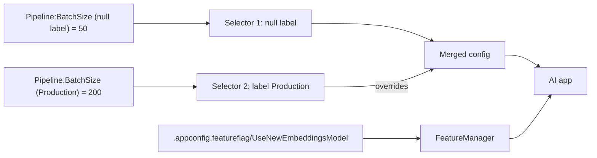

## What this covers

A document pipeline uses a batch size of 10 in development and 200 in production, and you may want to switch to a new embeddings model without shipping code. App Configuration handles the first with **labels** and the second with **feature flags**. This page covers both, plus a key naming scheme that keeps filtering simple.

**Exam weight:** Secure, monitor, and troubleshoot Azure solutions (20–25%)

**Skills measured**

- "Store and retrieve app configuration information by using Azure App Configuration"

## Key concepts

### Labels

- A label creates a **variant** of a key. `Pipeline:BatchSize` can hold `10` (label `Development`), `50` (`Staging`) and `200` (`Production`). The code always reads `Pipeline:BatchSize`.
- A key with no label has the **null label**, written `"\0"` in the provider. Treat null-label keys as defaults.
- Labels replace per-environment files and names such as `Pipeline_BatchSize_Prod`.
- Labels can also mark versions (`v2`) or regions (`westeurope`).

### Stacking defaults and overrides

Pass two selectors: null label first, environment label second. Later selectors override earlier ones for the same key, so every key has a default and an environment can override just the ones it needs.

### Key naming

Use a consistent hierarchy so one component can load only its keys:

| Key | Meaning |
| --- | --- |
| `OpenAI:Endpoint` | Model endpoint URL |
| `OpenAI:DeploymentName` | Model deployment |
| `OpenAI:MaxTokens` | Token limit per request |
| `CosmosDB:DatabaseName` | Target database |
| `CosmosDB:ContainerName` | Target container |
| `Pipeline:BatchSize` | Documents per batch |
| `Pipeline:RetryCount` | Max retries |
| `Pipeline:TimeoutSeconds` | Step timeout |

A component that needs only model settings loads `key_filter="OpenAI:*"`. The portal also sorts keys alphabetically, so hierarchies group together.

### Feature flags

- A feature flag is a special key-value: name, enabled state and optional **filters**. It's stored under the key prefix `.appconfig.featureflag/` with content type `application/vnd.microsoft.appconfig.ff+json;charset=utf-8`. The libraries hide this.
- Flags separate **releasing** a feature from **deploying** code.
- Built-in filters let a flag be "on" conditionally, for example **Microsoft.TimeWindow** (on between two times) and **Microsoft.Targeting** (specific users, groups or a percentage of users). Variant feature flags can return a value instead of on/off.
- In Python, load flags with `feature_flag_enabled=True`, filter them with `feature_flag_selectors`, and evaluate with `FeatureManager(config).is_enabled("Name")` from the separate `featuremanagement` package. The loaded flags sit under `config["feature_management"]["feature_flags"]`.
- Refresh flags with `feature_flag_refresh_enabled=True`. All loaded flags are monitored, independently of normal key refresh.

### AI patterns for flags

- **Progressive model rollout**: route internal or a percentage of traffic to a new embeddings model first.
- **Kill switch**: turn off a misbehaving classification stage in seconds instead of rolling back code.
- **A/B comparison**: send requests down two paths and compare results.
- **Staged pipeline activation**: enable stages one at a time as each is verified.

## How it works



Selectors load in order and later values overwrite earlier ones. Feature flags go into a separate section that `FeatureManager` reads each time `is_enabled()` is called.

## Hands-on

### Azure portal

1. **Configuration explorer** → **Create** → **Key-value**: `Pipeline:BatchSize` = `50` with no label, then again with label `Production` and value `200`.
2. **Feature manager** → **Create**: name `UseNewEmbeddingsModel`, leave it disabled.
3. Edit the flag → **Use feature filter** → **Targeting** with a 10% default rollout, then enable it.
4. Toggle the flag off to test the kill switch.

### Azure CLI

```bash
az appconfig kv set --name <store-name> --key "Pipeline:BatchSize" --value 50 --yes
az appconfig kv set --name <store-name> --key "Pipeline:BatchSize" --value 200 \
  --label Production --yes

az appconfig kv list --name <store-name> --key "Pipeline:*" --label "\0,Production"

az appconfig feature set --name <store-name> --feature UseNewEmbeddingsModel --yes
az appconfig feature enable --name <store-name> --feature UseNewEmbeddingsModel --yes
az appconfig feature disable --name <store-name> --feature UseNewEmbeddingsModel --yes
az appconfig feature list --name <store-name> -o table
```

### Python

```python
import os
from azure.appconfiguration.provider import load, SettingSelector
from azure.identity import DefaultAzureCredential
from featuremanagement import FeatureManager  # pip install featuremanagement

endpoint = os.environ["AZURE_APPCONFIG_ENDPOINT"]
environment = os.environ.get("APP_ENVIRONMENT", "Development")

config = load(
    endpoint=endpoint,
    credential=DefaultAzureCredential(),
    selects=[
        SettingSelector(key_filter="*", label_filter="\0"),        # defaults
        SettingSelector(key_filter="*", label_filter=environment),  # overrides
    ],
    feature_flag_enabled=True,
    feature_flag_selectors=[SettingSelector(key_filter="*", label_filter=environment)],
    feature_flag_refresh_enabled=True,
)

batch_size = int(config["Pipeline:BatchSize"])
feature_manager = FeatureManager(config)

def process(document):
    config.refresh()  # cheap no-op until the refresh interval passes
    if feature_manager.is_enabled("UseNewEmbeddingsModel"):
        return process_with_new_model(document)
    return process_with_current_model(document)
```

The Learn unit's sample writes `feature_flags_enabled`; the provider reference documents the parameter as `feature_flag_enabled`, which is what the code above uses.

## Exam traps

| Need | Use |
| --- | --- |
| Same key, different value per environment | Labels |
| Default value plus environment override | Two selectors: `"\0"` then the environment label |
| Turn a feature on or off without redeploying | Feature flag |
| Expose a feature to 10% of users | Feature flag with the Targeting filter |
| Enable a feature only during a maintenance window | TimeWindow filter |
| Emergency stop of a pipeline stage | Feature flag used as a kill switch |

> [!WARNING]
> **Exam trap:** Selector order matters. Put the environment selector **after** the null-label selector; reversed, the defaults overwrite your overrides.

> [!WARNING]
> **Exam trap:** Feature flags aren't loaded by default. Without `feature_flag_enabled=True`, `is_enabled()` returns `False` for every flag.

> [!TIP]
> Labels answer "which value here?"; feature flags answer "is this on right now?".

> [!NOTE]
> Changing a flag doesn't trigger a refresh of normal settings, and a settings change doesn't refresh flags. Both update when `refresh()` runs.

## Quick review

- Labels create per-environment variants of one key; no label = null label `"\0"`.
- Later `SettingSelector`s override earlier ones for the same key.
- Hierarchical keys (`OpenAI:*`, `Pipeline:*`) make prefix filtering easy.
- Feature flags live under `.appconfig.featureflag/` with their own content type.
- Load flags with `feature_flag_enabled=True` and evaluate with `FeatureManager.is_enabled()`.
- Targeting and TimeWindow filters make flags conditional.
- Flag refresh is independent of settings refresh.

## Practice

[Practice: Azure App Configuration questions](/practice/app-configuration)

## Official references

- [Organize settings with labels and feature flags (unit)](https://learn.microsoft.com/training/modules/manage-app-settings-app-config/3-organize-labels-feature-flags)
- [Python configuration provider reference](https://learn.microsoft.com/azure/azure-app-configuration/reference-python-provider)
- [Feature management overview](https://learn.microsoft.com/azure/azure-app-configuration/feature-management-overview)
- [Quickstart: feature flags in Python](https://learn.microsoft.com/azure/azure-app-configuration/quickstart-feature-flag-python)
- [Keys and values](https://learn.microsoft.com/azure/azure-app-configuration/concept-key-value)
