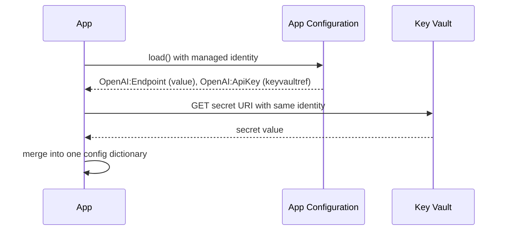

## What this covers

An AI pipeline needs both a model endpoint URL (not sensitive) and an API key (sensitive) for the same service. A **Key Vault reference** lets App Configuration hold a pointer to the secret while the value stays in Key Vault. The app makes one `load()` call and gets both. This page covers the reference format, how the provider resolves it, the roles you need on both services and how rotated secrets get picked up.

**Exam weight:** Secure, monitor, and troubleshoot Azure solutions (20–25%)

**Skills measured**

- "Store and retrieve app configuration information by using Azure App Configuration"
- "Secure secrets by using Azure Key Vault, including rotation and retrieval"

## Key concepts

### What a reference is

- A normal key (for example `OpenAI:ApiKey`) whose value is JSON holding a secret URI: `{"uri":"https://<vault>.vault.azure.net/secrets/openai-api-key"}`.
- Its content type is `application/vnd.microsoft.appconfig.keyvaultref+json;charset=utf-8`. That content type is how clients recognize it.
- App Configuration **never stores or reads the secret value**. The **client** (the provider in your app) calls Key Vault with the app's own identity.
- References behave like any key: they take labels, match `SettingSelector` filters and appear in the config dictionary.

### Versioned vs versionless

- Versionless URI (`.../secrets/openai-api-key`) resolves the **latest** version. Recommended: rotations flow through without touching App Configuration.
- Versioned URI (`.../secrets/openai-api-key/<version>`) pins one value. Use it only when you deliberately want to freeze a credential.
- Labels let `Development` and `Production` references point at different vaults.

### Configuring the Python provider

| Option | Purpose |
| --- | --- |
| `keyvault_credential=credential` | One credential used for every referenced vault |
| `keyvault_client_configs={vault_uri: {"credential": ...}}` | Per-vault settings; extra keys are passed to `SecretClient` |
| `secret_resolver=fn(uri)` | Custom function that returns a value for a reference |
| `secret_refresh_interval=seconds` | Re-resolve secrets on this cycle even if App Configuration didn't change |

Without one of the first three, loading a store that contains references fails.

### Roles on both services

The app identity needs two role assignments:

- **App Configuration Data Reader** on the store, to read the reference.
- **Key Vault Secrets User** on **each** referenced vault, to read the secret.

If the second is missing, `load()` raises an error naming the vault and secret it couldn't read.

### Refresh and rotation

The reference URI doesn't change when the secret rotates, so watching a sentinel won't notice. `secret_refresh_interval` (for example `7200` for two hours) makes `refresh()` re-fetch secret values on that schedule. Each resolution is one Key Vault call, so many references with a short interval can add up against Key Vault throttling limits.

### App Service and Functions references

App Service, Azure Functions and Container Apps have their **own** Key Vault reference syntax for app settings: `@Microsoft.KeyVault(SecretUri=https://<vault>.vault.azure.net/secrets/<name>/)` or `@Microsoft.KeyVault(VaultName=<vault>;SecretName=<name>)`. There the platform resolves the secret using the app's managed identity, and the code reads an ordinary environment variable. Don't confuse it with App Configuration references.

## How it works



## Hands-on

### Azure portal

1. Store `openai-api-key` in Key Vault.
2. In App Configuration → **Configuration explorer** → **Create** → **Key Vault reference**: key `OpenAI:ApiKey`, label `Production`, choose the vault and secret, leave version as **Latest**.
3. Assign **App Configuration Data Reader** on the store and **Key Vault Secrets User** on the vault to the app's managed identity.

### Azure CLI

```bash
az appconfig kv set-keyvault \
  --name <store-name> \
  --key "OpenAI:ApiKey" \
  --secret-identifier "https://<vault-name>.vault.azure.net/secrets/openai-api-key" \
  --label Production \
  --yes

az role assignment create --assignee <principal-id> \
  --role "App Configuration Data Reader" \
  --scope $(az appconfig show --name <store-name> --query id -o tsv)

az role assignment create --assignee <principal-id> \
  --role "Key Vault Secrets User" \
  --scope $(az keyvault show --name <vault-name> --query id -o tsv)

# Shows the reference JSON, not the secret
az appconfig kv show --name <store-name> --key "OpenAI:ApiKey" --label Production
```

### Python

```python
import os
from azure.appconfiguration.provider import load, SettingSelector, WatchKey
from azure.identity import DefaultAzureCredential

endpoint = os.environ["AZURE_APPCONFIG_ENDPOINT"]
credential = DefaultAzureCredential()

config = load(
    endpoint=endpoint,
    credential=credential,
    selects=[SettingSelector(key_filter="*", label_filter="Production")],
    keyvault_credential=credential,       # same managed identity for Key Vault
    refresh_on=[WatchKey("Sentinel")],
    refresh_interval=60,
    secret_refresh_interval=7200,          # re-resolve secrets every 2 hours
)

model_endpoint = config["OpenAI:Endpoint"]  # from App Configuration
api_key = config["OpenAI:ApiKey"]           # resolved from Key Vault

# Different identity per vault
config = load(
    endpoint=endpoint,
    credential=credential,
    keyvault_client_configs={
        "https://<vault-name>.vault.azure.net/": {"credential": credential},
    },
)
```

## Exam traps

| Need | Choose |
| --- | --- |
| One retrieval path for settings and secrets | App Configuration Key Vault reference |
| Pick up rotated secrets automatically | Versionless secret URI + `secret_refresh_interval` |
| App Service setting backed by Key Vault | `@Microsoft.KeyVault(...)` app setting reference |
| Reference resolves with 403 | Add Key Vault Secrets User on that vault |
| Different credentials per vault | `keyvault_client_configs` |

> [!WARNING]
> **Exam trap:** App Configuration doesn't fetch secrets for you. The client resolves them, so the **app identity** needs Key Vault access. Granting the store's own managed identity access to the vault doesn't help.

> [!WARNING]
> **Exam trap:** Bumping the sentinel won't pick up a rotated secret, because the reference value didn't change. Use `secret_refresh_interval` or reload.

> [!TIP]
> Two services, two roles: **Data Reader** on the store, **Secrets User** on the vault.

> [!NOTE]
> Reading the reference with `az appconfig kv show` or the low-level SDK returns the JSON pointer, not the secret. Only the provider (or your own code) resolves it.

## Quick review

- A Key Vault reference stores a secret URI with the `keyvaultref+json` content type.
- The secret value never lives in App Configuration.
- Resolution happens client-side with the app's identity.
- Use `keyvault_credential`, `keyvault_client_configs` or `secret_resolver` in `load()`.
- The app needs Data Reader on the store and Secrets User on each vault.
- Prefer versionless URIs so rotation is picked up.
- `secret_refresh_interval` re-resolves secrets independently of setting refresh.

## Practice

[Practice: Azure App Configuration questions](/practice/app-configuration)

[Practice: Azure Key Vault questions](/practice/key-vault)

## Official references

- [Reference Key Vault secrets from App Configuration (unit)](https://learn.microsoft.com/training/modules/manage-app-settings-app-config/4-reference-key-vault-secrets)
- [Python configuration provider: Key Vault reference](https://learn.microsoft.com/azure/azure-app-configuration/reference-python-provider#key-vault-reference)
- [Use Key Vault references in App Configuration](https://learn.microsoft.com/azure/azure-app-configuration/use-key-vault-references-dotnet-core)
- [Use Key Vault references as app settings in App Service](https://learn.microsoft.com/azure/app-service/app-service-key-vault-references)
