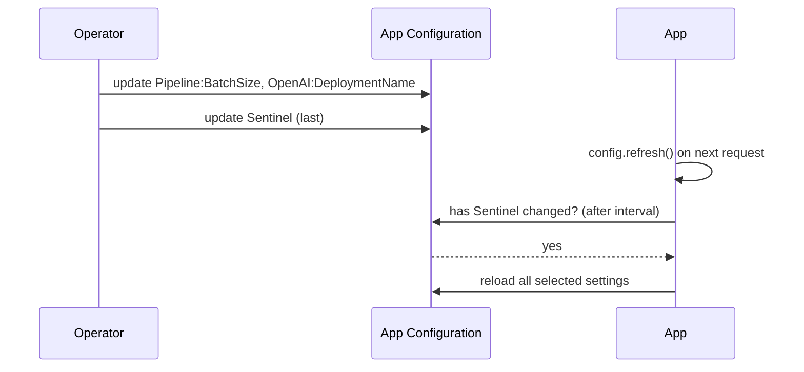

## What this covers

Centralized settings only pay off if running apps pick up changes without a restart, and if a bad change can be rolled back quickly. This page covers activity-driven refresh in the Python provider, the sentinel key pattern, and the two rollback tools App Configuration gives you: immutable **snapshots** and **revision history**.

**Exam weight:** Secure, monitor, and troubleshoot Azure solutions (20–25%)

**Skills measured**

- "Store and retrieve app configuration information by using Azure App Configuration"

## Key concepts

### Activity-driven refresh

- The provider never pushes changes to you. Your code calls `config.refresh()`, usually in a request handler or a processing loop.
- `refresh()` contacts the store only if `refresh_interval` has elapsed (default **30 seconds**). Otherwise it returns immediately, so calling it on every request is cheap.
- If a refresh fails, the app keeps using the last loaded values and tries again after the next interval.
- `on_refresh_success` runs when a change was found and applied; `on_refresh_error` runs when a refresh fails.

### What gets watched

- `refresh_enabled=True` with no `refresh_on`: the provider monitors **all loaded key-values**.
- `refresh_on=[WatchKey("Sentinel")]`: the provider checks only the watched keys. When any watched key changes, it reloads **all** selected settings. Setting `refresh_on` turns refresh on automatically.
- Feature flags refresh separately with `feature_flag_refresh_enabled=True`.
- Key Vault reference values re-resolve on their own clock with `secret_refresh_interval`.

### The sentinel key pattern

A **sentinel** is a dedicated key, often called `Sentinel`, that you change *after* you finish editing other settings. Because the provider watches only the sentinel, a half-finished batch of edits never reaches the app. Change five settings, then bump `Sentinel`, and all five apply together on the next refresh. Watching one key is also cheaper than checking many.

### Push model with Event Grid

App Configuration publishes `Microsoft.AppConfiguration.KeyValueModified` and `KeyValueDeleted` events to Event Grid. A subscriber can trigger a refresh right away instead of waiting for the interval, which is useful for apps with little traffic.

### Snapshots

- A **snapshot** is a named, **immutable** set of key-values chosen by key and label filters when it's created. Its contents never change.
- Uses: controlled rollout (the app points at `release-2026-10`), last-known-good rollback (point back at the previous snapshot), version history, auditing and identical test environments.
- Operations: create, archive and recover only; you can't edit, delete or purge a snapshot. An archived snapshot still works until its retention period ends (default 30 days on Standard and Premium, 7 days on Free and Developer; set only at creation).
- Composition type **`key`** keeps one value per key (later filters win); **`key_label`** keeps every key-label pair. The Python provider can load only `key` snapshots.
- Limits: 1 MB per snapshot; a storage quota per tier (10 MB Free, 500 MB Developer, 1 GB Standard, 4 GB Premium).
- Creating needs `snapshots/write` (App Configuration Data Owner); reading needs `snapshots/read` (Data Reader includes it).

### Revision history

Every change to a key-value is recorded. `az appconfig revision list` shows past values, and `az appconfig kv restore --datetime` rolls the store back to a point in time (7 days of history on Free, 30 days on Standard).

## How it works



## Hands-on

### Azure portal

1. **Configuration explorer** → create `Sentinel` with value `1`.
2. Edit some settings, then edit `Sentinel` to `2` and watch the app pick up the batch.
3. **Snapshots** → **Create**: name `release-2026-10`, filter key `Pipeline:*` and label `Production`, composition **Key**.
4. **Restore** (revision history) → choose a date and time to roll keys back.

### Azure CLI

```bash
az appconfig kv set --name <store-name> --key Sentinel --value 2 --yes

az appconfig snapshot create --name <store-name> \
  --snapshot-name release-2026-10 \
  --filters '{"key":"Pipeline:*","label":"Production"}' \
  --composition-type key \
  --retention-period 2592000

az appconfig snapshot list --name <store-name>
az appconfig snapshot archive --name <store-name> --snapshot-name release-2026-09

az appconfig revision list --name <store-name> --key "Pipeline:BatchSize"
az appconfig kv restore --name <store-name> --datetime "2026-10-20T08:00:00Z" --yes
```

### Python

```python
import os
from azure.appconfiguration.provider import load, SettingSelector, WatchKey
from azure.identity import DefaultAzureCredential

endpoint = os.environ["AZURE_APPCONFIG_ENDPOINT"]
credential = DefaultAzureCredential()

def on_error(error):
    print(f"Refresh failed, keeping cached config: {error}")

config = load(
    endpoint=endpoint,
    credential=credential,
    selects=[SettingSelector(key_filter="Pipeline:*", label_filter="Production")],
    refresh_on=[WatchKey("Sentinel")],
    refresh_interval=60,
    on_refresh_error=on_error,
)

def handle_request(doc):
    config.refresh()  # no network call until 60 s have passed
    return run_pipeline(doc, batch_size=int(config["Pipeline:BatchSize"]))

# Pin a release to an immutable snapshot (provider 2.3.0 or later)
release = load(
    endpoint=endpoint,
    credential=credential,
    selects=[SettingSelector(snapshot_name="release-2026-10")],
)
```

## Exam traps

| Need | Use |
| --- | --- |
| Apply several edits together | Sentinel key watched with `refresh_on` |
| Pick up changes without a restart | `refresh()` in request handling |
| React instantly to a change | Event Grid `KeyValueModified` → trigger refresh |
| Guarantee release config never changes | Snapshot |
| Undo yesterday's bad edit | Revision history restore, or point back to the previous snapshot |
| Fewer requests to the store | Longer `refresh_interval`; watch one sentinel |

> [!WARNING]
> **Exam trap:** Setting `refresh_on` alone doesn't refresh anything. The app must call `refresh()`; there's no background thread doing it for you.

> [!WARNING]
> **Exam trap:** Snapshots can't be edited or deleted. To change config, create a new snapshot and point the app at it.

> [!TIP]
> Update the sentinel **last**. It's the "commit" for a batch of changes.

> [!NOTE]
> `snapshot_name` can't be combined with `key_filter`, `label_filter` or `tag_filters` in the same selector.

## Quick review

- Refresh is activity-driven: call `config.refresh()`.
- Default `refresh_interval` is 30 seconds; calls before then are no-ops.
- Watching a sentinel key reloads all selected settings when it changes.
- Failed refreshes keep the cached values.
- Snapshots are immutable, filter-defined and can only be archived or recovered.
- The provider loads snapshots with `SettingSelector(snapshot_name=...)`, composition type `key` only.
- Revision history allows point-in-time restore of key-values.

## Practice

[Practice: Azure App Configuration questions](/practice/app-configuration)

## Official references

- [Connect to App Configuration from application code (unit)](https://learn.microsoft.com/training/modules/manage-app-settings-app-config/2-connect-app-configuration)
- [Python configuration provider reference](https://learn.microsoft.com/azure/azure-app-configuration/reference-python-provider)
- [Snapshots in Azure App Configuration](https://learn.microsoft.com/azure/azure-app-configuration/concept-snapshots)
- [Point-in-time snapshot of key-values](https://learn.microsoft.com/azure/azure-app-configuration/concept-point-time-snapshot)
- [Azure App Configuration as an Event Grid source](https://learn.microsoft.com/azure/event-grid/event-schema-app-configuration)
