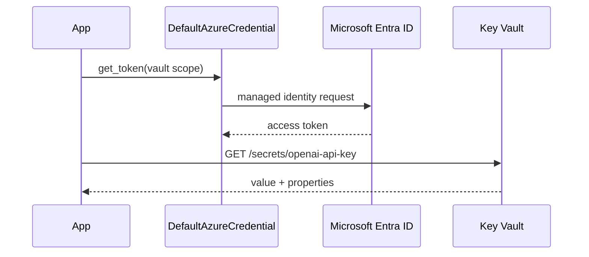

## What this covers

Retrieval is the half of the Key Vault skill you write code for. This page shows how a Python AI service reads secrets at runtime with `azure-keyvault-secrets` and `azure-identity`, how `DefaultAzureCredential` picks an identity, which exceptions mean what, and when to use the async client.

**Exam weight:** Secure, monitor, and troubleshoot Azure solutions (20–25%)

**Skills measured**

- "Secure secrets by using Azure Key Vault, including rotation and retrieval"

## Key concepts

### Packages and the client

- `azure-keyvault-secrets` provides `SecretClient` for every secret operation (needs Python 3.9 or later).
- `azure-identity` provides the credential. Every `SecretClient` needs one.
- The vault URL is `https://<vault-name>.vault.azure.net/`. Get it with `az keyvault show --name <vault-name> --query properties.vaultUri`.
- Keys and certificates have their own clients: `KeyClient` (`azure-keyvault-keys`) and `CertificateClient` (`azure-keyvault-certificates`).

### DefaultAzureCredential chain

`DefaultAzureCredential` tries credentials in order and uses the first one that works:

1. **EnvironmentCredential**: `AZURE_CLIENT_ID`, `AZURE_TENANT_ID`, `AZURE_CLIENT_SECRET` (service principal).
2. **WorkloadIdentityCredential**: Kubernetes workload identity on AKS.
3. **ManagedIdentityCredential**: system-assigned or user-assigned managed identity on Container Apps, App Service, Functions, AKS or VMs.
4. **AzureCliCredential**: the account from `az login`.
5. **AzureDeveloperCliCredential**: the account from `azd auth login`.
6. **AzurePowerShellCredential**: the account from `Connect-AzAccount`.

The same code runs locally (CLI credential) and in Azure (managed identity) with no branching. For a **user-assigned** identity, set `AZURE_CLIENT_ID` to its client ID, or pass `managed_identity_client_id=` to the credential, so the right identity is picked.

### What get_secret returns

`get_secret(name)` returns a `KeyVaultSecret` for the **latest version**:

- `.value`: the secret string to pass to downstream clients.
- `.properties`: `version`, `created_on`, `updated_on`, `expires_on`, `enabled`, `content_type`, `tags`.

Log the name and version for audit, never the value.

### Listing without values

`list_properties_of_secrets()` returns `SecretProperties` objects (name, enabled, content type, tags) but **no values**. Use it at startup to check that every required secret exists before the app takes traffic. Key Vault Secrets User includes the list permission it needs.

### Error types

| Exception | Meaning | Retry? |
| --- | --- | --- |
| `ResourceNotFoundError` | Secret name doesn't exist (404) | No, fix configuration |
| `HttpResponseError` | 401/403 (missing role), 429 throttling, server errors | Only for 429/5xx |
| `ServiceRequestError` | DNS, network, timeout | Usually yes |
| `ClientAuthenticationError` | No credential in the chain produced a token | No, fix identity |

The SDK already retries transient failures with exponential backoff, so your code only decides what to do once retries run out.

## How it works



The credential caches and refreshes tokens for you. Create one `SecretClient` per vault at startup and reuse it: building a new client per request wastes connections and token requests.

## Hands-on

### Azure portal

1. Open the Container App (or App Service) → **Identity** → turn **System assigned** on and copy the object ID.
2. Open the vault → **Access control (IAM)** → **Add role assignment** → **Key Vault Secrets User** → select that managed identity.
3. Copy the **Vault URI** from the vault **Overview** into an app environment variable such as `KEY_VAULT_URL`.

### Azure CLI

```bash
pip install azure-keyvault-secrets azure-identity

az keyvault show --name <vault-name> --query properties.vaultUri -o tsv

PRINCIPAL_ID=$(az containerapp identity assign \
  --name <app-name> --resource-group <resource-group> \
  --system-assigned --query principalId -o tsv)

az role assignment create \
  --assignee-object-id "$PRINCIPAL_ID" \
  --assignee-principal-type ServicePrincipal \
  --role "Key Vault Secrets User" \
  --scope $(az keyvault show --name <vault-name> --query id -o tsv)

az keyvault secret show --vault-name <vault-name> --name openai-api-key --query value -o tsv
az keyvault secret list --vault-name <vault-name> --query "[].name"
```

### Python

```python
from azure.core.exceptions import (
    HttpResponseError,
    ResourceNotFoundError,
    ServiceRequestError,
)
from azure.identity import DefaultAzureCredential
from azure.keyvault.secrets import SecretClient

client = SecretClient(
    vault_url="https://kv-ragpipeline-prod.vault.azure.net/",
    credential=DefaultAzureCredential(),
)

# Validate at startup: names only, no values
required = {"openai-api-key", "cosmosdb-connection-string"}
present = {p.name for p in client.list_properties_of_secrets() if p.enabled}
missing = required - present
if missing:
    raise RuntimeError(f"Missing secrets: {missing}")

def get_secret_safely(name: str) -> str:
    try:
        secret = client.get_secret(name)
        print(f"Loaded {name} version {secret.properties.version}")
        return secret.value
    except ResourceNotFoundError:
        print(f"'{name}' not found: check the name and vault")
        raise
    except HttpResponseError as e:
        print(f"Access or server error for '{name}': {e.status_code}")
        raise
    except ServiceRequestError:
        print(f"Network error reaching the vault for '{name}'")
        raise

api_key = get_secret_safely("openai-api-key")
```

Async version for FastAPI or aiohttp services:

```python
from azure.identity.aio import DefaultAzureCredential
from azure.keyvault.secrets.aio import SecretClient

async def get_ai_credentials() -> str:
    credential = DefaultAzureCredential()
    client = SecretClient(
        vault_url="https://kv-ragpipeline-prod.vault.azure.net/",
        credential=credential,
    )
    async with client:
        secret = await client.get_secret("openai-api-key")
    await credential.close()
    return secret.value
```

Close both the async client and the async credential. In a web app, create them once in the startup hook and close them on shutdown.

## Exam traps

| Scenario | Use |
| --- | --- |
| Same code locally and in Azure | `DefaultAzureCredential` |
| App on Container Apps, App Service, Functions | Managed identity + Key Vault Secrets User |
| App in AKS pods | Workload identity (`WorkloadIdentityCredential`) |
| Check secrets exist without reading values | `list_properties_of_secrets()` |
| Non-blocking calls in asyncio apps | `azure.keyvault.secrets.aio.SecretClient` |
| Read a specific older value | `get_secret(name, version=...)` |

> [!WARNING]
> **Exam trap:** A 403 from `get_secret` means authentication worked but authorization failed: the identity lacks a data plane role (or access policy). A `ClientAuthenticationError` means no token was obtained at all.

> [!WARNING]
> **Exam trap:** With several user-assigned identities on one resource, `DefaultAzureCredential` can't guess which one to use. Set `AZURE_CLIENT_ID` or `managed_identity_client_id`.

> [!TIP]
> The async packages mirror the sync ones with `.aio` added: `azure.identity.aio` and `azure.keyvault.secrets.aio`. Mixing a sync credential with an async client fails.

> [!NOTE]
> Role assignments can take a few minutes to propagate. A 403 right after assigning a role is often just timing.

## Quick review

- Install `azure-keyvault-secrets` and `azure-identity`.
- `SecretClient(vault_url, credential)`; the URL ends in `.vault.azure.net/`.
- `get_secret(name)` returns the latest version; `.value` holds the string.
- `list_properties_of_secrets()` never returns values.
- `ResourceNotFoundError` = wrong name; 403 `HttpResponseError` = missing role; `ServiceRequestError` = network.
- Managed identity comes before Azure CLI in the `DefaultAzureCredential` chain.
- Reuse one client per vault; close async clients and credentials.

## Practice

[Practice: Azure Key Vault questions](/practice/key-vault)

## Official references

- [Retrieve secrets using Azure SDK client libraries (unit)](https://learn.microsoft.com/training/modules/manage-app-secrets-key-vault/3-retrieve-secrets-sdk)
- [Azure Key Vault secrets client library for Python](https://learn.microsoft.com/python/api/overview/azure/keyvault-secrets-readme)
- [Credential chains in the Azure Identity library for Python](https://learn.microsoft.com/azure/developer/python/sdk/authentication/credential-chains)
- [Key Vault developer's guide](https://learn.microsoft.com/azure/key-vault/general/developers-guide)
