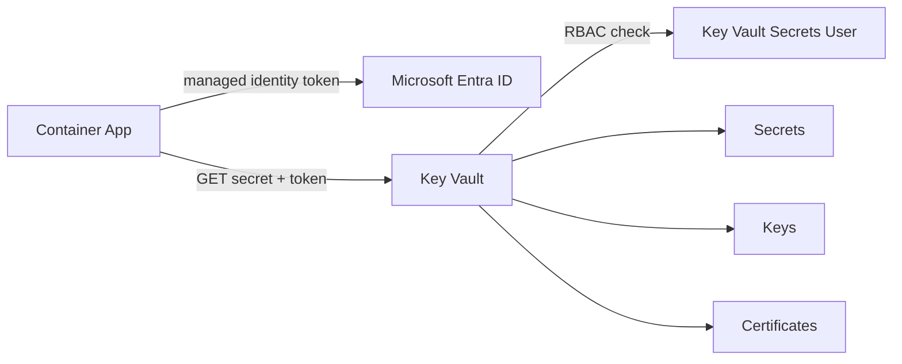

## What this covers

An AI back end juggles many credentials: a model API key, a Cosmos DB connection string, a storage account key and a TLS certificate for its public endpoint. Azure Key Vault holds all of them in one place so nothing sensitive lives in code or config files. This page covers which object type to use, how to lay out vaults, which roles to assign and how deletion protection works.

**Exam weight:** Secure, monitor, and troubleshoot Azure solutions (20–25%)

**Skills measured**

- "Secure secrets by using Azure Key Vault, including rotation and retrieval"

## Key concepts

### Three object types

| Object | What it holds | Typical AI use |
| --- | --- | --- |
| **Secret** | Any string up to 25 KB, treated as opaque bytes | API keys, connection strings, passwords, tokens |
| **Key** | RSA (2048/3072/4096), EC (P-256, P-256K, P-384, P-521) or symmetric (oct) key | Encrypt training data, sign model artifacts, customer-managed keys (CMK) |
| **Certificate** | X.509 certificate plus private key, with issuance and renewal | HTTPS endpoints, mutual TLS between services |

- A secret can carry an optional `content_type` (up to 255 characters) such as `text/plain` or `application/json` so consumers know how to parse it.
- Key operations (encrypt, sign, wrap) run **inside** the vault; raw key material is never returned.
- Creating a certificate also creates an addressable key and secret with the same name. Reading the secret returns the certificate with its private key.

### Service tiers

- **Standard**: software-protected keys (FIPS 140 Level 1). Fine for most apps.
- **Premium**: adds HSM-protected keys (FIPS 140-3 Level 3); key material never leaves the HSM. Pick it when compliance demands HSM keys.
- Managed HSM is a separate single-tenant service for the strictest requirements.

### Organizing vaults

- **Vault per application per environment**, for example `kv-ragpipeline-dev`, `kv-ragpipeline-staging`, `kv-ragpipeline-prod`. A compromise is contained to one app in one environment, and RBAC is simpler.
- **Vault names** are globally unique, 3–24 characters, letters, digits and hyphens only, start with a letter, end with a letter or digit, no consecutive hyphens. The vault URI is `https://<vault-name>.vault.azure.net/`.
- **Secret names** should be descriptive and hyphenated: `cosmosdb-connection-string`, `openai-api-key`, `blob-storage-account-key`.
- **Tags**: up to 15 per secret (name ≤512 chars, value ≤256 chars), such as `environment=production` or `rotation-policy=90-days`. Anyone with `get` or `list` can read tags, so never put sensitive data in them.

### Authorization: Azure RBAC vs access policies

Key Vault supports two permission models. **Azure RBAC** is recommended: it works at management group, subscription, resource group, vault or even individual secret scope, supports Privileged Identity Management (PIM) and uses the same model as the rest of Azure. **Vault access policies** are the legacy model: permissions are vault-wide per object type, and anyone who can write the vault's properties can grant themselves data access.

| Role | Plane | Grants |
| --- | --- | --- |
| Key Vault Secrets User | Data | Read secret values (including certificate private keys stored as secrets) |
| Key Vault Secrets Officer | Data | Create, update, delete, list secrets |
| Key Vault Administrator | Data | All data operations on keys, secrets, certificates; no role assignment rights |
| Key Vault Reader | Data | Metadata only (names, properties), never values |
| Key Vault Contributor | Control | Manage the vault resource; **no** secret reads |

Give an app's **managed identity** Key Vault Secrets User. The app then needs zero stored credentials to reach the vault that holds all its other credentials.

### Soft delete and purge protection

- **Soft delete** is on by default and can't be turned off. Deleted vaults and objects are kept for **7–90 days (default 90)**. The retention period is set at vault creation and can't be changed later.
- **Purge protection** is optional but irreversible once enabled. It blocks permanent deletion until retention ends, even for administrators. Enable it on production vaults, especially those holding CMK keys.
- Recovering a soft-deleted **vault** does not bring back its RBAC role assignments or Event Grid subscriptions. Recreate them yourself.

## How it works



The app gets a token from Microsoft Entra ID through its managed identity, calls the vault's data plane, and the vault checks the role assignment before it returns anything. Control plane calls such as creating or deleting the vault go through Azure Resource Manager and use separate roles.

## Hands-on

### Azure portal

1. Create a resource: **Key Vault**. Choose the **Standard** pricing tier, set **Days to retain deleted vaults** and enable **Purge protection** for production.
2. On the **Access configuration** tab, choose **Azure role-based access control**.
3. Open the vault: **Access control (IAM)** → **Add role assignment** → **Key Vault Secrets User** → assign it to the app's managed identity.
4. Under **Objects** → **Secrets** → **Generate/Import**, add `openai-api-key` with a content type and tags.

### Azure CLI

```bash
az keyvault create \
  --name kv-ragpipeline-prod \
  --resource-group <resource-group> \
  --location eastus \
  --sku standard \
  --enable-rbac-authorization true \
  --retention-days 90 \
  --enable-purge-protection true

VAULT_ID=$(az keyvault show --name kv-ragpipeline-prod --query id -o tsv)

az role assignment create \
  --assignee-object-id <principal-id> \
  --assignee-principal-type ServicePrincipal \
  --role "Key Vault Secrets User" \
  --scope "$VAULT_ID"

az keyvault secret set \
  --vault-name kv-ragpipeline-prod \
  --name openai-api-key \
  --value "<api-key>" \
  --content-type text/plain \
  --tags environment=production team=ai-platform

# Soft delete in action
az keyvault secret delete --vault-name kv-ragpipeline-prod --name openai-api-key
az keyvault secret list-deleted --vault-name kv-ragpipeline-prod
az keyvault secret recover --vault-name kv-ragpipeline-prod --name openai-api-key
```

### Python

```python
from azure.identity import DefaultAzureCredential
from azure.keyvault.secrets import SecretClient

client = SecretClient(
    vault_url="https://kv-ragpipeline-prod.vault.azure.net/",
    credential=DefaultAzureCredential(),
)

client.set_secret(
    "openai-api-key",
    "<api-key>",
    content_type="text/plain",
    tags={"environment": "production", "team": "ai-platform"},
)
```

## Exam traps

| Need | Choose |
| --- | --- |
| Store an API key or connection string | Secret |
| Encrypt or sign without exposing key material | Key |
| HTTPS or mTLS with auto-renewal | Certificate |
| HSM-protected keys in a multi-tenant vault | Premium tier |
| App reads secrets at runtime | Key Vault Secrets User on the managed identity |
| Pipeline creates and updates secrets | Key Vault Secrets Officer |
| Monitoring tool lists secret names only | Key Vault Reader |

> [!WARNING]
> **Exam trap:** Key Vault Contributor manages the vault resource but can't read a single secret. If an identity "has Contributor but gets 403 on get_secret", the fix is a data plane role such as Key Vault Secrets User.

> [!WARNING]
> **Exam trap:** You can't disable soft delete or change the retention period after creation, and you can't turn purge protection off once it's on.

> [!TIP]
> Secrets **User** reads, Secrets **Officer** writes. Users consume, officers manage.

> [!NOTE]
> Purging a soft-deleted vault frees its globally unique name. Until then you can't create a new vault with that name.

## Quick review

- Secrets: strings up to 25 KB; keys: crypto ops inside the vault; certificates: X.509 plus lifecycle.
- Standard = software keys; Premium = HSM-backed keys.
- One vault per app per environment limits blast radius.
- Azure RBAC is the recommended permission model; access policies are legacy.
- Key Vault Secrets User is the least-privilege role for an app that only reads secrets.
- Soft delete is always on, 7–90 days, default 90, fixed at creation.
- Purge protection blocks permanent deletion during retention and can't be disabled.

## Practice

[Practice: Azure Key Vault questions](/practice/key-vault)

## Official references

- [Manage application secrets with Azure Key Vault (module)](https://learn.microsoft.com/training/modules/manage-app-secrets-key-vault/)
- [Store and organize secrets, keys, and certificates (unit)](https://learn.microsoft.com/training/modules/manage-app-secrets-key-vault/2-store-organize-secrets)
- [About keys, secrets, and certificates](https://learn.microsoft.com/azure/key-vault/general/about-keys-secrets-certificates)
- [Azure RBAC for Key Vault](https://learn.microsoft.com/azure/key-vault/general/rbac-guide)
- [Soft-delete overview](https://learn.microsoft.com/azure/key-vault/general/soft-delete-overview)
- [AI-200 study guide](https://learn.microsoft.com/credentials/certifications/resources/study-guides/ai-200)
