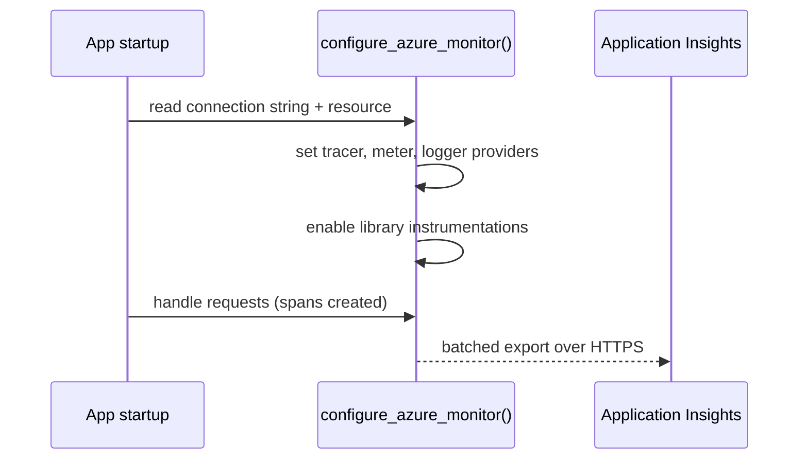

## What this covers

Adding the **OpenTelemetry SDK** wires your app so telemetry can be collected and exported. On Azure the preferred path is the **Azure Monitor OpenTelemetry Distro**: one call that configures the tracer, meter and logger providers, the Azure Monitor exporter and auto-instrumentation for popular libraries. This page covers installing it, what it collects for free, the connection string, and cloud role naming.

**Exam weight:** Secure, monitor, and troubleshoot Azure solutions (20–25%)

**Skills measured**

- "Trace distributed systems by using OpenTelemetry SDKs"

## Key concepts

### Autoinstrumentation vs SDK instrumentation

| Approach | How | Trade-off |
|----------|-----|-----------|
| **Autoinstrumentation** (codeless) | Enabled through configuration on App Service, Azure Functions, VMs | Fast, but little control over custom spans and enrichment |
| **SDK instrumentation** (manual) | OpenTelemetry SDK in your code | Full control: custom spans, attributes, sampling. Preferred for AI workloads |

The **Azure Monitor OpenTelemetry Distro** is the recommended SDK-based option. It bundles the OTel SDK, Azure Monitor exporters and common instrumentation libraries in one package.

### What the Python distro collects automatically

| Library | Captured as |
|---------|-------------|
| Flask, Django, FastAPI | Incoming HTTP → server spans → **requests** |
| `requests`, `urllib`, `urllib3`, `httpx` | Outgoing HTTP → client spans → **dependencies** |
| `psycopg2` | PostgreSQL queries → **dependencies** |
| Azure SDK (`azure_sdk`) | Calls to Storage, Service Bus, Key Vault and so on → **dependencies** |
| Python `logging` | Log records → **traces** table |

Turn individual instrumentations off with `instrumentation_options={"flask": {"enabled": False}}` or `OTEL_PYTHON_DISABLED_INSTRUMENTATIONS="psycopg2,fastapi"`.

### Manual SDK configuration

A **TracerProvider** owns how spans are created and processed. A **SpanProcessor** (usually `BatchSpanProcessor`) batches finished spans and hands them to an **exporter**. Use manual setup when you need custom processors, multiple exporters, or to understand the raw pipeline.

| Component | Role |
|-----------|------|
| **TracerProvider** | Global factory for tracers and span creation |
| **BatchSpanProcessor** | Buffers spans and exports them in batches (default every 5,000 ms) |
| **AzureMonitorTraceExporter** | Sends spans to Application Insights ingestion; handles retry and offline storage |
| **Tracer** | Creates named spans in your code |

### Connection string

Prefer the **Application Insights connection string** over the legacy instrumentation-key-only setting. It holds both the key and the regional ingestion endpoint:

```text
InstrumentationKey=xxxx;IngestionEndpoint=https://<region>.in.applicationinsights.azure.com/
```

Ways to supply it, best first for production:

1. `APPLICATIONINSIGHTS_CONNECTION_STRING` environment variable (keeps it out of code; ideal for containers and App Service).
2. `connection_string=` argument to `configure_azure_monitor(...)` or the exporter.

If both are set, the **code argument wins**.

### Cloud role name

Each service sharing one Application Insights resource needs its own **cloud role name** or the Application Map collapses everything into one node. The role name comes from the `service.name` resource attribute, prefixed by `service.namespace` when set (`rag-pipeline.embedding-service`). `service.instance.id` sets the role instance. Without `service.name`, telemetry shows up as `unknown_service`.

## How it works



Call `configure_azure_monitor()` **once, early**, before frameworks and clients are imported and used, so instrumentations can hook them.

## Hands-on

### Azure portal

1. Open the **Application Insights** resource and copy the **Connection String** from **Overview**.
2. In your App Service or Container App, add an app setting / environment variable `APPLICATIONINSIGHTS_CONNECTION_STRING`.
3. After traffic flows, open **Live Metrics** (on by default in the distro) to confirm requests arrive within seconds.

### Azure CLI

```bash
az monitor app-insights component show \
  --app <app-insights-name> --resource-group <resource-group> \
  --query connectionString -o tsv

export APPLICATIONINSIGHTS_CONNECTION_STRING="InstrumentationKey=...;IngestionEndpoint=..."
export OTEL_SERVICE_NAME="rag-api"
export OTEL_RESOURCE_ATTRIBUTES="service.namespace=rag-pipeline,service.instance.id=api-1"
```

### Python

Install the distro:

```bash
pip install azure-monitor-opentelemetry
```

Minimal setup (connection string from the environment):

```python
from azure.monitor.opentelemetry import configure_azure_monitor

configure_azure_monitor()
```

Explicit connection string, resource attributes and Microsoft Entra ID auth with managed identity:

```python
from azure.identity import ManagedIdentityCredential
from azure.monitor.opentelemetry import configure_azure_monitor
from opentelemetry.sdk.resources import Resource

configure_azure_monitor(
    connection_string="InstrumentationKey=...;IngestionEndpoint=...",
    credential=ManagedIdentityCredential(),  # Entra auth to ingestion
    resource=Resource.create({
        "service.name": "embedding-service",
        "service.namespace": "rag-pipeline",
        "service.instance.id": "embedding-instance-1",
    }),
)
```

Manual pipeline without the distro:

```python
from opentelemetry import trace
from opentelemetry.sdk.trace import TracerProvider
from opentelemetry.sdk.trace.export import BatchSpanProcessor
from azure.monitor.opentelemetry.exporter import AzureMonitorTraceExporter

provider = TracerProvider()
exporter = AzureMonitorTraceExporter(connection_string="...")
provider.add_span_processor(BatchSpanProcessor(exporter))
trace.set_tracer_provider(provider)

tracer = trace.get_tracer(__name__)
```

### C#

```csharp
builder.Services.AddOpenTelemetry()
    .UseAzureMonitor(o => o.ConnectionString = "InstrumentationKey=...");
```

## Exam traps

| Scenario | Use the Azure Monitor distro | Use manual TracerProvider setup |
|----------|------------------------------|----------------------------------|
| Standard web APIs and workers on Azure | Yes | |
| Fast bootstrap with auto-instrumentation | Yes | |
| Fine-grained processors or samplers | | Yes |
| Custom exporters or multi-backend export | | Yes |
| Learning the raw OTel pipeline pieces | | Yes |

> [!WARNING]
> **Exam trap:** Use the **connection string**, not the instrumentation key alone. Instrumentation-key-only ingestion is retired; the connection string also carries the regional endpoint.

> [!WARNING]
> **Exam trap:** All services showing as one node or as `unknown_service` means `service.name` / `OTEL_SERVICE_NAME` is not set per service.

> [!TIP]
> Order of the pattern: configure → provider → processor → exporter → tracer. Package APIs change; the pattern does not.

> [!NOTE]
> Microsoft docs (late 2026) also describe a newer **Microsoft OpenTelemetry Distro** for Python (`pip install microsoft-opentelemetry`, `use_microsoft_opentelemetry(enable_azure_monitor=True, ...)`). The Learn module for this exam uses `azure-monitor-opentelemetry`. Never initialize both distros in one process.

## Quick review

- Python distro package: `azure-monitor-opentelemetry`; .NET: `Azure.Monitor.OpenTelemetry.AspNetCore` (`UseAzureMonitor()`).
- `configure_azure_monitor()` sets up traces, metrics and logs in one call.
- Connection string env var: `APPLICATIONINSIGHTS_CONNECTION_STRING`; code argument takes precedence.
- Flask/Django/FastAPI, `requests`, `urllib3`, `httpx`, `psycopg2` and Azure SDK calls are auto-instrumented.
- Cloud role name = `service.namespace` + `service.name`; set via `Resource` or `OTEL_SERVICE_NAME`.
- Pass `credential=` (managed identity) for Entra ID authenticated ingestion.

## Practice

[Practice: OpenTelemetry questions](/practice/opentelemetry)

## Official references

- [Add the OpenTelemetry SDK to an application (Learn unit)](https://learn.microsoft.com/en-us/training/modules/instrument-app-opentelemetry/3-add-opentelemetry-sdk)
- [Azure Monitor OpenTelemetry Distro for Python (readme)](https://learn.microsoft.com/en-us/python/api/overview/azure/monitor-opentelemetry-readme)
- [Enable Azure Monitor OpenTelemetry for Python](https://learn.microsoft.com/en-us/azure/azure-monitor/app/opentelemetry-enable?tabs=python)
- [Configure OpenTelemetry in Application Insights](https://learn.microsoft.com/en-us/azure/azure-monitor/app/opentelemetry-configuration?tabs=python)
- [Connection strings](https://learn.microsoft.com/en-us/azure/azure-monitor/app/connection-strings)
- [AI-200 study guide](https://learn.microsoft.com/en-us/credentials/certifications/resources/study-guides/ai-200)
