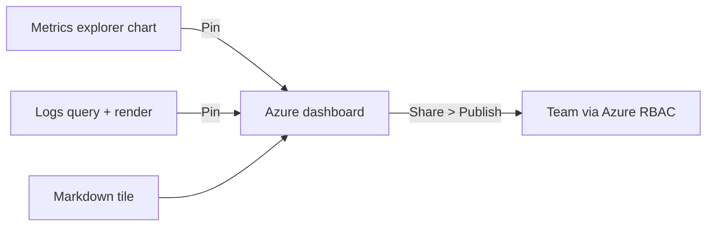

## What this covers

**Dashboards** give at-a-glance health for AI services: request rate, failure rate, P95 latency and dependency health. In Azure you pin charts from **Azure Monitor metrics**, **Log Analytics / Application Insights queries**, Markdown and resource tiles onto a shared **Azure dashboard** in the portal. This page covers pinning metrics and KQL results, how tiles refresh, sharing with RBAC, and design guidance.

**Exam weight:** Secure, monitor, and troubleshoot Azure solutions (20–25%)

**Skills measured**

- "Write KQL queries to analyze logs and metrics"

## Key concepts

### Azure dashboard

An **Azure dashboard** is a customizable portal page of tiles: metrics charts, log query results, Markdown text and items from the Tile Gallery. One dashboard can combine resources from **multiple subscriptions and resource groups**, for example App Insights next to AKS node health and storage throughput. Use it as the "front door" for service health on a team screen or at stand-up.

### Dashboards vs workbooks

| Dashboards | Workbooks |
|------------|-----------|
| Always-on status for a service ("is it healthy?") | Guided troubleshooting / deep analysis ("why?") |
| Shared team wall / ops overview | Parameters, drill-downs, multi-step stories |
| Few key tiles, static layout, scheduled refresh | Many linked queries and visuals, interactive |

### Metrics tiles vs log tiles

| Metrics explorer | Log-based tiles |
|------------------|-----------------|
| Pre-aggregated standard and custom metrics, near real time | Rich App Insights tables and custom dimensions |
| Simple charts, less flexible | Full KQL power |
| Good for request rate, server response time, failed requests, availability | Good for AI custom attributes, joins, percentiles |

Common Application Insights metrics to pin: **Server response time**, **Failed requests**, **Dependency failures**, **Server request rate**, **Availability**. Pick the aggregation deliberately: **Avg** for typical latency, **Sum** for totals, **Max** for worst-case spikes. Use **filters** (for example one cloud role) and **splitting** (by operation or result code) before pinning.

### Typical AI app tiles

| Tile | Source idea |
|------|-------------|
| Request rate | App Insights metric, or KQL `summarize count() by bin(...)` |
| Failure rate | `countif(Success == false) / count()` |
| P95 latency | `percentile(DurationMs, 95)` |
| Top failing dependencies | `AppDependencies` summarize by `Target` |
| Exception count | `AppExceptions` count over time |

### Refresh and sharing

Tiles are **not real-time**; they show results as of the last scheduled refresh. During an incident use **Live Metrics** or a workbook. To share, select **Share** → **Publish**; the dashboard becomes an Azure resource governed by **Azure RBAC**. Viewers need read access to the dashboard **and** to each underlying data source, or the tile shows an access error.

## How it works



The chart type you pick when pinning (or the `render` in the query) is preserved on the tile.

## Hands-on

### Azure portal

Pin a metric:

1. Application Insights → **Metrics**.
2. Choose **Server response time**, aggregation **Avg**; add a filter on cloud role name; optionally **Apply splitting** by operation name.
3. Select **Pin to dashboard** → choose an existing or new dashboard.

Pin a log query:

1. Open Application Insights → **Logs**.
2. Run a query ending with `| render timechart` (or `barchart`).
3. Select **Pin to** → **Azure dashboard**.
4. Open the dashboard → **Edit**: resize, arrange and rename tiles; add a Markdown tile; save, then **Share** → **Publish**.

### Azure CLI

```bash
# Export a dashboard you built in the portal, then recreate it elsewhere
az portal dashboard show --name <dashboard-name> --resource-group <resource-group> > dashboard.json
az portal dashboard create --name <dashboard-name> --resource-group <resource-group> \
  --location eastus --input-path dashboard.json
```

### Python

```python
from datetime import timedelta
from azure.identity import DefaultAzureCredential
from azure.monitor.query import MetricsQueryClient

client = MetricsQueryClient(DefaultAzureCredential())
resp = client.query_resource(
    "<app-insights-resource-id>",
    metric_names=["requests/failed"],
    timespan=timedelta(hours=24),
    granularity=timedelta(hours=1),
    aggregations=["Count"],
)
for ts in resp.metrics[0].timeseries:
    print([p.count for p in ts.data])
```

### KQL tiles

Failure rate over time (workspace names):

```kql
AppRequests
| where TimeGenerated > ago(24h)
| summarize
    Requests = count(),
    Failures = countif(Success == false)
    by bin(TimeGenerated, 1h)
| extend FailureRate = round(100.0 * Failures / Requests, 2)
| render timechart
```

Failed requests by service (classic names):

```kql
requests
| where timestamp > ago(24h)
| where success == false
| summarize failedCount = count() by cloud_RoleName
| render barchart
```

Latency percentiles; a widening gap between p50 and p95 means a subset of requests is degrading:

```kql
requests
| where timestamp > ago(24h)
| summarize p50 = percentile(duration, 50),
    p95 = percentile(duration, 95),
    p99 = percentile(duration, 99)
    by bin(timestamp, 1h)
| render timechart
```

## Exam traps

| Requirement | Choose |
|-------------|--------|
| Persistent team health view across subscriptions | Azure dashboard |
| Interactive filters and drill-down | Workbook |
| Second-by-second view during an incident | Live Metrics |
| Tile based on a custom span attribute | Pinned KQL query |
| Simple request rate with low effort | Pinned metric chart |

> [!WARNING]
> **Exam trap:** Sharing a dashboard does not grant access to its data. Users also need read RBAC on the Application Insights resource or workspace behind each tile.

> [!WARNING]
> **Exam trap:** Dashboard tiles refresh on a schedule. They are not a real-time monitoring tool.

> [!TIP]
> Design rules: one dashboard per service or pipeline stage (ingest, embed, serve), failures and latency above traffic charts, 5–10 clearly named tiles ("Classification P95 latency", not "Query 3"), and a Markdown tile with runbook links and on-call contacts.

## Quick review

- Pin from Metrics, from Logs (with `render`), or from Application Insights blades.
- A dashboard can mix resources from multiple subscriptions.
- Metrics tiles = simple and fast; log tiles = full KQL.
- Tiles refresh periodically; use Live Metrics for real time.
- Share → Publish; RBAC applies to the dashboard and the data sources.
- Dashboards answer "is it healthy?"; workbooks answer "why?".

## Practice

[Practice: KQL questions](/practice/kql)

## Official references

- [Build dashboards for app telemetry (Learn unit)](https://learn.microsoft.com/en-us/training/modules/analyze-telemetry-logs-metrics/4-build-dashboards-app-telemetry)
- [Create Azure dashboards](https://learn.microsoft.com/en-us/azure/azure-portal/azure-portal-dashboards)
- [Pin Log Analytics charts](https://learn.microsoft.com/en-us/azure/azure-monitor/visualize/tutorial-logs-dashboards)
- [AI-200 study guide](https://learn.microsoft.com/en-us/credentials/certifications/resources/study-guides/ai-200)
