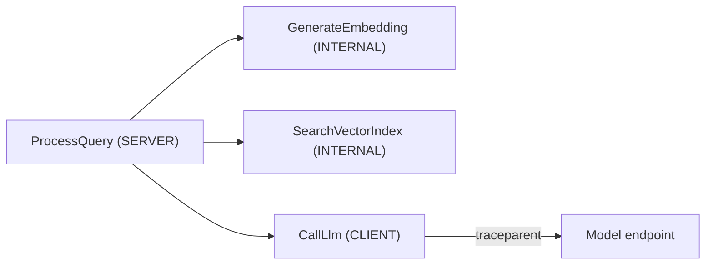

## What this covers

A **trace** is the end-to-end journey of one request. A **span** is one unit of work inside it (an HTTP call, a DB query, an embedding step). Spans nest into a parent/child tree, and that nesting produces the waterfall view in Application Insights. Auto-instrumentation covers HTTP and database calls, but AI-specific steps (embed, search, assemble prompt, call LLM) need **custom spans**. This page covers creating them, choosing span kinds, adding attributes, recording errors, propagating context and sampling.

**Exam weight:** Secure, monitor, and troubleshoot Azure solutions (20–25%)

**Skills measured**

- "Trace distributed systems by using OpenTelemetry SDKs"

## Key concepts

### Tracers and spans

Call `trace.get_tracer("name")` once per service or component; the name identifies the instrumentation source. After `configure_azure_monitor()` no other registration is needed in Python because the distro sets the global tracer provider. `tracer.start_as_current_span("Name")` is a context manager: the span starts on entering the `with` block and ends on exit, even if an exception escapes.

Nesting `with` blocks creates parent/child spans automatically. The SDK tracks the current span with Python context variables, so you never pass parent references by hand. All spans in the tree share one **trace ID**, which Azure groups as `operation_Id` / `OperationId`.

### Span kinds

| `SpanKind` | Meaning | Lands in |
|------------|---------|----------|
| `SERVER` | Incoming request handled by this service | `requests` / `AppRequests` |
| `CONSUMER` | Processing a message from a queue/topic | `requests` / `AppRequests` |
| `CLIENT` | Outgoing call to another service | `dependencies` / `AppDependencies` |
| `PRODUCER` | Sending a message to a queue/topic | `dependencies` / `AppDependencies` |
| `INTERNAL` (default) | In-process work | `dependencies` / `AppDependencies` (type `InProc`) |

### Attributes, status and events

| Concept | Definition | Example |
|---------|------------|---------|
| **Attribute** | Key-value metadata on a span | `model.name = gpt-4o`, `http.status_code = 200` |
| **Status** | Outcome of the span (`UNSET`, `OK`, `ERROR`) | Failed payment → `ERROR` |
| **Event** | Timestamped note attached to a span | `span.add_event("cache_miss")` |
| **Exception recording** | Attach exception type, message, stack | `span.record_exception(ex)` |

**Resource attributes** (`service.name`) describe the whole service and are set once at startup. **Span attributes** describe one operation. Span attributes become **custom dimensions** (`customDimensions` classic, `Properties` workspace) and are queryable in KQL. Use namespaced keys such as `embedding.model`, `search.result_count`, `llm.prompt_tokens`; avoid generic keys like `value` or `data`. Values must be strings, numbers, booleans or arrays of these.

If an exception propagates out of `start_as_current_span`, the Python SDK records it and sets status `ERROR` automatically. If you catch it yourself, call `record_exception()` and `set_status()` explicitly.

### Context propagation

**Context propagation** carries the active trace across process and network boundaries so Service B's spans join Service A's trace. HTTP uses the W3C **`traceparent`** header (plus optional `tracestate`).

- Auto-instrumentation for `requests`, `httpx` and `HttpClient` injects and extracts headers for you.
- Message queues and custom protocols often need **manual** `inject()` into message properties and `extract()` on the consumer.
- If traces "stop" at a service boundary, propagation broke or the next service is not instrumented.

```text
Service A span  --traceparent-->  Service B span  --traceparent-->  DB dependency
                 (same Trace ID / operation_Id across the chain)
```

### Sampling

**Sampling** decides which traces to keep, to control ingestion cost.

| Approach | Notes |
|----------|-------|
| **Rate limited** (distro default) | Caps traces per second; Python distro default is about 5 traces/sec. `traces_per_second=1.5` or `OTEL_TRACES_SAMPLER=microsoft.rate_limited` |
| **Fixed percentage** | Keep a ratio, for example 10%: `sampling_ratio=0.1` or `OTEL_TRACES_SAMPLER=microsoft.fixed_percentage` + `OTEL_TRACES_SAMPLER_ARG=0.1` |
| **Ratio-based (plain OTel)** | `TraceIdRatioBased(0.1)` keeps about 10% of traces by trace ID |
| **Parent-based** | Child spans follow the parent's sampling decision so traces stay complete |

## How it works



The root span becomes a row in `requests`; the three children become rows in `dependencies`; all share one `operation_Id`. In the end-to-end transaction view, the waterfall shows each child's duration relative to the root, so an 8-second `CallLlm` inside a 10-second request stands out immediately.

## Hands-on

### Azure portal

1. Run the app and send a request.
2. Open Application Insights → **Transaction search**, filter to the operation name.
3. Open the result; the waterfall shows the nested custom spans. Select a span to see its attributes under **Custom properties** and any recorded exception.

### Azure CLI

```bash
az monitor app-insights query \
  --app <app-insights-name> --resource-group <resource-group> \
  --analytics-query "dependencies | where timestamp > ago(30m) | where name == 'GenerateEmbedding' | project timestamp, duration, customDimensions" \
  --output table
```

### Python

Nested spans for a RAG request, with kinds and attributes:

```python
from azure.monitor.opentelemetry import configure_azure_monitor
from opentelemetry import trace
from opentelemetry.trace import SpanKind

configure_azure_monitor()
tracer = trace.get_tracer("llm-orchestrator")

def process_query(query: str) -> str:
    with tracer.start_as_current_span("ProcessQuery", kind=SpanKind.SERVER) as root:
        root.set_attribute("query.length", len(query))
        with tracer.start_as_current_span("GenerateEmbedding") as span:
            span.set_attribute("embedding.model", "text-embedding-3-large")
            embedding = embed(query)
        with tracer.start_as_current_span("SearchVectorIndex") as span:
            span.set_attribute("search.top_k", 5)
            docs = vector_search(embedding, top_k=5)
            span.set_attribute("search.result_count", len(docs))
            if not docs:
                span.add_event("no_results")
        with tracer.start_as_current_span("CallLlm", kind=SpanKind.CLIENT) as span:
            response = call_llm(query, docs)
            span.set_attribute("llm.response_tokens", response.usage.completion_tokens)
            return response.content
```

Recording a handled failure:

```python
from opentelemetry import trace
from opentelemetry.trace import Status, StatusCode

with tracer.start_as_current_span("process_order") as span:
    span.set_attribute("order.id", order_id)
    with tracer.start_as_current_span("charge_payment") as child_span:
        child_span.set_attribute("payment.method", "card")
        try:
            charge_card(order_id)
        except Exception as ex:
            child_span.record_exception(ex)
            child_span.set_status(Status(StatusCode.ERROR, "Payment failed"))
            raise
```

Manual propagation over a message queue (for example Service Bus application properties):

```python
from opentelemetry.propagate import inject, extract
from opentelemetry.trace import SpanKind

# Producer
with tracer.start_as_current_span("enqueue_doc", kind=SpanKind.PRODUCER):
    headers = {}
    inject(headers)                       # adds traceparent / tracestate
    send_message(body, properties=headers)

# Consumer
ctx = extract(message.application_properties)
with tracer.start_as_current_span("process_doc", context=ctx, kind=SpanKind.CONSUMER):
    handle(message)
```

Sampling with plain OTel (manual TracerProvider):

```python
from opentelemetry.sdk.trace import TracerProvider
from opentelemetry.sdk.trace.sampling import ParentBasedTraceIdRatio

# Keep ~10% of root traces; children follow the parent decision
provider = TracerProvider(sampler=ParentBasedTraceIdRatio(0.1))
```

## Exam traps

| Create a custom span | Rely on auto-instrumentation |
|----------------------|------------------------------|
| AI-specific steps (embed, rank, call LLM) | Outbound HTTP via `requests` / `HttpClient` |
| Business operations you want named in the UI | Framework request handling (Flask, ASP.NET) |
| Logical stages inside one function | Standard DB drivers already instrumented |

> [!WARNING]
> **Exam trap:** A queue consumer span must be `SpanKind.CONSUMER` (a request) and must use the **extracted** context as its parent. Otherwise each message starts a new, disconnected trace.

> [!WARNING]
> **Exam trap:** Setting status `ERROR` alone does not attach the stack trace. Call `record_exception()` too when you catch an exception.

> [!TIP]
> Server or Consumer = Request; everything else = Dependency.

> [!NOTE]
> Sampling applies to traces only. Metrics are never sampled. The kept spans carry the sample rate so portal counts are scaled back up (`itemCount`).

## Quick review

- `trace.get_tracer(name)` then `start_as_current_span(name)`; nesting creates parent/child automatically.
- `INTERNAL` is the default span kind and lands in dependencies.
- `set_attribute` values become custom dimensions you can filter in KQL.
- `record_exception` + `set_status(Status(StatusCode.ERROR, ...))` for handled errors.
- `traceparent` carries trace context over HTTP; use `inject`/`extract` for queues.
- Python distro defaults to rate-limited sampling (~5 traces/sec); env vars override code.
- Parent-based sampling keeps traces whole.

## Practice

[Practice: OpenTelemetry questions](/practice/opentelemetry)

## Official references

- [Configure spans and traces (Learn unit)](https://learn.microsoft.com/en-us/training/modules/instrument-app-opentelemetry/4-configure-spans-traces)
- [Add and modify OpenTelemetry in Application Insights](https://learn.microsoft.com/en-us/azure/azure-monitor/app/opentelemetry-add-modify?tabs=python)
- [Configure OpenTelemetry sampling](https://learn.microsoft.com/en-us/azure/azure-monitor/app/opentelemetry-configuration?tabs=python)
- [Traces and spans](https://opentelemetry.io/docs/concepts/signals/traces/)
- [W3C Trace Context](https://www.w3.org/TR/trace-context/)
- [AI-200 study guide](https://learn.microsoft.com/en-us/credentials/certifications/resources/study-guides/ai-200)
