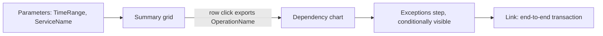

## What this covers

**Azure Monitor Workbooks** are interactive reports inside Azure Monitor: parameterized KQL, metrics, charts, grids and Markdown in one document. Use them when a dashboard is not enough and you need guided analysis of AI app telemetry, such as "why is RAG slow for this service in this time window?". This page covers workbook steps, parameters and their syntax, visualizations, drill-down with links and conditional visibility, and saving and sharing.

**Exam weight:** Secure, monitor, and troubleshoot Azure solutions (20–25%)

**Skills measured**

- "Write KQL queries to analyze logs and metrics"

## Key concepts

### Workbook

An **Azure Workbook** is an interactive canvas of **steps** rendered top to bottom. Data sources include Logs (Log Analytics / Application Insights), Metrics, Azure Resource Graph and others. Authors build the analysis story; operators change parameters without rewriting KQL. Open workbooks from **Azure Monitor**, a **Log Analytics workspace** or an **Application Insights** resource; the gallery has templates for performance, failure and usage analysis.

| Step type | Purpose |
|-----------|---------|
| Text | Markdown explanations, "what to check next" |
| Parameters | Inputs (time range, dropdowns, resource picker) |
| Query | KQL against Logs, shown as grid, chart, tiles or map |
| Metrics | Azure resource metrics charts |
| Group | Container for steps (tabs, collapsible sections) |

### Parameters

Parameters make workbooks interactive. Reference them inside queries with braces: `{TimeRange}`, `{ServiceName}`, `{OperationName}`. When a user changes a value, every step that references it re-runs.

| Parameter type | Example use |
|----------------|-------------|
| **Time range** | Last hour / 24 hours / 7 days for all queries |
| **Drop down** | Service names from a KQL query or a static list; supports multi-select |
| **Resource picker** | Choose which App Insights resource or workspace to analyze |
| **Text** | Free text such as a route or model deployment name |

Multi-select values become a comma-separated list, so filter with `in`: `| where AppRoleName in ({ServiceName})`.

### Drill-down: conditional visibility and links

- **Conditional visibility** shows or hides a step based on a parameter value (for example, show exception details only after a service is selected).
- **Grid link actions** make a column clickable to open end-to-end transaction details, open another workbook, or **export a parameter** that filters later steps.

### When to use

| Use a workbook | Prefer a plain dashboard / saved query |
|----------------|----------------------------------------|
| Multi-step investigation with filters | Single KPI glance |
| Shared troubleshooting runbook | Ad-hoc one-off query |
| Comparing services via parameters | Pinning one chart |

## How it works



Typical structure for an AI API workbook:

1. **Parameters**: time range, `service.name` (cloud role), HTTP route
2. **Overview**: request volume, failure rate, P95
3. **Dependencies**: slow or failing outbound calls (Cosmos DB, PostgreSQL vector stores, model endpoints)
4. **Exceptions**: top `ProblemId`s linked by `OperationId`
5. **Sample traces**: grid of recent failed `OperationId`s to open in Transaction search

## Hands-on

### Azure portal

1. Azure Monitor or Application Insights → **Workbooks** → **+ New** (Empty), or start from a template.
2. **Add parameters**: TimeRange (Time range picker); ServiceName (Drop down, query below, allow multiple selections).
3. **Add query**: data source **Logs**, resource type Application Insights, write KQL, choose visualization (time chart, grid, tiles).
4. On a grid, open **Column settings** → set a column to **Link** and choose an action (export parameter or open details).
5. On a detail step, open **Advanced settings** → **Make this item conditionally visible** when the parameter is set.
6. **Save** to a resource group with a clear name (`AI-200 RAG health`), as a shared workbook so teammates with RBAC read access can open it.

### Azure CLI

```bash
# Workbooks are ARM resources (Microsoft.Insights/workbooks); list them in a resource group
az resource list --resource-group <resource-group> \
  --resource-type "Microsoft.Insights/workbooks" --output table
```

### Python

Test a workbook query outside the portal before adding it as a step:

```python
from datetime import timedelta
from azure.identity import DefaultAzureCredential
from azure.monitor.query import LogsQueryClient

client = LogsQueryClient(DefaultAzureCredential())
q = "AppRequests | summarize count() by AppRoleName"
print(client.query_workspace("<workspace-guid>", q, timespan=timedelta(days=1)).tables[0].rows)
```

### KQL steps

Dropdown parameter source (distinct services):

```kql
AppRequests
| where TimeGenerated {TimeRange}
| distinct AppRoleName
```

Overview step bound to parameters:

```kql
AppRequests
| where TimeGenerated {TimeRange}
| where AppRoleName in ({ServiceName})
| where Name has "{OperationName}"
| summarize
    Total = count(),
    Failures = countif(Success == false),
    P95 = percentile(DurationMs, 95)
  by bin(TimeGenerated, 1h)
```

Success rate per service (classic names, as in the Learn unit, where `{TimeRange}` is used with `ago()`):

```kql
requests
| where timestamp > ago({TimeRange})
| summarize totalRequests = count(),
    failedRequests = countif(success == false)
    by cloud_RoleName
| extend successRate = round(100.0 * (totalRequests - failedRequests) / totalRequests, 2)
| project cloud_RoleName, totalRequests, failedRequests, successRate
```

Model deployment parameter via custom dimensions:

```kql
AppDependencies
| where TimeGenerated {TimeRange}
| where tostring(Properties["gen_ai.model"]) == "{ModelName}"
| summarize P95 = percentile(DurationMs, 95) by Name
```

## Exam traps

| Need | Feature |
|------|---------|
| One filter drives every chart | Parameter referenced as `{Name}` |
| Compare 2–3 services | Multi-select dropdown + `in ({Param})` |
| Click a row to filter the rest | Grid link → export parameter |
| Hide detail until needed | Conditional visibility |
| Reuse across environments | Resource picker parameter |

> [!WARNING]
> **Exam trap:** Workbooks are for interactive investigation; a dashboard is for always-on glanceable status. Questions about "parameters", "drill-down" or "guided troubleshooting" point to workbooks.

> [!WARNING]
> **Exam trap:** A multi-select parameter needs `in ({Param})`, not `== "{Param}"`.

> [!TIP]
> Every query step re-runs when a parameter changes. Keep steps few and time-scoped to control load time and cost.

> [!NOTE]
> A time range parameter can be inserted directly as `TimeGenerated {TimeRange}`, which expands to the selected range, or its duration can be used in expressions.

## Quick review

- Workbooks combine text, parameters, KQL and metrics steps in one report.
- Parameters are referenced with `{ParamName}`.
- Parameter types: time range, dropdown, resource picker, text.
- Grid link actions and conditional visibility enable drill-down.
- Save as a shared workbook to a resource group; access is governed by RBAC.
- Start from gallery templates for failures and performance.

## Practice

[Practice: KQL questions](/practice/kql)

## Official references

- [Create workbooks for interactive analysis (Learn unit)](https://learn.microsoft.com/en-us/training/modules/analyze-telemetry-logs-metrics/5-create-workbooks-interactive-analysis)
- [Azure Workbooks overview](https://learn.microsoft.com/en-us/azure/azure-monitor/visualize/workbooks-overview)
- [Workbook parameters](https://learn.microsoft.com/en-us/azure/azure-monitor/visualize/workbooks-parameters)
- [AI-200 study guide](https://learn.microsoft.com/en-us/credentials/certifications/resources/study-guides/ai-200)
