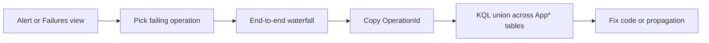

## What this covers

Distributed AI systems fail in pieces: the API returns 500 because a dependency timed out three hops away. **Trace data** lets you rebuild the whole path using **`OperationId`** (the Azure name for the OTel trace ID) and find the break point. This page covers the portal tools (Application Map, end-to-end transaction details) and the KQL patterns that correlate requests, dependencies, exceptions and logs.

**Exam weight:** Secure, monitor, and troubleshoot Azure solutions (20–25%)

**Skills measured**

- "Trace distributed systems by using OpenTelemetry SDKs"
- "Write KQL queries to analyze logs and metrics"

## Key concepts

### Operation ID

**`OperationId`** (classic `operation_Id`) is the shared correlation ID for one end-to-end request across all Application Insights tables. It equals the OpenTelemetry **trace ID**. `ParentId` (classic `operation_ParentId`) links a row to its parent span.

### Application Map

A topology view: each **node** is a cloud role (from `service.name`), each **edge** is a call between roles. Nodes and edges show average duration, call count and failure rate for the time range, so a vector search node averaging 5 s next to 500 ms nodes stands out. Select a node or edge to drill into its requests and dependencies.

### End-to-end transaction details

A **waterfall** of every span in one trace: root at the top, children indented, horizontal bars for start time and duration. Sequential work appears in series, parallel work overlaps. Selecting a span shows its name, duration, status, custom attributes and any recorded exception with stack trace. Reach it from **Performance**, **Failures**, **Transaction search** or the **Application Map**.

### AI-specific failure patterns

| Pattern | Signal in trace data |
|---------|---------------------|
| Embedding timeouts | Embedding dependency spans over the timeout or with error status; segment by `embedding.model` |
| Vector search cold starts | High variance in search span duration, slow clusters after idle periods |
| LLM rate limiting | Dependency `ResultCode` 429 and long durations from retry back-off |
| Context window overflow | Errors from the model call; track `llm.prompt_tokens` near the limit |

### Common failure modes

| Symptom | Likely cause |
|---------|--------------|
| Trace ends at Service A; nothing in Service B | Missing `traceparent` or B not instrumented |
| Request OK, dependency failed | Downstream error handled by retry; inspect `AppDependencies` / `AppExceptions` |
| High duration, Success true | Slow path (DB, model, cold start), not a hard failure |
| Many `unknown_service` rows | Missing `OTEL_SERVICE_NAME` / `service.name` |
| Gaps in high-traffic apps | Aggressive sampling; raise the rate temporarily while debugging |

## How it works



Debugging workflow:

1. **Portal waterfall**: Application Insights → Performance or Failures → open a request → end-to-end transaction.
2. **Or hunt by pattern in KQL**, for example a failing dependency target.
3. **Pivot on `OperationId`**: `union` all telemetry for that operation.
4. **Find the break**: failing child, ballooning duration, or missing spans after a hop.
5. **Fix instrumentation** if traces stop cold at a queue or service with no children.

## Hands-on

### Azure portal

1. Application Insights → **Application Map**; select the slowest node.
2. Select **Investigate performance**, choose the operation, then a slow sample.
3. In the waterfall, select the longest child span and read its attributes and exception details.

### Azure CLI

```bash
az monitor log-analytics query \
  --workspace <workspace-guid> \
  --analytics-query "AppDependencies | where TimeGenerated > ago(1h) and Success == false | summarize count() by Target, ResultCode" \
  --output table
```

### Python

Stamp searchable context so traces can be filtered later:

```python
from opentelemetry import trace

span = trace.get_current_span()
span.set_attribute("llm.prompt_tokens", prompt_tokens)
span.set_attribute("tenant.id", tenant_id)
print(format(span.get_span_context().trace_id, "032x"))  # log it to find the trace
```

### KQL patterns (workspace names)

Find failing calls to one target:

```kql
AppDependencies
| where Success == false and Target == "payments-api"
| project OperationId, TimeGenerated, Name, ResultCode
```

Rebuild those operations:

```kql
union AppRequests, AppDependencies, AppExceptions, AppTraces
| where OperationId in ("id1", "id2", "id3")
| order by OperationId, TimeGenerated asc
```

Full timeline for one operation. `Type` holds the source table name:

```kql
union AppRequests, AppDependencies, AppTraces, AppExceptions
| where OperationId == "abc123def456"
| project TimeGenerated, Type, Name, Message, DurationMs
| order by TimeGenerated asc
```

Exceptions joined to the triggering request:

```kql
AppExceptions
| where TimeGenerated > ago(6h)
| join kind=inner (AppRequests | where TimeGenerated > ago(6h)) on OperationId
| project TimeGenerated, ProblemId, OuterMessage, Name, ResultCode
```

P95 latency by operation:

```kql
AppRequests
| where TimeGenerated > ago(1d)
| summarize p95 = percentile(DurationMs, 95) by Name
| order by p95 desc
```

### KQL patterns (App Insights scope, classic names)

```kql
requests
| where duration > 3000
| summarize count(), avg(duration) by cloud_RoleName
| order by avg_duration desc
```

```kql
requests
| where duration > 5000
| join kind=inner (dependencies) on operation_Id
| project timestamp, requestName = name, requestDuration = duration,
    dependencyName = name1, dependencyDuration = duration1, dependencyTarget = target
| order by requestDuration desc
```

```kql
dependencies
| where name == "GenerateEmbedding"
| extend tokenCount = toint(customDimensions["embedding.token_count"]),
    model = tostring(customDimensions["embedding.model"])
| summarize avg(duration), percentile(duration, 95), avg(tokenCount) by model
```

## Exam traps

| Question asks for | Use |
|-------------------|-----|
| Which service is slow, at a glance | Application Map |
| Timing of every hop in one request | End-to-end transaction details |
| Patterns across many requests | KQL on `AppRequests` / `AppDependencies` |
| One timeline across tables | `union` + `where OperationId == ...` |
| Request context for an exception | `join` on `OperationId` |

> [!WARNING]
> **Exam trap:** In the workspace schema the table-name column is **`Type`** (classic: `itemType`). There is no lowercase `type` column in `App*` tables; `AppDependencies` uses `DependencyType` for the dependency kind.

> [!WARNING]
> **Exam trap:** After a join, duplicate column names get a `1` suffix (`name1`, `duration1`). Rename inside the subquery to avoid confusion.

> [!TIP]
> Parent succeeds + child fails = look at the dependency. Duration spike without exception = bottleneck, not error.

## Quick review

- `OperationId` = OTel trace ID; it ties every table together.
- Application Map nodes = cloud roles; edges = calls with duration and failure rate.
- The waterfall shows span durations, attributes and exceptions for one trace.
- `union` stacks tables; `Type` tells which table each row came from.
- 429 result codes on model calls signal rate limiting.
- Traces stopping at a boundary = missing `traceparent` or uninstrumented service.

## Practice

[Practice: OpenTelemetry questions](/practice/opentelemetry) · [Practice: KQL questions](/practice/kql)

## Official references

- [Debug distributed flows with trace data (Learn unit)](https://learn.microsoft.com/en-us/training/modules/instrument-app-opentelemetry/6-debug-distributed-flows-trace-data)
- [Diagnose failures with Application Insights](https://learn.microsoft.com/en-us/azure/azure-monitor/app/transaction-diagnostics)
- [Correlation in Application Insights](https://learn.microsoft.com/en-us/azure/azure-monitor/app/correlation)
- [AI-200 study guide](https://learn.microsoft.com/en-us/credentials/certifications/resources/study-guides/ai-200)
