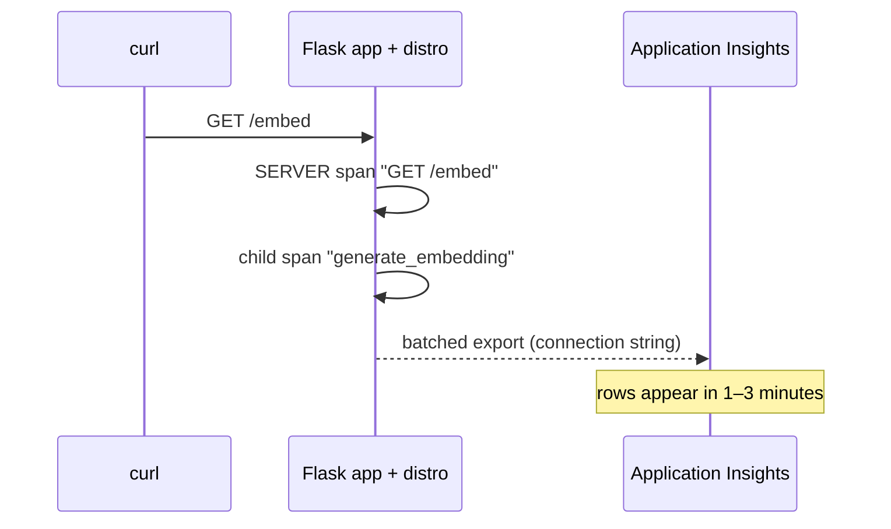

## What this covers

This exercise instruments a small Python AI-style API end to end: create a Log Analytics workspace and a workspace-based Application Insights resource, configure the **Azure Monitor OpenTelemetry Distro**, add a custom span with attributes for an "embedding" step, and confirm the telemetry in the portal and with KQL. The official Learn exercise uses a Flask document-processing pipeline with parent and child spans and has you diagnose a simulated latency bottleneck; the steps below follow the same shape.

**Exam weight:** Secure, monitor, and troubleshoot Azure solutions (20–25%)

**Skills measured**

- "Trace distributed systems by using OpenTelemetry SDKs"
- "Write KQL queries to analyze logs and metrics"

## Key concepts

### Goals

- Create (or reuse) a Log Analytics workspace + Application Insights resource
- Install and configure the Azure Monitor OpenTelemetry distro
- Add a custom span with attributes for an "embedding" step
- Confirm telemetry in `AppRequests` / `AppDependencies` and the custom attributes

### Prerequisites

- Azure subscription, Azure CLI logged in (`az login`)
- Python 3.10+ (the Learn lab asks for 3.12+) and VS Code
- A resource group, for example `<resource-group>`

### What you should see

| Telemetry | Where it lands | Why |
|-----------|----------------|-----|
| `GET /embed` | `AppRequests` (`requests`) | Flask instrumentation creates a SERVER span |
| `generate_embedding` | `AppDependencies` (`dependencies`), type InProc | Custom span defaults to `SpanKind.INTERNAL` |
| `gen_ai.model`, `documents.count` | `Properties` (`customDimensions`) on the dependency row | Span attributes become custom dimensions |
| Shared ID | `OperationId` (`operation_Id`) | Both spans belong to one trace |

## How it works



## Hands-on

### Azure CLI

Step 1: create monitoring resources and read the connection string.

```bash
az monitor log-analytics workspace create \
  --resource-group <resource-group> \
  --workspace-name <workspace-name> \
  --location eastus

az monitor app-insights component create \
  --app <app-insights-name> \
  --location eastus \
  --resource-group <resource-group> \
  --workspace <workspace-name>

az monitor app-insights component show \
  --app <app-insights-name> \
  --resource-group <resource-group> \
  --query connectionString -o tsv
```

Step 2: install packages.

```bash
pip install azure-monitor-opentelemetry flask
```

### Python

Step 3: instrument a minimal app (`app.py`). Set the service name **before** calling `configure_azure_monitor()`.

```python
import os
from flask import Flask, jsonify
from azure.monitor.opentelemetry import configure_azure_monitor
from opentelemetry import trace

os.environ.setdefault("OTEL_SERVICE_NAME", "ai200-demo-api")
configure_azure_monitor(
    connection_string=os.environ["APPLICATIONINSIGHTS_CONNECTION_STRING"],
)

app = Flask(__name__)
tracer = trace.get_tracer(__name__)

@app.get("/embed")
def embed():
    with tracer.start_as_current_span("generate_embedding") as span:
        span.set_attribute("gen_ai.model", "text-embedding-3-large")
        span.set_attribute("documents.count", 1)
        # pretend work
        vector = [0.1, 0.2, 0.3]
        return jsonify({"dims": len(vector)})

if __name__ == "__main__":
    app.run(port=8080)
```

Step 4: generate traffic, then wait 1–2 minutes for ingestion.

```bash
export APPLICATIONINSIGHTS_CONNECTION_STRING="..."
python app.py
# in another shell
curl http://127.0.0.1:8080/embed
```

To mimic the lab's latency bottleneck, add `time.sleep(2)` inside the span and compare durations.

### Azure portal

Step 5: verify.

1. Open the Application Insights resource → **Live Metrics** while you send requests; you should see them within seconds.
2. Open **Transaction search**, find `GET /embed`, open it and confirm `generate_embedding` is nested under it with the two custom properties.
3. Open **Logs** and run the queries below (run each one separately).

Workspace names:

```kql
AppRequests
| where TimeGenerated > ago(15m)
| where Name has "embed"
| project TimeGenerated, Name, Success, DurationMs, OperationId, AppRoleName
```

```kql
AppDependencies
| where TimeGenerated > ago(15m)
| where Name == "generate_embedding"
| project TimeGenerated, Name, DurationMs, OperationId,
    model = tostring(Properties["gen_ai.model"])
| take 20
```

App Insights scope (classic names):

```kql
dependencies
| where timestamp > ago(15m)
| where name == "generate_embedding"
| project timestamp, duration, operation_Id, customDimensions
```

Reconstruct one operation:

```kql
union AppRequests, AppDependencies
| where OperationId == "<operation-id>"
| project TimeGenerated, Type, Name, DurationMs
| order by TimeGenerated asc
```

### Checklist

- [ ] Connection string set; `AppRoleName` is `ai200-demo-api`, not `unknown_service`
- [ ] Request appears in `AppRequests`
- [ ] Custom attributes visible under `Properties` (`customDimensions` in App Insights scope)
- [ ] You can copy `OperationId` and reconstruct the operation with `union`

## Exam traps

| Symptom during the lab | Fix |
|------------------------|-----|
| No data after 5 minutes | Check the connection string and outbound HTTPS; call `configure_azure_monitor()` before creating the Flask app |
| Role shows `unknown_service` | Set `OTEL_SERVICE_NAME` before configuring the distro |
| Custom span missing from `AppRequests` | Expected: INTERNAL spans are in `AppDependencies` |
| `customDimensions` not found in `AppDependencies` | Use `Properties` in workspace tables |
| Some requests missing under load | Default rate-limited sampling (~5 traces/sec) |

> [!WARNING]
> **Exam trap:** Looking for a custom span's attributes on the **request** row. They sit on the span that set them, which for an internal span is a **dependency** row.

> [!TIP]
> Use Live Metrics for a "is anything arriving?" check; use Logs once ingestion catches up.

> [!NOTE]
> The Flask development server is fine for the lab. In production, run under Gunicorn or similar and set the connection string as an app setting, not in code.

## Quick review

- One workspace + one workspace-based App Insights resource is all the infrastructure you need.
- `pip install azure-monitor-opentelemetry`, then call `configure_azure_monitor()` once.
- Flask requests appear automatically in `AppRequests`.
- Custom spans default to INTERNAL and land in `AppDependencies`.
- Attributes appear in `Properties` / `customDimensions`.
- Expect 1–3 minutes of ingestion delay; Live Metrics is near real time.

## Practice

[Practice: OpenTelemetry questions](/practice/opentelemetry) · [Practice: KQL questions](/practice/kql)

## Official references

- [Exercise - Instrument an app with the OpenTelemetry SDK (Learn unit)](https://learn.microsoft.com/en-us/training/modules/instrument-app-opentelemetry/7-exercise-instrument-app-opentelemetry)
- [Enable Azure Monitor OpenTelemetry](https://learn.microsoft.com/en-us/azure/azure-monitor/app/opentelemetry-enable?tabs=python)
- [AI-200 study guide](https://learn.microsoft.com/en-us/credentials/certifications/resources/study-guides/ai-200)
