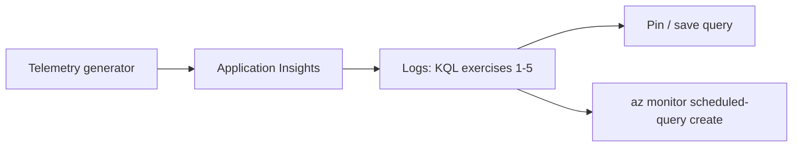

## What this covers

Practice the KQL patterns the AI-200 exam uses: filter failures, aggregate latency, correlate with `OperationId`, chart error rate, and turn a query into an alert. The official Learn exercise deploys Application Insights, runs a Python OpenTelemetry script that generates sample requests, dependencies and exceptions, has you query them in the **Logs** blade, and then creates an action group and log search alert rule with the Azure CLI.

**Exam weight:** Secure, monitor, and troubleshoot Azure solutions (20–25%)

**Skills measured**

- "Write KQL queries to analyze logs and metrics"

## Key concepts

### Goals

- Query `AppRequests` and `AppDependencies` (or `requests` / `dependencies` in App Insights scope)
- Compute failure rate and P95 latency
- Reconstruct a distributed operation with `union`
- Save, pin or alert on at least one useful query

### Prerequisites

- Application Insights resource with recent telemetry (from the [OpenTelemetry exercise](/study/observe-and-troubleshoot-apps-on-azure/exercise-instrument-an-app-with-the-opentelemetry-sdk) or any instrumented app)
- Access to the **Logs** blade; Azure CLI for the alert step; Python 3.12+ for the Learn lab's generator

### Name cheat sheet

| Workspace (`App*`) | App Insights scope (classic) |
|--------------------|------------------------------|
| `TimeGenerated` | `timestamp` |
| `DurationMs` | `duration` |
| `Success` | `success` |
| `OperationId` | `operation_Id` |
| `AppRoleName` | `cloud_RoleName` |
| `Properties` | `customDimensions` |
| `Type` | `itemType` |

## How it works



## Hands-on

### Azure portal

Open Application Insights → **Logs** (or the workspace → **Logs** for `App*` names) and work through the exercises.

**1. Failed requests in the last hour**

```kql
AppRequests
| where TimeGenerated > ago(1h)
| where Success == false
| project TimeGenerated, Name, ResultCode, DurationMs, OperationId
| order by TimeGenerated desc
```

**Check:** you can explain each projected column.

**2. Slow dependencies**

```kql
AppDependencies
| where TimeGenerated > ago(1h)
| where DurationMs > 500
| summarize count(), avg(DurationMs) by Name, Target
| order by avg_DurationMs desc
```

**Check:** identify the slowest `Target`. Note that `avg(DurationMs)` produces the auto-named column `avg_DurationMs`.

Percentile version used in the Learn lab (classic names):

```kql
dependencies
| where timestamp > ago(1h)
| summarize p50 = percentile(duration, 50), p95 = percentile(duration, 95) by target
| order by p95 desc
```

**3. Error rate chart**

```kql
AppRequests
| where TimeGenerated > ago(24h)
| summarize
    Total = count(),
    Failures = countif(Success == false)
    by bin(TimeGenerated, 1h)
| extend ErrorRate = round(100.0 * Failures / Total, 2)
| render timechart
```

**Check:** the chart renders in the portal.

**4. Correlate one operation**

Copy an `OperationId` from exercise 1, then:

```kql
let op = "PASTE_OPERATION_ID";
union AppRequests, AppDependencies, AppTraces, AppExceptions
| where OperationId == op
| project TimeGenerated, Type, Name, Message, DurationMs, Success
| order by TimeGenerated asc
```

**Check:** you see a chronological timeline across tables, and `Type` names the source table.

Join exceptions to requests (classic names):

```kql
exceptions
| where timestamp > ago(1h)
| join kind=inner (requests | project operation_Id, requestName = name, resultCode) on operation_Id
| project timestamp, type, outerMessage, requestName, resultCode
```

**5. Top failing dependency targets with exceptions**

```kql
let FailingOps =
    AppExceptions
    | where TimeGenerated > ago(24h)
    | distinct OperationId;
AppDependencies
| where TimeGenerated > ago(24h)
| where OperationId in (FailingOps)
| summarize
    Total = count(),
    Failures = countif(Success == false),
    P95Latency = percentile(DurationMs, 95)
  by Target
| extend FailureRatePct = round(100.0 * Failures / Total, 1)
| top 5 by FailureRatePct desc
```

**Check:** you can walk through each pipeline stage (`let` → filter → `summarize` → `extend` → `top`).

### Azure CLI

**6. Alert on failures** (the Learn lab's final task):

```bash
az monitor action-group create \
  --resource-group <resource-group> --name ag-kql-lab --short-name kqllab \
  --action email me <your-email>

az monitor scheduled-query create \
  --resource-group <resource-group> --name alert-failed-requests \
  --scopes <app-insights-resource-id> \
  --condition "count 'Failed' > 10" \
  --condition-query Failed="requests | where success == false" \
  --evaluation-frequency 5m --window-size 5m --severity 2 \
  --action-groups <action-group-resource-id>
```

### Python

Run exercise 1 from code:

```python
from datetime import timedelta
from azure.identity import DefaultAzureCredential
from azure.monitor.query import LogsQueryClient

client = LogsQueryClient(DefaultAzureCredential())
q = "AppRequests | where Success == false | project TimeGenerated, Name, ResultCode, OperationId"
for row in client.query_workspace("<workspace-guid>", q, timespan=timedelta(hours=1)).tables[0].rows:
    print(row)
```

### Stretch goals

- Save the error-rate query as a **function** or workbook step
- Pin the timechart to a **dashboard**
- Create a **log search alert** that fires when Failures > 10 in 5 minutes (step 6)

### Checklist

- [ ] Used `where`, `summarize`, `extend`, `order by` / `top`
- [ ] Used `union` + `OperationId` correlation
- [ ] Distinguished classic vs `App*` table names where docs differed
- [ ] Created an action group and a scheduled query alert

## Exam traps

| Mistake in the lab | Correct approach |
|--------------------|------------------|
| `customDimensions` on `AppRequests` | `Properties` |
| `type` column in an `App*` union | `Type` |
| `take 5` for "top 5 slowest" | `top 5 by DurationMs desc` |
| Average for latency SLO | `percentile(DurationMs, 95)` |
| `count()` with sampling on | `sum(ItemCount)` |

> [!WARNING]
> **Exam trap:** Running several queries in one editor tab without blank lines between them runs them as one statement. Separate queries with a blank line and place the cursor in the one to run.

> [!TIP]
> Auto-named aggregate columns follow `function_Column` (`avg_DurationMs`, `count_`), which you can sort on directly.

## Quick review

- Failed requests: `where Success == false`.
- Slow dependencies: `where DurationMs > N` + `summarize ... by Target`.
- Error rate: `countif` / `count` by `bin`, then `render timechart`.
- `let` + `union` + `OperationId` rebuilds one transaction.
- `top N by` beats `take` for ranked results.
- `az monitor scheduled-query create` turns a query into an alert.

## Practice

[Practice: KQL questions](/practice/kql)

## Official references

- [Exercise - Query logs with KQL (Learn unit)](https://learn.microsoft.com/en-us/training/modules/analyze-telemetry-logs-metrics/7-exercise-query-logs-kql)
- [KQL quick reference](https://learn.microsoft.com/en-us/azure/data-explorer/kql-quick-reference)
- [az monitor scheduled-query](https://learn.microsoft.com/en-us/cli/azure/monitor/scheduled-query)
- [AI-200 study guide](https://learn.microsoft.com/en-us/credentials/certifications/resources/study-guides/ai-200)
