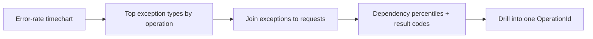

## What this covers

Once telemetry is in Application Insights, use **KQL** to hunt failures and latency. Focus on **`Success`**, **`DurationMs`**, **`ResultCode`** and **`OperationId`** across the standard tables. This page covers error-rate and exception queries, correlating failures across services, dependency latency percentiles, AI-specific explorations with custom dimensions, and when to use the built-in **Failures** and **Performance** views instead of KQL.

**Exam weight:** Secure, monitor, and troubleshoot Azure solutions (20–25%)

**Skills measured**

- "Write KQL queries to analyze logs and metrics"

## Key concepts

### Key fields

| Field (workspace) | Classic | Meaning |
|-------------------|---------|---------|
| `TimeGenerated` | `timestamp` | When the telemetry was recorded |
| `Success` | `success` | Whether the operation succeeded |
| `DurationMs` | `duration` | Latency in milliseconds |
| `ResultCode` | `resultCode` | HTTP or status-style result |
| `Name` | `name` | Operation or dependency name |
| `Target` | `target` | Downstream host/resource for dependencies |
| `OperationId` | `operation_Id` | End-to-end correlation ID |
| `AppRoleName` | `cloud_RoleName` | Which service emitted the row |
| `ExceptionType` | `type` (exceptions) | Exception class |
| `ItemCount` | `itemCount` | Events represented by one sampled row |

### Counting correctly under sampling

With sampling on, each kept row represents `ItemCount` real events. `count()` returns sampled rows and undercounts; `sum(ItemCount)` (classic `sum(itemCount)`) estimates the true volume.

### Percentiles over averages

An average of 200 ms can hide 5% of calls taking 2 s. `percentile(DurationMs, 95)` or `percentiles(DurationMs, 50, 95, 99)` exposes the tail that users complain about.

### Reading result codes

| `ResultCode` on a dependency | Meaning |
|------------------------------|---------|
| 429 | Throttled / rate limited (common for model endpoints): adjust throughput or add retry with back-off |
| 500–503 | Server-side failure in the dependency |
| Empty + long duration | Timeout, network issue or overloaded target |

### Failures and Performance views

- **Investigate > Failures** groups failed operations and shows the top response codes, exception types and failed dependencies; drill to a sample to open the end-to-end transaction.
- **Investigate > Performance** ranks operations by duration or count and shows a duration distribution, which reveals bimodal latency (most fast, a slow cluster).

Start in these views to find the problem area, then move to KQL for joins, custom dimensions and charts.

## How it works



## Hands-on

### Azure portal

1. Application Insights → **Failures**; switch between **Operations**, **Dependencies** and **Exceptions** tabs.
2. Select the top failing operation → **Drill into samples** → open one transaction.
3. Application Insights → **Performance**; select an operation and inspect its duration distribution.

### Azure CLI

```bash
az monitor app-insights query \
  --app <app-insights-name> --resource-group <resource-group> \
  --analytics-query "exceptions | where timestamp > ago(1h) | summarize sum(itemCount) by type" \
  --output table
```

### Python

```python
from datetime import timedelta
from azure.identity import DefaultAzureCredential
from azure.monitor.query import LogsQueryClient

client = LogsQueryClient(DefaultAzureCredential())
q = "AppDependencies | where Success == false | summarize n = sum(ItemCount) by Target, ResultCode"
result = client.query_workspace("<workspace-guid>", q, timespan=timedelta(hours=24))
for row in result.tables[0].rows:
    print(row)
```

### KQL: failed requests

```kql
AppRequests
| where TimeGenerated > ago(1h)
| where Success == false
| project TimeGenerated, Name, ResultCode, DurationMs, OperationId
| order by TimeGenerated desc
```

### KQL: slow dependencies

Dependencies are outbound calls (databases, HTTP APIs, queues, model endpoints). High `DurationMs` here often explains slow requests upstream.

```kql
AppDependencies
| where TimeGenerated > ago(1h)
| where DurationMs > 500
| summarize Calls = count(), AvgMs = avg(DurationMs), P95 = percentile(DurationMs, 95)
    by Name, Target
| order by P95 desc
```

```kql
dependencies
| where timestamp > ago(24h)
| summarize avg(duration), percentiles(duration, 50, 95, 99) by target, type
| order by percentile_duration_95 desc
```

```kql
dependencies
| where timestamp > ago(24h)
| where success == false
| summarize failureCount = count() by target, resultCode, cloud_RoleName
| order by failureCount desc
```

### KQL: error rate over time

```kql
AppRequests
| where TimeGenerated > ago(24h)
| summarize
    Total = count(),
    Failures = countif(Success == false)
    by bin(TimeGenerated, 1h)
| extend ErrorRate = round(100.0 * Failures / Total, 2)
| render timechart
```

### KQL: exceptions

```kql
exceptions
| where timestamp > ago(24h)
| summarize exceptionCount = sum(itemCount) by bin(timestamp, 1h), type
| render timechart
```

```kql
exceptions
| where timestamp > ago(24h)
| summarize exceptionCount = sum(itemCount) by type, operation_Name
| top 10 by exceptionCount desc
```

Exceptions with request context (workspace names):

```kql
AppExceptions
| where TimeGenerated > ago(6h)
| join kind=inner (
    AppRequests
    | where TimeGenerated > ago(6h)
  ) on OperationId
| project TimeGenerated, ProblemId, OuterMessage, Name, ResultCode
| order by TimeGenerated desc
```

Classic version that renames columns in the subquery to avoid `name1`-style duplicates:

```kql
exceptions
| where timestamp > ago(24h)
| join kind=inner (
    requests
    | project requestName = name, requestDuration = duration, operation_Id, requestRoleName = cloud_RoleName
) on operation_Id
| project timestamp, exceptionType = type, exceptionMessage = outerMessage,
    requestName, requestDuration, cloud_RoleName = requestRoleName
| top 20 by timestamp desc
```

### KQL: AI-specific explorations

Spans tagged with a model name via custom dimensions (the attribute is set on the embedding/LLM span, so query dependencies):

```kql
AppDependencies
| where TimeGenerated > ago(24h)
| extend model = tostring(Properties["gen_ai.model"])
| where isnotempty(model)
| summarize
    count(),
    avg(DurationMs),
    percentile(DurationMs, 95)
  by model, Name
```

Trace messages mentioning token or embedding errors:

```kql
AppTraces
| where TimeGenerated > ago(6h)
| where Message has "embedding" or Message has "token"
| project TimeGenerated, Message, SeverityLevel, OperationId
```

## Exam traps

| Need | Tool |
|------|------|
| Quick "what is failing" overview | Failures view |
| Bimodal latency for one operation | Performance view distribution |
| Join exceptions to requests, filter by custom attribute | KQL |
| True volume under sampling | `sum(ItemCount)` |
| Tail latency | `percentile` / `percentiles` |

> [!WARNING]
> **Exam trap:** `customDimensions` does not exist in `App*` tables; use `Properties`. And an attribute set on a child span is on the **dependency** row, not the request.

> [!WARNING]
> **Exam trap:** In `AppExceptions` the exception class is `ExceptionType`; in classic `exceptions` it is `type`. In `AppDependencies` the dependency kind is `DependencyType`.

> [!TIP]
> 429 from a model endpoint = throttling, not a bug in your code.

## Quick review

- Failed requests: `AppRequests | where Success == false`.
- Slow dependencies: `AppDependencies | where DurationMs > …` + `percentile`.
- Error rate: `countif(Success == false)` over `count()` by `bin(TimeGenerated, …)`.
- Join exceptions to requests on `OperationId`.
- Use `sum(ItemCount)` when sampling is active.
- Start in Failures/Performance, finish in KQL.

## Practice

[Practice: KQL questions](/practice/kql)

## Official references

- [Explore logs for errors and performance (Learn unit)](https://learn.microsoft.com/en-us/training/modules/analyze-telemetry-logs-metrics/3-explore-logs-errors-performance)
- [Application Insights log query examples](https://learn.microsoft.com/en-us/azure/azure-monitor/app/analytics-using)
- [Diagnose failures with Application Insights](https://learn.microsoft.com/en-us/azure/azure-monitor/app/transaction-diagnostics)
- [AI-200 study guide](https://learn.microsoft.com/en-us/credentials/certifications/resources/study-guides/ai-200)
