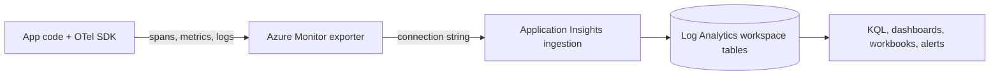

## What this covers

**Observability** means you can explain *what* a distributed AI app is doing, *where* time goes and *why* a request failed, across APIs, queues, workers and databases. On AI-200 that story starts with **OpenTelemetry** instrumentation in your code, lands in **Azure Monitor Application Insights**, is stored in a **Log Analytics workspace** and is analyzed with **KQL**. This page sets up the vocabulary used by every other page in this path.

**Exam weight:** Secure, monitor, and troubleshoot Azure solutions (20–25%)

**Skills measured**

- "Trace distributed systems by using OpenTelemetry SDKs"
- "Write KQL queries to analyze logs and metrics"

## Key concepts

### OpenTelemetry

**OpenTelemetry (OTel)** is a vendor-neutral, open-source standard hosted by the CNCF for generating telemetry: **traces**, **metrics** and **logs**. It is not Azure-specific. You instrument once and pick an exporter for the backend you want (Azure Monitor, Jaeger, Prometheus, Grafana, Datadog and others) without changing instrumentation code.

OTel has four building blocks:

| Component | Role |
|-----------|------|
| **API** | Stable interfaces your code and libraries call to create telemetry |
| **SDK** | Implements the API: batching, sampling, resource detection |
| **Instrumentation libraries** | Auto-capture telemetry from frameworks (HTTP servers and clients, DB drivers) |
| **Exporters** | Serialize and send telemetry to a backend |

It gives you a consistent API across Python, .NET, Java, Node.js and Go, auto-instrumentation for common libraries, and manual spans for AI-specific work such as embedding generation, RAG retrieval and model calls.

**Use case:** an inference API calls Cosmos DB for vector search, then a model endpoint. OTel spans show which hop is slow.

### The three pillars

| Signal | What it is | AI example |
|--------|------------|------------|
| **Traces** | The path and timing of one request across services | Find which dependency failed in a RAG pipeline |
| **Metrics** | Numeric aggregates over time (rate, error %, percentiles) | Alert when P95 embedding latency rises |
| **Logs** | Timestamped detail records for discrete events | Capture model name, document ID or prompt hash |

A handy summary: metrics tell you *that* something changed, traces tell you *where*, logs tell you *why*.

### Traces, spans and context propagation

A **trace** is the end-to-end record of one request. It is a tree of **spans**, where each span is a named, timed unit of work. Every span carries a **trace ID** (32 hex characters, shared by the whole trace), its own **span ID** (16 hex), a **parent span ID** (empty for the root span), a name, start and end timestamps, **attributes** (key-value context) and a **status**.

**Context propagation** carries the trace ID and the caller's span ID across process boundaries so Service B's spans join Service A's trace. OTel uses the W3C Trace Context header:

```text
traceparent: 00-4bf92f3577b34da6a3ce929d0e0e4736-00f067aa0ba902b7-01
             ^version ^trace-id (32 hex)          ^parent span (16 hex) ^flags (01 = sampled)
```

### Azure Monitor and Application Insights

| Concept | Definition |
|---------|------------|
| **Azure Monitor** | Platform-wide observability: metrics, logs, alerts, dashboards, workbooks |
| **Application Insights** | The app-focused APM feature of Azure Monitor (requests, dependencies, exceptions, traces) |
| **Log Analytics workspace** | Shared log store that Application Insights (workspace-based) and many Azure resources write into |
| **KQL** | Kusto Query Language, used to query Log Analytics and Application Insights |

You explore the data in portal experiences (Application Map, Failures, Performance, Transaction search) or by writing KQL in **Logs**.

### Vocabulary mapping (OTel to Azure)

| OpenTelemetry | Application Insights (classic name / workspace name) |
|---------------|------------------------------------------------------|
| Trace ID | Operation ID: `operation_Id` / `OperationId` |
| Span ID | `id` / `Id`; the child's parent link is `operation_ParentId` / `ParentId` |
| `SpanKind.SERVER`, `CONSUMER` | Request: `requests` / `AppRequests` |
| `SpanKind.CLIENT`, `PRODUCER`, `INTERNAL` | Dependency: `dependencies` / `AppDependencies` |
| Log record | `traces` / `AppTraces` |
| Span attributes | `customDimensions` / `Properties` |
| `service.name` (+ `service.namespace`) | Cloud role name: `cloud_RoleName` / `AppRoleName` |
| Sampler | Sampling (fixed percentage or rate limited) to control cost |

## How it works



The same flow as plain text:

```text
Your App (OpenTelemetry SDK)
      │  spans / traces / metrics / logs
      ▼
Azure Monitor Exporter
      │
      ▼
Application Insights (ingestion)
      │  stored as tables
      ▼
Log Analytics Workspace  →  queried with KQL
```

Microsoft packages the SDK, the Azure Monitor exporter, common instrumentation libraries and Azure resource detectors as the **Azure Monitor OpenTelemetry Distro**, so one call at startup wires the whole pipeline. See [Add the OpenTelemetry SDK to an application](/study/observe-and-troubleshoot-apps-on-azure/add-the-opentelemetry-sdk-to-an-application).

## Hands-on

### Azure portal

1. Open your **Application Insights** resource.
2. Select **Application Map** to see one node per cloud role (`service.name`) and edges for calls between them.
3. Select **Investigate > Performance**, pick an operation, then a sample to open the **end-to-end transaction** waterfall.
4. Select **Logs** and confirm the schema pane lists the standard tables.

### Azure CLI

```bash
az monitor app-insights component show \
  --app <app-insights-name> \
  --resource-group <resource-group> \
  --query "{conn:connectionString, workspace:workspaceResourceId}" -o json
```

### Python

```python
from azure.monitor.opentelemetry import configure_azure_monitor
from opentelemetry import trace

configure_azure_monitor()  # reads APPLICATIONINSIGHTS_CONNECTION_STRING
tracer = trace.get_tracer("rag-api")

with tracer.start_as_current_span("rag_query") as span:
    ctx = span.get_span_context()
    print(format(ctx.trace_id, "032x"))  # equals OperationId in App Insights
```

## Exam traps

| Need | Choose |
|------|--------|
| Instrument once, export to any backend | OpenTelemetry |
| APM views (Application Map, Failures, Performance) on Azure | Application Insights |
| Store and query logs from many resources | Log Analytics workspace + KQL |
| Correlate every row of one request | `OperationId` / `operation_Id` (= trace ID) |

When to use OpenTelemetry + App Insights vs something else:

| Use OpenTelemetry + App Insights | Prefer something else |
|----------------------------------|------------------------|
| Multi-service AI pipelines (API → queue → worker → DB) | Single-machine scripts with no ops needs |
| Debugging latency across Functions, ACA, Cosmos DB | One-off local profiling only |
| Exam scenarios asking for correlation / end-to-end traces | Pure infrastructure metrics (VM CPU) without app context |

> [!WARNING]
> **Exam trap:** OpenTelemetry is not an Azure service and does not store data. It produces and exports telemetry; Application Insights and the Log Analytics workspace store it.

> [!WARNING]
> **Exam trap:** `SpanKind.CONSUMER` maps to a **request**, not a dependency, and `SpanKind.INTERNAL` maps to a **dependency**. Only SERVER and CONSUMER spans land in `requests`.

> [!TIP]
> Trace = Operation, Span = row, Attributes = custom dimensions. If you remember those three, most mapping questions answer themselves.

> [!NOTE]
> Distributed tracing only works when **trace context** (`traceparent`) propagates across every hop. A missing header splits one request into several unrelated traces.

## Quick review

- OpenTelemetry is **vendor-neutral**: the same code can export to Azure Monitor, Jaeger, Datadog and others.
- Three signals: **traces**, **metrics**, **logs**.
- Application Insights is the APM layer of Azure Monitor; its data lives in a **Log Analytics workspace**.
- Trace ID maps to `operation_Id` (classic) or `OperationId` (workspace).
- SERVER/CONSUMER spans become requests; CLIENT/PRODUCER/INTERNAL spans become dependencies.
- Span attributes surface as `customDimensions` (classic) or `Properties` (workspace).
- `traceparent` = version, 32-hex trace ID, 16-hex parent span ID, flags.

## Practice

[Practice: OpenTelemetry questions](/practice/opentelemetry)

## Official references

- [Explore OpenTelemetry and its role in observability (Learn unit)](https://learn.microsoft.com/en-us/training/modules/instrument-app-opentelemetry/2-explore-opentelemetry-observability)
- [OpenTelemetry concepts](https://opentelemetry.io/docs/concepts/)
- [Application Insights overview](https://learn.microsoft.com/en-us/azure/azure-monitor/app/app-insights-overview)
- [AI-200 study guide](https://learn.microsoft.com/en-us/credentials/certifications/resources/study-guides/ai-200)
