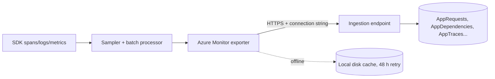

## What this covers

Once spans exist, an **exporter** sends them to Azure. With Application Insights, telemetry lands in **pre-created tables** in your Log Analytics workspace; you never create `AppRequests` or `AppDependencies` yourself. This page covers the export pipeline, which table each signal lands in, sampling to control cost, offline storage and retries, custom dimensions, service naming and how to verify the data arrived.

**Exam weight:** Secure, monitor, and troubleshoot Azure solutions (20–25%)

**Skills measured**

- "Trace distributed systems by using OpenTelemetry SDKs"
- "Write KQL queries to analyze logs and metrics"

## Key concepts

### Azure Monitor exporter

The **Azure Monitor exporter** (wrapped by the distro) serializes telemetry and sends it to the Application Insights ingestion endpoint named in the connection string. By default the distro uses **direct export**: in-process, no extra infrastructure. The alternative is an **OpenTelemetry Collector** sidecar or gateway, which adds central sampling, transformation and multi-backend routing at the cost of running another component.

### Where data lands

| Telemetry | Table (workspace-based) | Classic name (App Insights scope) |
|-----------|-------------------------|------------------------------------|
| Incoming requests (SERVER, CONSUMER spans) | `AppRequests` | `requests` |
| Outgoing calls: HTTP, DB, queue (CLIENT, PRODUCER, INTERNAL) | `AppDependencies` | `dependencies` |
| Log messages | `AppTraces` | `traces` |
| Exceptions | `AppExceptions` | `exceptions` |
| Custom metrics | `AppMetrics` | `customMetrics` |
| Custom events | `AppEvents` | `customEvents` |
| Perf counters | `AppPerformanceCounters` | `performanceCounters` |
| Availability tests | `AppAvailabilityResults` | `availabilityResults` |
| Browser timings / page views | `AppBrowserTimings` / `AppPageViews` | `browserTimings` / `pageViews` |

Which names you type depends on **query scope**: Logs opened from the Application Insights resource accept classic names; Logs opened from the Log Analytics workspace use `App*` names. Columns are renamed too: `timestamp` → `TimeGenerated`, `duration` → `DurationMs`, `operation_Id` → `OperationId`, `cloud_RoleName` → `AppRoleName`, `customDimensions` → `Properties`, `itemCount` → `ItemCount`.

### Are App* tables pre-created?

Yes. When you create a workspace-based **Application Insights** resource, Azure provides a fixed schema. Your exporter only writes rows.

| You create | You do not create |
|------------|-------------------|
| Custom log tables (`*_CL`) via Data Collection Rules / Logs ingestion API | `AppRequests`, `AppDependencies`, `AppTraces`, … |
| Custom dimensions via `span.set_attribute` | Physical columns for every attribute |
| Saved queries / functions (reusable KQL) | The base App Insights schema |

### Custom dimensions

OTel span attributes become a dynamic property bag: `customDimensions` in classic queries, `Properties` in `App*` tables. Read values with `tostring()`, `toint()` and similar. Attributes on internal spans land on **dependency** rows, not request rows.

### Sampling

The distro supports **fixed-percentage** (`sampling_ratio=0.1`) and **rate-limited** (`traces_per_second=1.5`) sampling, or the env vars `OTEL_TRACES_SAMPLER` (`microsoft.fixed_percentage` / `microsoft.rate_limited`) and `OTEL_TRACES_SAMPLER_ARG`. Env vars beat code. With nothing configured, the Python distro uses the **rate-limited sampler at about 5 traces per second**. Metrics are never sampled. Kept records carry `itemCount` so portal counts are scaled up; lower rates make those estimates less precise. A starting point of about 5% is suggested for high-volume apps.

### Offline storage and retries

If ingestion is unreachable, the exporter caches telemetry on local disk and retries for **up to 48 hours**. Under heavy load it may drop data, keeping newer events. Override the folder with `storage_directory=`; `disable_offline_storage=True` turns it off (not recommended in production).

### Service naming

Without `service.name`, every app shows as `unknown_service`. Set `OTEL_SERVICE_NAME` or a `Resource`; this is critical when several AI microservices share one Application Insights resource.

## How it works



Export is batched (`OTEL_BSP_SCHEDULE_DELAY`, default 5,000 ms), and ingestion adds a delay of a few minutes. **Live Metrics** bypasses the normal pipeline for near-real-time checks.

## Hands-on

### Azure portal

1. Application Insights → **Overview**: server requests and response time charts should populate after traffic.
2. **Live Metrics**: watch requests, dependencies and exceptions in near real time.
3. **Logs**: the schema pane lists tables before you write a query.

### Azure CLI

```bash
az monitor log-analytics workspace create \
  --resource-group <resource-group> \
  --workspace-name <workspace-name> \
  --location eastus

az monitor app-insights component create \
  --app <app-insights-name> \
  --location eastus \
  --resource-group <resource-group> \
  --workspace <workspace-name>
```

### Python

```python
import os
from azure.monitor.opentelemetry import configure_azure_monitor

configure_azure_monitor(
    connection_string=os.environ["APPLICATIONINSIGHTS_CONNECTION_STRING"],
    sampling_ratio=0.1,                       # or traces_per_second=1.5
    storage_directory="/var/telemetry/rag-pipeline",
)
```

```bash
export OTEL_SERVICE_NAME="embedding-worker"
export OTEL_TRACES_SAMPLER="microsoft.fixed_percentage"
export OTEL_TRACES_SAMPLER_ARG=0.1
```

```python
span.set_attribute("gen_ai.model", deployment_name)
span.set_attribute("rag.top_k", 5)
```

Query the attribute in the workspace (`Properties`) or App Insights scope (`customDimensions`):

```kql
AppDependencies
| where TimeGenerated > ago(1h)
| extend model = tostring(Properties["gen_ai.model"])
| summarize count() by model
```

```kql
requests
| where timestamp > ago(1h)
| project timestamp, name, duration, success, cloud_RoleName
| order by timestamp desc
| take 20
```

## Exam traps

| Requirement | Choice |
|-------------|--------|
| Simplest path, no extra infrastructure | Direct export with the distro |
| Central sampling, transformation, multiple backends | OpenTelemetry Collector |
| Cap cost at steady volume | Rate-limited sampling |
| Keep a fixed share of traffic | Fixed-percentage sampling |
| Custom table for non-App Insights data | `*_CL` table via DCR |

> [!WARNING]
> **Exam trap:** `customDimensions` is the **classic** column. In `AppRequests`/`AppDependencies` it is `Properties`. Mixing `AppRequests` with `customDimensions` fails.

> [!WARNING]
> **Exam trap:** With sampling on, `count()` undercounts. Use `sum(itemCount)` (classic) or `sum(ItemCount)` (workspace).

> [!TIP]
> No telemetry? Check in order: connection string, `configure_azure_monitor()` called before imports, outbound HTTPS to the ingestion endpoint, then wait a few minutes.

## Quick review

- Server/consumer spans → `AppRequests`; client/producer/internal → `AppDependencies`.
- Logs → `AppTraces`; exceptions → `AppExceptions`; custom metrics → `AppMetrics` (`customMetrics`).
- App Insights tables are created by Azure; you only create `*_CL` custom tables.
- Python distro default sampler: rate limited, ~5 traces/sec; env vars override code.
- Offline cache retries for up to 48 hours.
- Live Metrics is on by default and bypasses ingestion delay.

## Practice

[Practice: OpenTelemetry questions](/practice/opentelemetry) · [Practice: KQL questions](/practice/kql)

## Official references

- [Export telemetry to Azure Monitor (Learn unit)](https://learn.microsoft.com/en-us/training/modules/instrument-app-opentelemetry/5-export-telemetry-azure-monitor)
- [OpenTelemetry with Azure Monitor](https://learn.microsoft.com/en-us/azure/azure-monitor/app/opentelemetry-overview)
- [Configure OpenTelemetry in Application Insights](https://learn.microsoft.com/en-us/azure/azure-monitor/app/opentelemetry-configuration?tabs=python)
- [Application Insights data model](https://learn.microsoft.com/en-us/azure/azure-monitor/app/data-model)
- [AI-200 study guide](https://learn.microsoft.com/en-us/credentials/certifications/resources/study-guides/ai-200)
