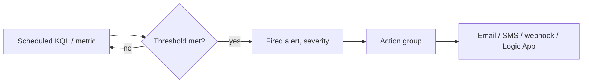

## What this covers

**Alerts** notify you when AI apps break or degrade (error spikes, slow dependencies, exception surges) before users flood support. Azure Monitor alert rules evaluate **metrics** or **log search (KQL) queries** and trigger **action groups** (email, SMS, voice, push, webhook, Logic App, Function, ITSM). This page covers rule structure, alert types, writing KQL for log search alerts, action groups, severity, smart detection and alert hygiene.

**Exam weight:** Secure, monitor, and troubleshoot Azure solutions (20–25%)

**Skills measured**

- "Write KQL queries to analyze logs and metrics"

## Key concepts

### Rule structure

| Part | Meaning |
|------|---------|
| **Scope** | Resource(s) monitored: Application Insights resource or Log Analytics workspace |
| **Condition** | Signal + threshold logic |
| **Actions** | One or more **action groups** (up to 5 per rule) |
| **Severity** | 0 Critical, 1 Error, 2 Warning, 3 Informational, 4 Verbose |

### Alert types

| Type | Definition | Best for |
|------|------------|----------|
| **Metric alert** | Threshold (static or dynamic) on a platform/App Insights metric | Request rate, availability, standard latency metrics |
| **Log search alert** | Scheduled KQL; fires when the result meets the condition | Custom dimensions, joins, percentiles, AI-specific signals |
| **Activity log alert** | Control-plane events | Resource deletions, role changes (ops, not APM) |
| **Smart detection** | ML baseline on App Insights telemetry | Unexpected failure or performance anomalies |

### Log search alert settings

- **Evaluation frequency**: how often the query runs (1 minute to 24 hours).
- **Aggregation granularity / window size**: the time span each run looks at.
- **Measure**: **Table rows** or a numeric column, with an aggregation type.
- **Threshold**: operator and value (for example table rows > 0).
- **Split by dimensions**: one alert per value (for example per `AppRoleName`).
- **Number of violations**: require several failing periods to suppress one-off spikes.

### Action groups

An **action group** is a reusable list of notifications and automated actions referenced by alert rules.

| Notifications | Automated actions |
|---------------|-------------------|
| Email, SMS, Azure mobile app push, voice call | Azure Function, Logic App, webhook / secure webhook, Automation runbook, Event Hubs, ITSM |

Create separate groups per severity (Sev 0: SMS + voice + incident webhook; Sev 2: email only) and use the portal **Test** action before relying on them.

### Smart detection

Application Insights **smart detection** learns a baseline and alerts on deviations without you setting thresholds:

- **Failure anomalies**: abnormal rise in the failed request rate, with cluster analysis of affected operations, exceptions and dependencies.
- **Performance anomalies**: response time degradation, slower dependency durations, unusual exception volume, gradual degradation.

Use smart detection for the unexpected and log search alerts for explicit SLOs ("P95 under 3 s", "under 1% failures").

### What to alert on for AI apps

| Signal | Example condition |
|--------|-------------------|
| Failed requests | Failures > N in 5 minutes |
| Error rate | Failures / Total > 5% |
| P95 latency | P95 DurationMs > 2000 |
| Dependency failures | `AppDependencies` Success == false for Target X |
| Exceptions | `AppExceptions` count spike |
| Queue backlog | Service Bus active message count metric |

## How it works



## Hands-on

### Azure portal

1. Application Insights or Monitor → **Alerts** → **Create** → **Alert rule**.
2. Scope: the Application Insights resource or workspace.
3. Condition: choose a metric, or **Custom log search** and paste KQL; set measure, aggregation granularity (5 min), frequency (5 min), threshold and dimensions.
4. Actions: select or create an action group.
5. Details: severity, name, (optionally) auto-resolve; **Create**.

### Azure CLI

```bash
az monitor action-group create \
  --resource-group <resource-group> \
  --name ag-ai200-ops \
  --short-name ai200ops \
  --action email oncall <oncall-email>

az monitor scheduled-query create \
  --resource-group <resource-group> \
  --name alert-high-failures \
  --scopes <app-insights-resource-id> \
  --condition "count 'FailedReqs' > 0" \
  --condition-query FailedReqs="requests | where success == false | summarize failedCount = count() by cloud_RoleName | where failedCount > 10" \
  --evaluation-frequency 5m \
  --window-size 5m \
  --severity 2 \
  --action-groups <action-group-resource-id>
```

### Python

```python
from azure.identity import DefaultAzureCredential
from azure.mgmt.monitor import MonitorManagementClient

client = MonitorManagementClient(DefaultAzureCredential(), "<subscription-id>")
for rule in client.scheduled_query_rules.list_by_resource_group("<resource-group>"):
    print(rule.name, rule.severity, rule.enabled)
```

### KQL alert queries

Failure count and rate in the window (the alert window bounds time; `ago` here is for manual testing):

```kql
AppRequests
| where TimeGenerated > ago(5m)
| summarize
    Total = count(),
    Failures = countif(Success == false)
| extend ErrorRate = round(100.0 * Failures / Total, 2)
| where Failures > 10 or ErrorRate > 5
```

Configure it to run every 5 minutes over 5 minutes and fire when table rows > 0.

Per-service failures (classic names, as in the Learn unit):

```kql
requests
| where success == false
| summarize failedCount = count() by cloud_RoleName
| where failedCount > 10
```

P95 latency per service:

```kql
requests
| summarize p95Duration = percentile(duration, 95) by cloud_RoleName
| where p95Duration > 3000
```

Failed or slow dependencies:

```kql
AppDependencies
| where TimeGenerated > ago(5m)
| where Success == false or DurationMs > 2000
| summarize FailedOrSlow = count() by Target
| where FailedOrSlow > 5
```

## Exam traps

| Requirement | Choose |
|-------------|--------|
| Threshold on a standard metric, fastest evaluation | Metric alert |
| Condition on custom dimensions, joins or percentiles | Log search alert |
| No known threshold, catch unusual failure spikes | Smart detection (failure anomalies) |
| Notify several teams differently | Multiple action groups on one rule |
| Resource deleted or role assignment changed | Activity log alert |

> [!WARNING]
> **Exam trap:** The **action group** defines who/what is notified; the **alert rule** defines when. Reuse one action group across many rules.

> [!WARNING]
> **Exam trap:** Average-based latency alerts hide tail problems. Use a percentile (P95) for latency SLOs.

> [!TIP]
> Alert hygiene: start latency at Sev 2/3 and reserve Sev 0/1 for outages; require multiple violations; use alert processing rules to suppress during deployments; include `OperationId` samples or deep links in payloads; review noisy rules monthly.

## Quick review

- Rule = scope + condition + action group(s) + severity.
- Severity 0 Critical through 4 Verbose.
- Log search alerts run KQL on a frequency over a window; measure table rows or a numeric value.
- Up to 5 action groups per rule; email, SMS, voice, push, webhook, Function, Logic App, runbook, Event Hubs.
- Smart detection finds failure and performance anomalies from a learned baseline.
- `az monitor scheduled-query create` creates log search alerts from the CLI.

## Practice

[Practice: KQL questions](/practice/kql)

## Official references

- [Set alerts for app failures and anomalies (Learn unit)](https://learn.microsoft.com/en-us/training/modules/analyze-telemetry-logs-metrics/6-set-alerts-app-failures-anomalies)
- [Azure Monitor alerts overview](https://learn.microsoft.com/en-us/azure/azure-monitor/alerts/alerts-overview)
- [Log search alert rules](https://learn.microsoft.com/en-us/azure/azure-monitor/alerts/alerts-types#log-alerts)
- [Action groups](https://learn.microsoft.com/en-us/azure/azure-monitor/alerts/action-groups)
- [AI-200 study guide](https://learn.microsoft.com/en-us/credentials/certifications/resources/study-guides/ai-200)
