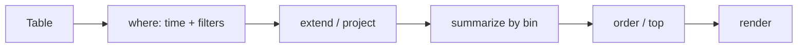

## What this covers

**KQL** (Kusto Query Language) is how you query Log Analytics and Application Insights. Queries are **pipelines**: start with a table, then pipe (`|`) rows through operators that filter, reshape, aggregate and sort. This page covers the core operators, the Application Insights tables and their classic vs workspace names, aggregation and time bucketing, joins and unions, querying metrics, and charting.

**Exam weight:** Secure, monitor, and troubleshoot Azure solutions (20–25%)

**Skills measured**

- "Write KQL queries to analyze logs and metrics"

## Key concepts

### Pipeline mental model

```kql
TableName
| operator1
| operator2
| operator3
```

Each `|` takes the previous result set and transforms it. Order matters: filter early, aggregate later, sort last. You write queries in the **Logs** query editor, opened from Azure Monitor, an Application Insights resource or a Log Analytics workspace.

### Query scope and table names

| Opened from | Table names | Example columns |
|-------------|-------------|-----------------|
| Application Insights resource | Classic: `requests`, `dependencies`, `exceptions`, `traces`, `customEvents`, `customMetrics`, `performanceCounters` | `timestamp`, `duration`, `success`, `operation_Id`, `cloud_RoleName`, `customDimensions`, `itemCount` |
| Log Analytics workspace | `AppRequests`, `AppDependencies`, `AppExceptions`, `AppTraces`, `AppEvents`, `AppMetrics`, `AppPerformanceCounters` | `TimeGenerated`, `DurationMs`, `Success`, `OperationId`, `AppRoleName`, `Properties`, `ItemCount` |

The Learn module writes classic names; this site mostly uses workspace names. Know both.

### Core operators

| Operator | Purpose |
|----------|---------|
| `where` | Filter rows |
| `project` / `extend` | Select (and rename/compute) columns / add columns |
| `project-away` / `project-rename` | Drop / rename |
| `summarize` | Aggregate (group by) |
| `order by` / `sort by` | Sort |
| `top` | Sort + limit |
| `take` / `limit` | Cap rows, no sort guarantee |
| `join` | Combine on key |
| `union` | Stack tables |
| `render` | Chart in portal |
| `let` | Variables / named queries |
| `distinct` | Unique values |
| `make-series` | Build a time series (fills empty bins) |

String matching inside `where`:

| Operator | Meaning |
|----------|---------|
| `==` `!=` `>` `<` | Comparisons |
| `and` / `or` | Combine conditions |
| `in ("a","b")` | Membership |
| `has` | Whole-term match, uses the term index (fast) |
| `contains` | Substring match, no index (slower) |
| `startswith` | Prefix match |

### Aggregation functions

`count()`, `sum()`, `avg()`, `min()`, `max()`, `percentile(col, N)`, `percentiles(col, 50, 95, 99)`, `dcount()` (fast estimate), `count_distinct()` (exact, costlier), `countif()`, `make_list()`, `make_set()`. `bin(TimeGenerated, 5m)` rounds timestamps into fixed buckets; without it every timestamp is its own group.

### Metrics in KQL

Custom OTel metrics land in `AppMetrics` (classic `customMetrics`), already pre-aggregated per interval with `Sum`, `ItemCount`, `Min`, `Max`. Average = `sum(Sum) / sum(ItemCount)`. Platform metrics for Azure resources can be routed to a workspace via diagnostic settings (`AzureMetrics`).

## How it works



Always put the time filter first (`where TimeGenerated > ago(1h)`); the engine prunes data by time before anything else.

## Hands-on

### Azure portal

1. Open Application Insights → **Logs** (classic names) or the workspace → **Logs** (`App*` names).
2. Set the time picker or include `ago()` in the query.
3. Run, then switch **Results / Chart** to visualize.

### Azure CLI

```bash
az monitor log-analytics query \
  --workspace <workspace-guid> \
  --analytics-query "AppRequests | where TimeGenerated > ago(1h) | summarize count() by ResultCode" \
  --output table
```

### Python

```python
from datetime import timedelta
from azure.identity import DefaultAzureCredential
from azure.monitor.query import LogsQueryClient

client = LogsQueryClient(DefaultAzureCredential())
result = client.query_workspace(
    workspace_id="<workspace-guid>",
    query="AppRequests | summarize P95 = percentile(DurationMs, 95) by Name",
    timespan=timedelta(hours=1),
)
for row in result.tables[0].rows:
    print(row)
```

### KQL examples

`where`, `project`, `extend`:

```kql
AppRequests
| where TimeGenerated > ago(1h)
| where Success == false
| project TimeGenerated, Name, ResultCode, DurationMs, OperationId
```

```kql
AppTraces
| where Message has "timeout"        // preferred
| where Message contains "time"      // broader, slower
```

```kql
AppRequests
| extend IsSlow = DurationMs > 1000
| where IsSlow == true
```

Classic equivalent with `top`:

```kql
requests
| where timestamp > ago(1h)
| where success == false
| project timestamp, name, resultCode, duration, cloud_RoleName
| top 20 by duration desc
```

`summarize`:

```kql
AppDependencies
| where TimeGenerated > ago(1h)
| summarize count(), avg(DurationMs), max(DurationMs) by Target
```

```kql
AppRequests
| where TimeGenerated > ago(1d)
| summarize
    Total = count(),
    Failures = countif(Success == false),
    P95 = percentile(DurationMs, 95)
  by Name
| order by P95 desc
```

Time buckets and charts:

```kql
AppRequests
| summarize RequestCount = count() by bin(TimeGenerated, 5m)
| render timechart
```

```kql
requests
| where timestamp > ago(24h)
| summarize requestCount = count() by bin(timestamp, 1h), cloud_RoleName
| render timechart
```

```kql
AppRequests
| summarize FailureRate = 100.0 * countif(Success == false) / count()
    by bin(TimeGenerated, 1h)
| render timechart
```

`top`:

```kql
AppRequests
| top 10 by DurationMs desc
```

`join` (specify `kind` explicitly):

```kql
AppExceptions
| where TimeGenerated > ago(6h)
| join kind=inner (
    AppRequests
    | where TimeGenerated > ago(6h)
  ) on OperationId
| project TimeGenerated, ProblemId, OuterMessage, RequestName = Name, ResultCode
```

`union` (`Type` = source table):

```kql
union AppRequests, AppDependencies, AppExceptions, AppTraces
| where OperationId == "abc123"
| project TimeGenerated, Type, Name, Message
| order by TimeGenerated asc
```

`let`:

```kql
let threshold = 1000;
let startTime = ago(2h);
AppDependencies
| where TimeGenerated > startTime
| where DurationMs > threshold
```

```kql
let SlowOps =
    AppDependencies
    | where DurationMs > 2000
    | distinct OperationId;
AppRequests
| where OperationId in (SlowOps)
```

Metrics:

```kql
AppMetrics
| where TimeGenerated > ago(6h) and Name == "llm.tokens"
| summarize Tokens = sum(Sum) by bin(TimeGenerated, 15m), AppRoleName
| render timechart
```

Worked example: top 5 dependency targets causing failures in 24 h, for operations that also had an exception.

```kql
let FailingOps =
    AppExceptions
    | where TimeGenerated > ago(24h)
    | distinct OperationId;
AppDependencies
| where TimeGenerated > ago(24h)
| where OperationId in (FailingOps)
| summarize
    Total = count(),
    Failures = countif(Success == false),
    P95Latency = percentile(DurationMs, 95)
  by Target
| extend FailureRatePct = round(100.0 * Failures / Total, 1)
| top 5 by FailureRatePct desc
```

## Exam traps

| Need | Use |
|------|-----|
| Highest N values | `top N by col` (not `take`) |
| Quick look at data shape | `take 10` |
| Fast term search | `has` |
| Substring inside a token | `contains` |
| Error rate in one pass | `countif()` / `count()` |
| Latency SLO | `percentile(DurationMs, 95)`, not `avg` |
| Approximate unique users | `dcount()` |

> [!WARNING]
> **Exam trap:** The default `join` kind is **`innerunique`**, which de-duplicates the left side on the key. Write `kind=inner`, `leftouter` or `fullouter` explicitly when you mean them.

> [!WARNING]
> **Exam trap:** `render` only affects the portal (and pinned tiles); APIs and alerts ignore it.

> [!TIP]
> Filter early, aggregate later, sort last: `where` → `extend` → `summarize` → `order by`.

> [!NOTE]
> Under sampling, use `sum(ItemCount)` (classic `sum(itemCount)`) for true event counts.

## Quick review

- KQL is a top-to-bottom pipeline joined by `|`.
- Classic names in App Insights scope, `App*` names in workspace scope.
- `has` uses the term index; `contains` does not.
- `summarize ... by bin(TimeGenerated, 1h)` for time series.
- `top` sorts and limits; `take` returns arbitrary rows.
- Default join kind is `innerunique`.
- Custom metrics are in `AppMetrics` / `customMetrics`.

## Practice

[Practice: KQL questions](/practice/kql)

## Official references

- [Write basic KQL queries (Learn unit)](https://learn.microsoft.com/en-us/training/modules/analyze-telemetry-logs-metrics/2-write-basic-kql-queries)
- [Log queries in Azure Monitor](https://learn.microsoft.com/en-us/azure/azure-monitor/logs/log-query-overview)
- [KQL quick reference](https://learn.microsoft.com/en-us/azure/data-explorer/kql-quick-reference)
- [KQL tutorial](https://learn.microsoft.com/en-us/azure/data-explorer/kusto/query/tutorial)
- [AI-200 study guide](https://learn.microsoft.com/en-us/credentials/certifications/resources/study-guides/ai-200)
